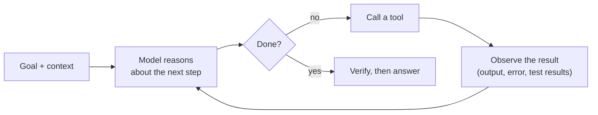

# AI Agents

!!! abstract "TL;DR"
    An **agent** is an LLM running in a loop: it decides the next action, calls a tool, observes the result, and repeats until the goal is met. Many problems are better served by **workflows** (fixed code paths that call LLMs: chaining, routing, parallelization, orchestrator–workers, evaluator–optimizer); use an agent when the path can't be known in advance. Agents need **tools, memory, planning and verification**, and they fail through loops, compounding errors and unsafe actions, so reliability comes from **bounded loops, checks, permissions and end-to-end evaluation**.

!!! evolution "Where this fits"
    **Before:** [Tool Calling](tool-calling.md) and [Reasoning Models](../alignment/reasoning.md). **This page:** putting them in a loop. **Next:** [MCP & A2A](mcp.md) standardize tool and agent connections; [Context Engineering](context-engineering.md) and [Harness Engineering](harness-engineering.md) make long-running agents work.

- **Prompting** 2020 One call, no actions.
- **Chain-of-thought** 2022 Reasoning, but no access to the world.
- **ReAct** 2022 Interleave reasoning with actions and observations.
- **Function calling** 2023 Structured tool requests, supported natively.
- **Agent loops and workflows** 2023–2024 Models choose their next step; patterns for composing calls.
- **Coding, research and computer-use agents** 2024–2026 Long tasks with many tools, sub-agents and verification.

## What makes something an agent

| Level | Who controls the flow | Example |
|---|---|---|
| **Single LLM call** | Your code | Classify a ticket |
| **Workflow** | Your code, with several LLM calls on predefined paths | Extract fields → validate → draft a reply |
| **Router** | The model picks one of a few predefined paths | Send a question to billing, technical or sales flows |
| **Agent** | The model decides which actions to take and when it's done | Fix a failing test in a repository; research a question across sources |

**Use the simplest level that works.** Agents trade cost, latency and predictability for flexibility. They're worth it when the number of steps and the path depend on what's discovered along the way.

## Workflow patterns

| Pattern | How | Good for |
|---|---|---|
| **Prompt chaining** | Fixed sequence; each call's output feeds the next, with checks between steps | Draft → review → translate; outline → write |
| **Routing** | Classify the input, then send it to a specialized prompt or model | Support triage; sending easy queries to a cheap model |
| **Parallelization** | Run independent sub-tasks at once (sectioning), or the same task several times and vote | Checking content against several policies; robust classification |
| **Orchestrator–workers** | A coordinating LLM breaks the task down dynamically and delegates to workers, then combines | Code changes touching an unknown number of files; multi-source research |
| **Evaluator–optimizer** | One call generates, another evaluates against criteria, loop until good enough | Translation, writing to a rubric, code that must pass checks |

## The agent loop

**ReAct** (Yao et al., 2022) made this explicit: alternate a *Thought* (reasoning about what to do), an *Action* (a tool call) and an *Observation* (the result), so reasoning guides actions and observations ground reasoning. Modern agents do the same with native tool calling, and reasoning models do much of the thinking internally.

Every loop needs **stopping conditions**: the goal is verified as met, a step or token budget is reached, the same action fails repeatedly, or a human must decide.

## Planning and reflection

- **Plan-and-execute:** write a plan first (a to-do list), then execute steps, updating the plan as results come in. Makes long tasks more coherent and easier to inspect.
- **Decomposition:** split the goal into sub-goals small enough to verify.
- **Re-planning:** revise when an observation invalidates the plan.
- **Reflection / self-critique:** after an attempt, critique it against the goal and try again (Reflexion stores these lessons as text memory).
- **Search:** explore several candidate actions or plans and evaluate them (tree search variants); costly, useful when mistakes are expensive and a good evaluator exists.
- **Verification beats confidence:** the strongest agents check their work against something external: run the tests, re-query the database, compare against the source.

## Memory

| Kind | What it holds | How |
|---|---|---|
| **Short-term (working)** | The current conversation, recent tool results | The context window |
| **Scratchpad** | Plans, to-do lists, intermediate notes | A file or structured state the agent reads and updates |
| **Long-term episodic** | What happened in past sessions | Logs or summaries, retrieved when relevant |
| **Long-term semantic** | Facts about the user, project or domain | Notes files, vector stores, knowledge graphs |
| **Procedural** | How to do recurring tasks | Instructions, skills or playbooks loaded when needed |

Design questions: what gets written (and who approves it), how it's retrieved (recency, relevance, explicit lookup), how it's kept small (summarization, expiry), and privacy (what may be stored about users). Long tasks depend on **compaction**: summarizing older context so the window doesn't overflow. See [Context Engineering](context-engineering.md).

## Multi-agent systems

| Topology | How | Notes |
|---|---|---|
| **Orchestrator with sub-agents** | A lead agent delegates focused sub-tasks to sub-agents, each with its own clean context and tools, and combines their condensed results | The most common and useful pattern |
| **Pipeline / handoffs** | Specialized agents pass work along (intake → research → drafting) | Clear responsibilities; errors propagate |
| **Debate or critique** | Agents argue or review each other | Can improve reasoning and catch errors; costly |
| **Peer network** | Agents message each other freely | Hard to control and debug |

**When multi-agent helps:** breadth-first tasks that parallelize (researching many sources at once), tasks whose context would overflow one window, and separation of concerns (a reviewer that didn't write the code). **Costs:** many times the tokens of a single agent, coordination failures (duplicated or conflicting work, lost information in handoffs), and harder debugging. For tightly coupled tasks such as editing one codebase, a single agent with good tools often wins.

## Frameworks

LangGraph, LlamaIndex, CrewAI, AutoGen, the OpenAI Agents SDK, the Claude Agent SDK, Google's Agent Development Kit and others provide loops, tool registries, state, memory, tracing and multi-agent orchestration. They speed up building, but hide the loop. Interviewers expect you to be able to write the core loop yourself (call model → run tools → append results → repeat with limits) and to explain the state, prompts and tools underneath any framework.

## Why agents fail, and the fixes

**Errors compound.** If each step succeeds with probability 0.95, a 20-step task succeeds end to end with probability $0.95^{20} \approx 0.36$. Reliability per step, checkpoints and verification matter more than raw capability.

| Failure | What it looks like | Mitigations |
|---|---|---|
| **Loops** | Repeats the same failing action | Step budgets, duplicate-action detection, better error messages |
| **Compounding errors** | An early wrong assumption derails everything | Verify after key steps, re-plan, keep plans visible |
| **Premature "done"** | Declares success without checking | Require evidence (tests pass, record exists); a separate verifier |
| **Goal drift** | Loses track of the original task over a long run | Restate the goal, keep a to-do list, compaction that preserves goals and decisions |
| **Tool misuse** | Wrong tool, invented arguments | Tool design, validation, examples |
| **Context overflow** | Huge tool outputs crowd out what matters | Truncate and summarize results, sub-agents, compaction |
| **Unsafe actions** | Deletes, sends or pays without authorization | Least privilege, confirmation for side effects, sandboxes |
| **Prompt injection** | Content it reads redirects its behavior | Treat tool results as data, restrict capabilities, human approval |
| **Cost blow-ups** | Runaway token usage | Budgets per task, cheaper models for sub-steps, caching |

## A design checklist

1. Define the goal, success criteria and how success is **verified**.
2. Start with a workflow; move to an agent only where the path is genuinely dynamic.
3. Design a **small set of well-described tools**, acting with the user's permissions.
4. Bound the loop: steps, tokens, time, cost.
5. Decide which actions need **human approval**.
6. Plan context: what's always loaded, what's fetched on demand, how history is compacted.
7. Add **tracing** of every step.
8. Build an **end-to-end evaluation suite** of realistic tasks and grade outcomes, not just final text. See [Evaluating LLM Systems](evaluation.md).

## Interview questions

??? question "Explain the ReAct loop."
    ReAct interleaves reasoning and acting: the model writes a thought about what it needs, chooses an action (a tool call with arguments), receives an observation (the tool's result), and repeats until it can answer. Reasoning makes actions purposeful, and observations ground the reasoning in real data, reducing hallucination compared with reasoning alone. Today it's implemented with native tool calling inside a bounded loop.

??? question "Workflow vs agent: when do you actually need an agent?"
    Use a workflow when the steps are known in advance: you get predictability, lower cost, easier testing and debugging. Use an agent when the number and order of steps depend on what's discovered along the way, such as debugging code, open-ended research, or support cases that require investigating several systems. Even then, keep agents bounded and consider hybrid designs: a workflow that calls an agent for one dynamic step.

??? question "Describe the common workflow patterns."
    **Prompt chaining:** a fixed sequence of calls with checks between them. **Routing:** classify the input and send it to a specialized path or model. **Parallelization:** split independent subtasks across concurrent calls, or run the same task several times and vote. **Orchestrator–workers:** a coordinating model decomposes the task at runtime and delegates to workers. **Evaluator–optimizer:** one model generates and another critiques against criteria, iterating until it passes.

??? question "How do you give an agent memory?"
    Short-term memory is the context window, managed with compaction so older turns become summaries. Working memory is a scratchpad the agent maintains, such as a plan or to-do file. Long-term memory is stored outside the model: notes files, a vector store of past interactions or facts, or a knowledge graph, written deliberately and retrieved when relevant. Decide what is worth storing, how it's retrieved, how it's pruned, and what's allowed for privacy.

??? question "Single-agent vs multi-agent: trade-offs."
    A single agent keeps all context in one place: simpler, cheaper, easier to debug, and better for tightly coupled work. Multi-agent systems give each sub-agent a focused, clean context and can parallelize, which helps breadth-heavy tasks and those exceeding one context window, and allows independent review. The costs are several times more tokens, coordination problems and information lost in handoffs. Use an orchestrator with sub-agents only where the task splits naturally.

??? question "How do you stop an agent from looping forever?"
    Hard limits on steps, tokens, wall-clock time and cost; detection of repeated identical actions or errors; tool errors that explain what went wrong and suggest alternatives; a plan the agent must update so it notices lack of progress; escalation to a human when stuck; and evaluation of loop rates on test tasks. The loop's exit conditions should be explicit in the harness, not left to the model.

??? question "Why do agents fail on long tasks even when each step looks easy?"
    Errors compound: per-step success rates multiply, so 95% per step gives about 36% over 20 steps. Long tasks also accumulate context, so important early information gets buried or summarized away, and the agent may drift from the goal. Mitigations: verification checkpoints, plans and to-do lists, compaction that preserves goals and decisions, sub-agents for isolated sub-tasks, and smaller, testable steps.

??? question "How do you make an agent verify its own work?"
    Give it checks grounded outside the model: run tests, linters and type checkers for code; re-query the database after a write; compare an answer's claims against retrieved sources; validate outputs against a schema. Require evidence before it can declare success, and use a separate evaluator prompt or model with explicit criteria for subjective work. Self-critique alone, without external signals, helps less.

??? question "What are the security risks of agents, and how do you mitigate them?"
    Agents read untrusted content and take actions, so prompt injection can turn them against users: exfiltrating data, sending messages, deleting resources. Excessive permissions magnify any mistake. Mitigate with least-privilege tools acting as the user, human approval for consequential actions, sandboxed execution, network and data egress restrictions, separating untrusted content from instructions, monitoring and audit logs, and red-team testing. See [Guardrails & Security](security.md).

??? question "Design an agent that triages and resolves customer support tickets."
    Clarify scope (which actions are allowed: refunds, plan changes) and success metrics (resolution rate, CSAT, escalation rate, cost per ticket). Start with a workflow: classify the ticket and route; for complex cases use an agent with tools such as account lookup, order history, policy search (RAG) and draft-reply, acting with the customer's permissions. Require approval for refunds above a threshold. Bound steps, log every action, hand off to humans with a summary. Evaluate on historical tickets with known resolutions, then shadow-mode on live traffic before letting it act.

??? question "How would you evaluate an agent?"
    With a suite of realistic tasks whose outcomes can be checked: the final state (tests pass, ticket resolved correctly, record updated once) rather than just the final message. Track success rate, steps, tokens, latency and cost per task, safety violations, and behavior when tools fail. Run each task several times because agents are stochastic, review transcripts of failures, and re-run the suite on every change to prompts, tools, models or the harness.

!!! pitfall "Common mistakes"
    - Reaching for a multi-agent framework when a workflow or a single call would do.
    - No step or cost limits.
    - Letting the agent declare success without evidence.
    - Giving agents broad credentials "for convenience".
    - Evaluating agents on a handful of demo tasks.

## Revision checklist

- [ ] Place single calls, workflows, routers and agents on the autonomy spectrum
- [ ] Explain the five workflow patterns
- [ ] Draw the agent loop with its stopping conditions
- [ ] Describe planning, reflection and verification
- [ ] Explain short-term, working and long-term memory
- [ ] Compare single- and multi-agent designs
- [ ] Explain compounding errors and list mitigations for eight failure modes

## Go deeper

- [Anthropic: Building effective agents](https://www.anthropic.com/research/building-effective-agents)
- [Anthropic: How we built our multi-agent research system](https://www.anthropic.com/research/multi-agent-research-system)
- [ReAct: Synergizing Reasoning and Acting in Language Models (2022)](https://arxiv.org/abs/2210.03629)
- [Reflexion (2023)](https://arxiv.org/abs/2303.11366)
- [Lilian Weng: LLM Powered Autonomous Agents](https://lilianweng.github.io/posts/2023-06-23-agent/)
