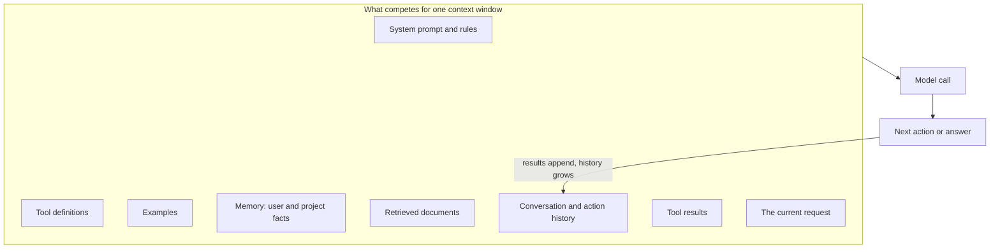

# Context Engineering

!!! abstract "TL;DR"
    Context engineering is deciding **what goes into the model's context window at each step**: instructions, tools, retrieved knowledge, memory, history and tool results. The window is a **scarce budget**: as it fills, quality drops (context rot), cost and latency rise, and irrelevant or conflicting content misleads the model. The goal is the **smallest set of high-signal tokens** for the current step, achieved with just-in-time retrieval, compaction, structured notes, sub-agents with clean contexts, and a cache-friendly layout.

!!! evolution "Where this fits"
    **Before:** [Prompt Engineering](prompting.md) (how to write instructions), [RAG](rag.md) (what to retrieve), [Agents](agents.md) (long loops that accumulate context), [long-context limits](../llms/efficient-attention.md). **This page:** managing everything in the window. **Next:** [Harness Engineering](harness-engineering.md) designs the whole system around the model.

## From prompts to context

Prompt engineering focuses on writing good instructions for a single call. Agents changed the problem: a long-running agent makes dozens or hundreds of calls, and each call's context is assembled from many sources that change as the task proceeds. The term **context engineering** (popular from mid-2025) names the discipline of curating that assembly.

## Why context is scarce

- **Attention is spread thin:** every token competes for the model's attention, and accuracy on details tends to fall as contexts grow, even well within the advertised window. This decline is often called **context rot**.
- **Position effects:** information in the middle of a long context is used less reliably ("lost in the middle").
- **Distractors:** irrelevant but similar-looking text measurably hurts accuracy.
- **Cost and latency:** every token is processed on every call; long prompts slow time to first token.
- **Finite size:** long agent runs eventually overflow any window.

## Principles

1. **The smallest high-signal set.** Include what this step needs, not everything that might be useful.
2. **System prompts at the right altitude.** Specific enough to guide behavior, general enough to let the model use judgment. Avoid both vague platitudes and brittle if-then rule lists. Organize with clear sections.
3. **Curated tools.** Few, clearly distinct tools with concise descriptions; overlapping tools confuse selection and every definition costs tokens.
4. **Canonical examples over exhaustive edge cases.** A few diverse, representative examples teach behavior better than a long list of rules.
5. **Just-in-time over pre-loading.** Keep lightweight references (file paths, document IDs, URLs, queries) and let the agent fetch details when it needs them, the way a person uses a file system instead of memorizing it. Pre-load only what is almost always needed.
6. **Progressive disclosure.** Let the agent discover structure (list a directory, read a summary, then open a file) instead of dumping everything at once.

## Techniques for long-running tasks

| Technique | How | Trade-off |
|---|---|---|
| **Compaction** | When the context nears its limit, summarize the history into a compact state (goal, decisions made, current status, open problems, key file names) and continue from that | Summaries can drop details that matter later; preserve decisions and unresolved issues |
| **Tool-result clearing** | Remove or shorten old tool outputs once they've been used | Very safe and cheap; keep references to re-fetch if needed |
| **Structured note-taking** | The agent writes progress, plans and findings to files (a to-do list, a notes file) outside the context and reads them back | Survives compaction and session restarts; needs discipline in what's written |
| **Sub-agents** | Delegate a focused sub-task to a sub-agent with a clean context; it returns a condensed result (often a few thousand tokens distilled from far more) | Clean separation; costs more total tokens; information can be lost in the summary |
| **Retrieval on demand** | Search tools for documents, code and memory instead of preloading | Adds steps; needs good search |
| **Output truncation** | Cap tool output sizes, paginate, return summaries plus a handle to the full data | The model may miss details beyond the cut; say what was truncated |

## Common ways context goes wrong

| Problem | What happens | Fix |
|---|---|---|
| **Poisoning** | A hallucination or bad tool result enters the context and is treated as fact in later steps | Verify important facts against sources; correct the record explicitly; compaction that doesn't preserve errors as truths |
| **Distraction** | So much accumulated history that the model repeats past actions instead of reasoning freshly | Compaction, clearing old results, restating the current goal |
| **Confusion** | Too many tools or irrelevant documents lead to wrong choices | Fewer tools per step, better retrieval, dynamic tool loading |
| **Clash** | Contradictory information (old vs new versions, conflicting instructions) | Remove superseded content, label versions and dates, resolve conflicts before the model sees them |

## Layout and prompt caching

Providers cache the processed prefix of a prompt so identical beginnings aren't recomputed, often charging much less for cached input tokens and cutting time to first token. To benefit:

- Put **stable content first:** system prompt, tool definitions, long reference documents, few-shot examples.
- Put **variable content last:** retrieved passages for this query, the latest messages, the current question.
- Avoid inserting timestamps or per-request IDs early in the prompt; they break the shared prefix.
- In agents, append new turns rather than rewriting earlier ones, so the prefix stays cacheable.

## Context engineering in practice

- **Chat assistants:** summarize older turns; keep user preferences in memory; retrieve past conversations only when relevant.
- **RAG:** retrieve fewer, better passages; rerank; order by relevance; include source metadata (titles, dates) so the model can judge them.
- **Coding agents:** a short project instructions file loaded every session; search tools instead of loading the repository; read files on demand; keep test output short; compact long sessions; notes for multi-session work.
- **Research agents:** sub-agents explore sources in parallel and return condensed findings with citations to a lead agent.

## Measuring it

Evaluate tasks at realistic context sizes, not just short prompts: run the same task suite with growing histories, more tools and more retrieved text, and track success, cost and latency. Synthetic "needle in a haystack" tests show whether retrieval of a planted fact works, but say little about reasoning over long, messy contexts.

## Interview questions

??? question "What is context engineering, and how is it different from prompt engineering?"
    Prompt engineering is writing effective instructions and examples for a model call. Context engineering is the broader job of deciding, at every step of an application or agent, which information enters the context window (system prompt, tools, retrieved data, memory, history, tool results) and in what form, under a limited token budget. It matters most for agents, whose context is assembled dynamically over many calls and grows as they work.

??? question "What is context rot or 'lost in the middle'?"
    Model accuracy tends to degrade as the context grows, especially for details buried in long inputs, and information in the middle of a long prompt is used less reliably than information near the start or end. So a large window doesn't mean everything in it will be used well; adding marginally relevant text can lower quality while raising cost. The response is to curate context, position key information well, and retrieve on demand.

??? question "How would you manage context for an agent that runs for hours?"
    Keep a compact, stable base context (system prompt, essential tools, a short project brief). Fetch details just in time through search and file tools. Truncate and clear old tool outputs. Have the agent maintain notes and a to-do file outside the context. Compact the history when nearing the limit, preserving the goal, decisions, current state and open issues. Delegate exploratory sub-tasks to sub-agents that return condensed results. And evaluate the agent on long tasks specifically, since short demos hide these failures.

??? question "When do you use sub-agents for context management?"
    When a sub-task requires reading a lot of material that the main agent doesn't need to keep: searching a large codebase, reading many documents, exploring alternatives. The sub-agent works in a fresh context and returns only a condensed result, keeping the lead agent's context clean. It costs more total tokens and can lose information in the handoff, so use it for genuinely separable, exploration-heavy work, not for tightly coupled edits.

??? question "Just-in-time retrieval vs pre-loading context: trade-offs."
    Pre-loading puts everything potentially relevant in the prompt up front: simpler, fewer steps, and cache-friendly if stable, but wasteful and distracting when most of it isn't needed. Just-in-time retrieval keeps references and lets the agent fetch what it needs: leaner, scales to huge corpora, but adds tool calls and latency and depends on good search tools. A hybrid is common: pre-load a short, high-value core; fetch the rest on demand.

??? question "How do you lay out a prompt to benefit from prompt caching?"
    Order content from most stable to most variable: system instructions and tool definitions first, then long reference material and examples, then per-session context, and the current user turn last. Avoid placing changing values (timestamps, request IDs, user-specific data) early. In multi-turn agents, append rather than edit earlier messages so the prefix stays identical between calls.

??? question "What is context poisoning, and how do you prevent it?"
    An error, such as a hallucinated fact or a wrong tool result, enters the context and later steps build on it as if it were true, so the mistake compounds. Prevent it by verifying important facts against external sources before relying on them, having tools return clear errors rather than plausible-looking defaults, explicitly correcting the record when an error is found, and making sure compaction summaries don't preserve unverified claims as facts.

!!! pitfall "Common mistakes"
    - Treating a 1M-token window as permission to include everything.
    - Loading every tool from every server into every call.
    - Compaction that drops the original goal or key decisions.
    - Putting per-request data at the top of the prompt and losing caching.
    - Testing only on short conversations.

## Revision checklist

- [ ] List what competes for the context window
- [ ] Explain why context is scarce (rot, position, distractors, cost)
- [ ] State six principles, including just-in-time retrieval
- [ ] Explain compaction, tool-result clearing, note-taking and sub-agents
- [ ] Describe poisoning, distraction, confusion and clash
- [ ] Lay out a prompt for prompt caching

## Go deeper

- [Anthropic: Effective context engineering for AI agents](https://www.anthropic.com/research/effective-context-engineering-for-ai-agents)
- [Lost in the Middle: How Language Models Use Long Contexts (2023)](https://arxiv.org/abs/2307.03172)
- [Anthropic: How we built our multi-agent research system](https://www.anthropic.com/research/multi-agent-research-system)
