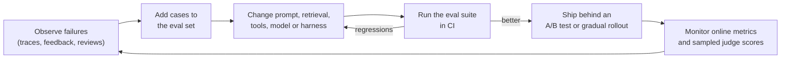

# Evaluating LLM Systems

!!! abstract "TL;DR"
    Open-ended outputs rarely have one right answer, and public benchmarks leak into training data, so **evaluate your system on your own tasks**. Build an evaluation set from real traffic and failures; grade with **programmatic checks** wherever possible, **LLM-as-judge** with rubrics (calibrated against people, watching for position, length and self-preference bias), and **human review** for what matters most. Evaluate components (retrieval, tool use) and **end-to-end outcomes**, run every change through the suite, report uncertainty, and confirm with **online metrics**.

!!! evolution "Where this fits"
    **Before:** [classical metrics and A/B testing](../foundations/evaluation.md), [RAG](rag.md), [Agents](agents.md), [Harness Engineering](harness-engineering.md). **This page:** measuring LLM applications. **Next:** [Guardrails & Security](security.md) and [MLOps & LLMOps](../production/mlops.md) for production monitoring.

## Why it's hard

- Many valid answers; quality has several dimensions (correctness, helpfulness, tone, safety, format).
- Outputs vary between runs.
- Benchmarks **saturate** (top models score near 100%) and get **contaminated** (test items appear in training data).
- Small prompt or model changes cause regressions in places nobody looked.
- Agents act over many steps, so the final message alone doesn't show whether the task was done correctly.

## Benchmarks: useful, but not your evaluation

| Area | Examples | What they test |
|---|---|---|
| Knowledge and reasoning | MMLU, MMLU-Pro, GPQA, Humanity's Last Exam | Multiple-choice and expert-level questions |
| Math | GSM8K, MATH, AIME problems | Multi-step quantitative reasoning |
| Code | HumanEval, MBPP, LiveCodeBench, **SWE-bench Verified** | From single functions to resolving real repository issues |
| Instruction following | IFEval, MT-Bench | Following explicit constraints; multi-turn quality |
| Tool use and agents | BFCL, τ-bench, web and computer-use benchmarks | Function calling, multi-turn tasks with tools and users |
| Human preference | LMArena (Chatbot Arena) | Crowd-sourced pairwise votes, Elo-style ratings |
| Truthfulness and safety | TruthfulQA, refusal and jailbreak suites | Misconceptions, harmful compliance, over-refusal |

Use benchmarks to shortlist models. Then decide with an evaluation on **your** data: your prompts, documents, tools, users and success criteria.

## Building an evaluation set

1. **Sources:** real user inputs (sampled and anonymized), support tickets, logged failures, expert-written cases, adversarial inputs, and synthetic cases generated by a model and reviewed by people.
2. **Coverage:** common cases, important slices (languages, customer tiers, document types), edge cases, unanswerable questions, and known past failures.
3. **Ground truth:** a reference answer, a set of required facts, a checkable end state, or a rubric describing what good looks like.
4. **Size:** start with 50–200 well-chosen cases; grow toward several hundred to thousands for important systems. A small, accurate set beats a large, noisy one.
5. **Versioning:** store it with the code; keep a held-out portion you don't tune against.
6. **Labeling guidelines** with examples, and agreement checks between labelers.

## Grading methods

| Method | How | Strengths | Weaknesses |
|---|---|---|---|
| **Programmatic checks** | Exact match, regex, JSON schema validation, executing code against tests, checking database state | Cheap, fast, objective, reproducible | Only for checkable properties |
| **Reference-based metrics** | BLEU, ROUGE, embedding similarity, BERTScore | Automatic | Weak correlation with quality for open-ended text |
| **LLM-as-judge** | A model scores outputs against a rubric (pointwise) or compares two outputs (pairwise) | Scales to subjective criteria | Biased; must be validated against people |
| **Human evaluation** | Experts or trained raters with guidelines | The gold standard for what matters | Slow, expensive, variable between raters |
| **User signals** | Ratings, regenerations, edits, copies, escalations, task completion | Real-world relevance | Noisy, biased, delayed |

### LLM-as-judge done well

| Bias or problem | Mitigation |
|---|---|
| **Position bias** (prefers the first or second answer in a pair) | Evaluate both orders; count ties when they disagree |
| **Verbosity bias** (prefers longer answers) | Rubrics that reward concision; length-controlled comparisons |
| **Self-preference** (prefers its own family's outputs) | Use a judge from a different model family, or several judges |
| **Leniency and vague scales** | Specific criteria, binary or 3-point scales, examples of each score |
| **Inconsistency** | Ask for reasoning before the verdict; low temperature; multiple samples |
| **Unknown accuracy** | Measure agreement with human labels on a sample before trusting it |

Effective judge prompts check one criterion at a time ("Is every claim supported by the sources? yes/no, with the unsupported claims listed") rather than asking for an overall 1–10 score.

## What to evaluate, by system type

| System | Key measures |
|---|---|
| **Chat assistant** | Helpfulness, correctness, instruction following, tone, refusal and over-refusal rates |
| **RAG** | Retrieval recall@k and MRR; context precision; **faithfulness**; answer correctness; citation accuracy (see [RAG](rag.md)) |
| **Extraction / classification** | Field-level precision and recall, accuracy, schema validity |
| **Tool use** | Tool selection, argument correctness, end-state correctness (see [Tool Calling](tool-calling.md)) |
| **Agents** | Task success on the final state, pass@k and pass^k, steps, cost, safety violations (see [Harness Engineering](harness-engineering.md)) |
| **Safety** | Harmful compliance on red-team prompts, jailbreak resistance, prompt-injection resistance, over-refusal on benign prompts |
| **All** | Latency (p50, p95), cost per request, robustness to paraphrases and typos, performance by slice |

## Comparing two systems fairly

- Run both on the **same** items; use paired comparisons.
- Report **confidence intervals** (bootstrap over items) rather than a single number. With 100 items, an accuracy of 80% has a 95% interval of roughly ±8 points, so a 3-point difference is noise.
- **Repeat runs** for stochastic systems and agents; report variance.
- Look at **per-item changes**: which cases got better or worse, and why.
- Watch for **overfitting the eval set**: keep a held-out set and refresh with new production samples.

## Eval-driven development

## Online evaluation

- **A/B tests** on task completion, resolution rate, user ratings, retention and cost per successful task (see [Evaluation & Metrics](../foundations/evaluation.md)).
- **Implicit signals:** regenerate rate, edits to drafts, copy rate, conversation abandonment, escalations to humans.
- **Sampled review:** run LLM judges continuously on a sample of production traffic, and route low-scoring or flagged conversations to human review.
- **Monitoring:** input drift (new topics, languages), judge-score trends, guardrail trigger rates, latency and cost.

Tooling such as promptfoo, DeepEval, RAGAS, Inspect, OpenAI Evals and observability platforms with evaluation features (LangSmith, Braintrust, Arize Phoenix and others) can help, but the evaluation set and grading criteria are the real asset.

## Interview questions

??? question "How would you evaluate a customer-support chatbot?"
    Define success: correct, policy-compliant resolution without unnecessary escalation, in an appropriate tone. Build an evaluation set from real tickets covering the main intents, hard cases and unanswerable questions, with reference resolutions or rubrics. Grade correctness and policy compliance with programmatic checks where possible (right action taken, right fields), faithfulness to retrieved policies with a calibrated LLM judge, and tone with a rubric; validate the judge against human labels. Online, track resolution rate, escalations, CSAT, regenerations and cost per resolved ticket, with A/B tests for changes and sampled human review.

??? question "Pros and cons of LLM-as-judge."
    Pros: scales to thousands of outputs, handles subjective criteria such as helpfulness and faithfulness, cheap compared with human review, and fast enough for CI. Cons: position, verbosity and self-preference biases; inconsistency; blind spots on domain correctness; and susceptibility to persuasive but wrong answers. Use specific rubrics with binary or short scales, reasoning before verdicts, both orderings for pairwise comparisons, judges from a different model family, and regular agreement checks against human labels.

??? question "What is benchmark contamination, and how do you deal with it?"
    Test items (or close paraphrases) appearing in a model's training data, which inflates scores without reflecting real ability. Signs include much better performance on older benchmarks than on fresh ones, or memorized answers. Deal with it by using recently created or private held-out sets, decontaminating training data, rewriting items, comparing on tasks drawn from your own domain, and treating public leaderboard numbers as rough signals rather than decisions.

??? question "How do you set up regression tests for prompts?"
    Keep a versioned evaluation set of representative and previously failing cases, each with a programmatic check or a judge rubric. Run it automatically in CI on every change to prompts, tools, retrieval, model versions or parameters, with thresholds per metric and per critical slice; block merges on significant regressions; and show per-case diffs so reviewers see what changed. Refresh the set with new production failures, and keep a held-out portion.

??? question "How many evaluation examples do you need?"
    Enough that the differences you care about exceed the noise. The standard error of an accuracy estimate is about $\sqrt{p(1-p)/n}$: with 100 items at 80% it's about 4 points, so the 95% interval is roughly ±8; with 1,000 items, about ±2.5. To detect small improvements you need hundreds to thousands of items, or paired comparisons on the same items, which reduce variance. Start small with high-quality cases and grow the set where decisions are close.

??? question "How do you evaluate an agent rather than a single response?"
    By outcomes on realistic tasks: check the final state of the environment (tests pass, the right record changed once, the booking exists) instead of only the final message. Run each task multiple times and report success rate, pass@k and pass^k, plus steps, cost, time, safety violations and human interventions. Review trajectories of failures to see whether problems come from tools, context management or verification, and re-run the suite after each change.

??? question "What metrics would you use to evaluate RAG specifically?"
    For retrieval: recall@k (was the needed evidence retrieved?), MRR or NDCG for ranking quality, context precision. For generation: faithfulness (all claims supported by the retrieved context), answer relevance, correctness against references, citation accuracy, and correct abstention on unanswerable questions. End to end: task success and user feedback. Measure stages separately so you know whether to fix retrieval or generation.

??? question "How do you measure whether a judge model can be trusted?"
    Have people label a representative sample (with clear guidelines and, ideally, two raters per item to measure inter-rater agreement), run the judge on the same items, and compute agreement (accuracy against the human labels, or Cohen's kappa). Check agreement by slice and on hard cases, test for position and length bias with swapped orders and padded answers, and re-validate when the judge model or rubric changes. Use the judge only where its agreement approaches human-to-human agreement.

??? question "Offline evaluation improved, but users are less happy. What could be going on?"
    The evaluation set may not represent current traffic (new topics, languages, harder cases); the judge may reward things users don't value (length, formality); the change may have increased latency or cost-related limits; online behavior may differ (longer conversations, different instructions); or the metric may miss a dimension users care about (tone, conciseness). Compare offline cases with recent production samples, review real conversations, check latency, and add the missing dimensions to the evaluation.

!!! pitfall "Common mistakes"
    - Choosing a model from leaderboards without testing on your tasks.
    - Trusting an LLM judge that was never compared with human labels.
    - Reporting a single score without uncertainty or slice breakdowns.
    - Grading only the final text of an agent, not the end state.
    - Letting the evaluation set go stale while production changes.

## Revision checklist

- [ ] Explain why benchmarks aren't enough, including contamination and saturation
- [ ] Build an evaluation set: sources, coverage, ground truth, size, versioning
- [ ] Compare programmatic checks, reference metrics, LLM judges, human review and user signals
- [ ] List LLM-as-judge biases and mitigations
- [ ] Choose metrics for chat, RAG, extraction, tools, agents and safety
- [ ] Compare systems with paired tests and confidence intervals

## Go deeper

- [Judging LLM-as-a-Judge with MT-Bench and Chatbot Arena (2023)](https://arxiv.org/abs/2306.05685)
- [Anthropic: Demystifying evals for AI agents](https://www.anthropic.com/research/demystifying-evals-for-ai-agents)
- [Hamel Husain: Your AI Product Needs Evals](https://hamel.dev/blog/posts/evals/)
- [Inspect evaluation framework](https://inspect.aisi.org.uk/)
