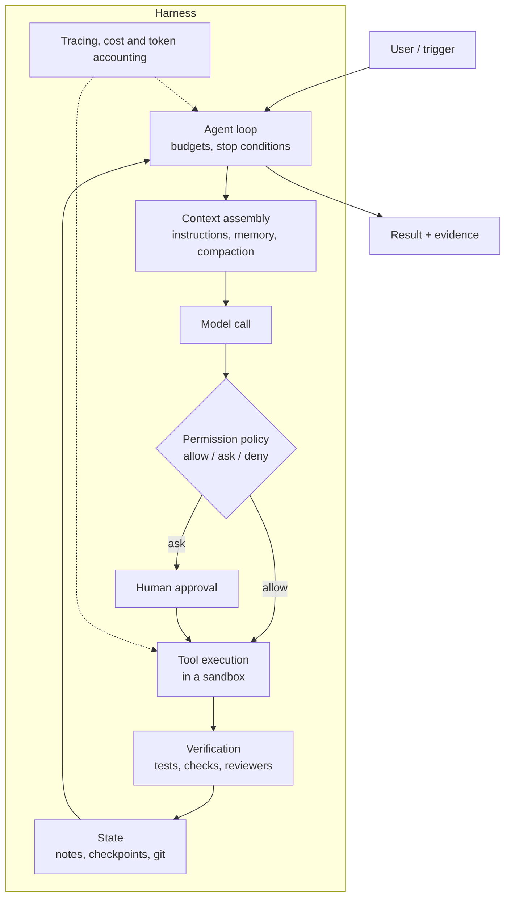

# Harness Engineering

!!! abstract "TL;DR"
    The **harness** is everything around the model that turns it into a working agent: the **loop**, the **tools**, the **execution environment**, **permissions** and human checkpoints, **context management**, **verification**, **state** for long-running work, **observability**, **budgets** and **evaluation**. The same model can succeed or fail on a task depending on its harness, so harness design is an engineering discipline of its own, improved the way models are: by measuring end-to-end task success and iterating.

!!! evolution "Where this fits"
    **Before:** [Tool Calling](tool-calling.md), [Agents](agents.md), [MCP](mcp.md), [Context Engineering](context-engineering.md). **This page:** putting them together into a reliable system. **Next:** [Evaluating LLM Systems](evaluation.md) and [Guardrails & Security](security.md).

## Why the harness matters

Coding agents made the point vivid: the same model scored very differently on software-engineering benchmarks depending on the tools it was given, how it could view and edit files, how test results were fed back, and how long it could work. Gains often came from changing the harness rather than the model. In production the harness also decides safety (what the agent may do), cost (how many tokens it burns) and user experience (when it asks, how it reports progress).

## Components of a harness



| Component | Decisions |
|---|---|
| **Agent loop** | Max steps, tokens, time and cost; stop conditions; retry and back-off; when to ask the user |
| **Tools** | Which tools, their granularity and descriptions; how results are shaped and truncated; dynamic loading for large catalogs |
| **Execution environment** | Containers or VMs; file-system scope; network egress allow-lists; secrets kept out of the agent's reach; CPU, memory and time limits |
| **Permissions** | Per-tool and per-resource rules (allow, ask, deny); read vs write; escalation paths; acting with the user's identity |
| **Human in the loop** | Approval points for consequential actions; plan review before execution; clear summaries for reviewers |
| **Context management** | What's loaded every call, what's fetched on demand, compaction, tool-result clearing, notes files |
| **Verification** | Tests, linters, type checks, schema validation, screenshots for UI work, independent reviewer passes, an explicit definition of done |
| **State** | Progress files, checkpoints, version control commits, resumable sessions, idempotent steps |
| **Observability** | A trace per run with every model call, tool call, token count, cost and latency; replay for debugging |
| **Evaluation** | An end-to-end task suite, graded on outcomes, run on every harness or model change |

## The loop, with the harness made explicit

```python
def run_agent(task, budget):
    state = load_or_init_state(task)            # notes, plan, checkpoints
    for step in range(budget.max_steps):
        if budget.exhausted(state):
            return escalate(state, reason="budget")
        context = assemble_context(task, state)  # instructions + memory + compacted history
        reply = model.generate(context, tools=select_tools(task, state))
        if reply.is_final:
            evidence = verify(task, state)       # tests, checks, reviewer
            if evidence.passed:
                return finish(state, evidence)
            state.add_feedback(evidence.report)  # not done yet: feed failures back
            continue
        for call in reply.tool_calls:
            decision = permissions.check(call, task.user)
            if decision == "deny":
                result = {"error": "Not permitted: " + decision.reason}
            elif decision == "ask" and not human_approves(call):
                result = {"error": "The user declined this action."}
            else:
                result = sandbox.execute(call, timeout_s=60)
            state.record(call, truncate(result))
        state.maybe_compact()                    # keep the context within budget
        state.checkpoint()                       # resumable after crashes
```

Everything outside `model.generate` is harness, and most reliability problems are fixed there.

## Execution environment and permissions

- **Sandbox by default:** run code and commands in a container or VM with only the needed files mounted, limited network access (allow-listed hosts), no production credentials, and resource and time limits. Treat the sandbox as disposable.
- **Least privilege:** the agent acts with the user's permissions or narrower; separate read and write tools; scope tokens to the task.
- **Policy as code:** rules such as "edits inside the repository are allowed, deleting branches needs approval, pushing to the default branch is denied" are enforced by the harness, not left to the prompt.
- **Approvals that are easy to review:** show the exact command or diff, its effect and why the agent wants it.
- **The dangerous combination:** access to private data, exposure to untrusted content, and the ability to communicate externally. Break the combination or require human approval. See [Guardrails & Security](security.md).

## Verification and feedback

Agents improve dramatically when the harness gives them **fast, objective feedback**:

- For code: run the relevant tests, linters and type checkers after edits and feed concise results back; for UI work, render and screenshot.
- For data tasks: re-query to confirm writes; validate against schemas and invariants.
- For writing and analysis: a separate reviewer prompt with a rubric, and citation checks against sources.
- A **definition of done** the harness checks before accepting "finished", so the agent can't declare success without evidence.

## Long-running work

Tasks that span many context windows or sessions need state outside the model:

- **Progress files and plans:** a feature or task list with status, and notes on what was tried and decided, read at the start of each session.
- **Checkpoints:** commit work in small, working increments (version control is an excellent checkpoint system) so failures can be rolled back and sessions resumed.
- **An initializer step:** set up the environment, write the plan and success criteria, and create helper scripts once; later sessions make incremental progress against that plan.
- **Idempotent, resumable steps:** after a crash, the harness should continue rather than redo or double-apply work.
- **Compaction** that preserves goals, decisions and open issues. See [Context Engineering](context-engineering.md).

## Observability

Record a structured **trace** for every run: each model call (inputs, outputs, tokens, latency, model version), each tool call (arguments, results, errors), permission decisions, and costs. Traces make it possible to debug failures, find expensive steps, replay runs after a fix, and build evaluation cases from real failures.

## Evaluating and improving a harness

- **End-to-end task suites** with checkable outcomes: the tests pass, the ticket is resolved correctly, the report contains the right figures with citations. SWE-bench-style suites are the public model for this.
- **Grade outcomes, not transcripts:** check the final state, plus rubric-based grading by people or calibrated model judges for subjective parts.
- **Run each task several times:** agents are stochastic. **pass@k** (at least one of k attempts succeeds) measures capability; **pass^k** (all k succeed) measures reliability, which is what users experience.
- **Track efficiency and safety:** steps, tokens, wall-clock time, cost per task, permission violations, human interventions.
- **Change one thing at a time** (a tool description, the compaction policy, the verification step) and compare on the suite.
- **Harness–model fit:** a harness tuned for one model may need changes for another; re-run the suite whenever the model changes.

## Interview questions

??? question "What is an agent harness, and what does it contain?"
    The software around the model that makes it a working agent: the loop that calls the model and executes tool calls with budgets and stop conditions; the tool set and how results are shaped; the execution environment (sandbox); permission rules and human approval points; context assembly and compaction; verification steps; persistent state for long tasks; tracing and cost accounting; and the evaluation suite used to improve it. The model decides; the harness determines what it can see, what it can do, and how its work is checked.

??? question "Why can the same model perform very differently in different harnesses?"
    Because the harness controls the information and feedback the model works with: which tools it has and how clear they are, how much irrelevant output floods its context, whether it can run tests and see results, how errors are reported, how long it can work, and whether its plans and notes persist. A well-designed harness turns a capable model's occasional success into reliable success; a poor one wastes capability on confusion, loops and unverified answers.

??? question "How do you let an agent run code safely?"
    Execute in an isolated sandbox (container or VM) with only the needed files, no production secrets, network access limited to allow-listed hosts, and CPU, memory and time limits. Enforce permission policies in the harness (for example, deny pushes to protected branches, require approval for deletions), log every command, and make the environment disposable. Combine with least-privilege credentials so even a successful escape or injection has little reach.

??? question "Where should a human approve the agent's actions?"
    Before consequential, irreversible or external effects: payments, sending messages, deleting or overwriting data, changing permissions, deploying, or acting on behalf of others. Also at plan level for large tasks (review the plan before execution), and whenever the agent is uncertain or the policy is unclear. Make approvals specific and easy to review, and loosen them gradually as evaluation shows reliability, rather than starting fully autonomous.

??? question "How do you evaluate an agent end to end?"
    Assemble realistic tasks with objective success checks on the final state, run each several times, and measure success (pass@k for capability, pass^k for reliability), cost, time, steps, safety violations and human interventions. Use rubric-based grading for subjective outputs, calibrated against people. Review failing transcripts to classify causes (tool confusion, context loss, missing verification), fix the harness, and re-run the suite. Keep a held-out set to avoid tuning to the test.

??? question "pass@k vs pass^k: what's the difference and why does it matter?"
    pass@k is the probability that at least one of k attempts succeeds; it rises with k and measures what the agent *can* do. pass^k is the probability that all k attempts succeed; it falls with k and measures consistency. A user running a task once cares about per-attempt reliability, and a deployment running it thousands of times cares about pass^k-like consistency, so reporting only pass@k overstates how dependable an agent is.

??? question "How would you design a harness for a coding agent?"
    Tools to search the repository, read files, edit with diffs, and run commands; a sandboxed workspace with the project's dependencies; a project instructions file loaded each session; permission rules (edits allowed, destructive git operations need approval, network limited); automatic test, lint and type-check runs after edits with concise results fed back; small commits as checkpoints; a progress file for multi-session work; compaction for long sessions; sub-agents for broad codebase exploration; full tracing; and an evaluation suite of real issues with hidden tests.

??? question "How do you make long-running agent work resumable?"
    Keep the source of truth outside the context: a plan or task list with statuses, notes of decisions and findings, and frequent checkpoints such as version-control commits of working increments. Make steps idempotent so re-running is safe, record which steps completed in persistent state, and start each new session by reading that state and verifying the environment. Compaction should preserve goals, decisions and open issues.

!!! pitfall "Common mistakes"
    - Putting safety rules only in the prompt instead of enforcing them in the harness.
    - Accepting "done" without a verification step.
    - Running agents with production credentials.
    - Evaluating with one attempt per task and calling the result reliability.
    - Changing several harness components at once and not knowing what helped.

## Revision checklist

- [ ] List the ten components of a harness and a key decision for each
- [ ] Write the agent loop with budgets, permissions, verification, compaction and checkpoints
- [ ] Design a sandbox and permission policy for code execution
- [ ] Explain how to make long tasks resumable
- [ ] Explain pass@k vs pass^k and how to evaluate a harness

## Go deeper

- [Anthropic: Effective harnesses for long-running agents](https://www.anthropic.com/research/effective-harnesses-for-long-running-agents)
- [Anthropic: Raising the bar on SWE-bench Verified](https://www.anthropic.com/research/swe-bench-sonnet)
- [Anthropic: Demystifying evals for AI agents](https://www.anthropic.com/research/demystifying-evals-for-ai-agents)
- [SWE-bench (2023)](https://arxiv.org/abs/2310.06770)
