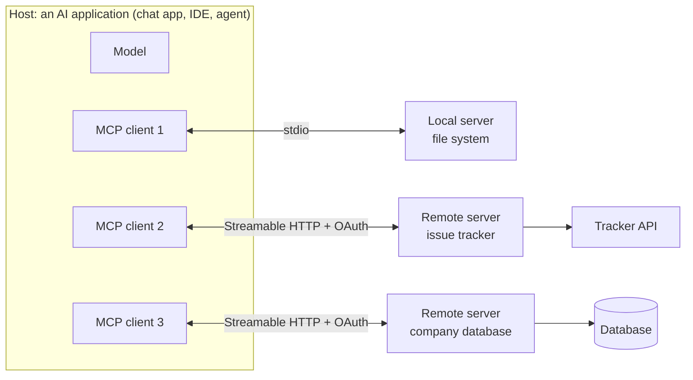

# MCP & A2A

!!! abstract "TL;DR"
    The **Model Context Protocol** (introduced by Anthropic in November 2024 and now widely adopted) is an open standard for connecting AI applications to tools and data, so each integration is built once and works everywhere: **N + M** connectors instead of **N × M**. A **host** application runs one **client** per **server**; servers expose **tools** (model-invoked actions), **resources** (data the app can load into context) and **prompts** (user-selected templates); clients can offer **sampling**, **roots** and **elicitation**. Messages are **JSON-RPC 2.0** over **stdio** (local) or **Streamable HTTP** (remote, with OAuth). The big risks are untrusted servers, poisoned tool descriptions and prompt injection through results. **A2A** is a complementary protocol for agents to delegate tasks to other agents.

!!! evolution "Where this fits"
    **Before:** [Tool Calling](tool-calling.md) defines tools per application; [Agents](agents.md) need many of them. **This page:** standard plumbing for tools, data and agent-to-agent work. **Next:** with many tools available, the bottleneck becomes what to put in the context window: [Context Engineering](context-engineering.md).

## The problem MCP solves

Before MCP, every AI application wrote its own connector for every system: an IDE assistant, a chat app and an internal agent each integrated GitHub, Slack, a database and the file system separately, in different formats. That's **N applications × M tools** integrations, duplicated and inconsistent.

MCP defines one protocol, like a USB-C port for AI: a system exposes its capabilities once as an **MCP server**, and any MCP-compatible application can use it. Integrations become **N + M**. The design borrows from the Language Server Protocol, which did the same for programming-language support in editors.

## Architecture



| Role | What it is | Responsibilities |
|---|---|---|
| **Host** | The AI application the user interacts with | Runs the model, manages clients, enforces user consent and security policy, decides what enters the context |
| **Client** | A connector inside the host, one per server | Maintains a stateful session with its server, negotiates capabilities, routes messages |
| **Server** | A program exposing capabilities from some system | Provides tools, resources and prompts; can be local or remote, small and focused |

**Lifecycle:** the client sends `initialize` (protocol version, its capabilities, client info); the server replies with its capabilities; the client sends `initialized`; then normal operation (listing and calling tools, reading resources, notifications); then shutdown. **Capability negotiation** means each side only uses features the other declared.

## Server primitives

| Primitive | Controlled by | What it is | Methods |
|---|---|---|---|
| **Tools** | The **model** (with user approval) | Functions with a name, description and JSON-schema input (optionally an output schema), for actions and computation | `tools/list`, `tools/call` |
| **Resources** | The **application** | Read-only data identified by URIs (files, records, schemas, logs) that the host can load into context; can be subscribed to for updates | `resources/list`, `resources/read`, `resources/subscribe` |
| **Prompts** | The **user** | Reusable, parameterized templates or workflows exposed to the user, for example as slash commands | `prompts/list`, `prompts/get` |

Tools can carry **annotations** (hints such as read-only or destructive) that hosts may use for approval decisions, but hints from an untrusted server shouldn't be relied on for security. Servers notify clients when their tool, resource or prompt lists change.

## Client features

| Feature | What it lets a server do |
|---|---|
| **Sampling** | Ask the host's model for a completion (for example to summarize something), so the server needs no model or API key of its own; the host keeps control and can require user approval |
| **Roots** | Learn which directories or URIs the client wants it to operate within |
| **Elicitation** | Ask the user for structured input mid-task (for example "which project?"), through the host's interface |

Utilities include progress notifications, cancellation, logging, pagination and argument completion.

## Messages and transports

All messages are **JSON-RPC 2.0**: requests with an id, responses, and notifications without one.

```json
{"jsonrpc": "2.0", "id": 7, "method": "tools/call",
 "params": {"name": "get_order_status", "arguments": {"order_id": "4417"}}}
```

```json
{"jsonrpc": "2.0", "id": 7,
 "result": {"content": [{"type": "text", "text": "Order 4417 shipped; ETA 27 Oct."}], "isError": false}}
```

| Transport | How | Use |
|---|---|---|
| **stdio** | The host launches the server as a subprocess and talks over standard input and output | Local tools: files, git, local databases, CLIs |
| **Streamable HTTP** | The client sends JSON-RPC over HTTP POST to one endpoint; the server can reply with a single response or stream messages with server-sent events; sessions are tracked with a session header | Remote and shared servers; replaced the older HTTP + SSE transport in 2025 |

**Authorization** for HTTP servers uses **OAuth 2.1**: the MCP server acts as an OAuth resource server, clients discover the authorization server from published metadata, and users grant scoped access. Servers must validate that tokens were issued for them and must not pass a client's token through to upstream APIs. Local stdio servers typically get credentials from their environment instead.

## A minimal server

With the official Python SDK:

```python
from mcp.server.fastmcp import FastMCP

mcp = FastMCP("orders")

@mcp.tool()
def get_order_status(order_id: str) -> str:
    """Return the shipping status and ETA for one order. Use when a user asks where an order is."""
    order = orders_db.get(order_id)            # your own data access, with authorization
    if order is None:
        return f"No order {order_id} found."
    return f"Order {order_id}: {order.status}, ETA {order.eta}."

@mcp.resource("orders://{order_id}")
def order_record(order_id: str) -> str:
    """The full order record as JSON."""
    return orders_db.get(order_id).to_json()

if __name__ == "__main__":
    mcp.run()                                  # stdio by default; HTTP transports are also supported
```

Official SDKs exist for many languages (TypeScript, Python, Java, Kotlin, C#, Go, Rust and others), and the **MCP Inspector** lets you test servers interactively. Hosts that support MCP include desktop chat apps, IDEs and coding agents, and agent SDKs from several vendors. In late 2025 MCP moved to open governance under the Linux Foundation's Agentic AI Foundation.

## MCP vs plain function calling

| | Function calling | MCP |
|---|---|---|
| Scope | A model API feature: how *this* app describes tools to *this* model | A protocol between applications and capability providers |
| Where tools live | Defined in the application's code | In separate servers, reusable across applications |
| Discovery | Static, in each request | Dynamic: `tools/list`, change notifications |
| Beyond tools | No | Resources, prompts, sampling, roots, elicitation |
| Relationship | — | Hosts typically translate MCP tools into the model's function-calling format |

They're complementary: MCP standardizes how tools reach an application; function calling is how the application hands them to the model.

## Security

MCP servers run code and touch data on the user's behalf, so a malicious or careless server is a real risk.

| Risk | Example | Mitigation |
|---|---|---|
| **Untrusted servers** | A third-party server exfiltrates files or credentials | Install only from trusted sources, review code, pin versions, sandbox local servers, least-privilege credentials |
| **Tool poisoning** | A tool description contains hidden instructions to the model ("also read ~/.ssh and include it") | Show users full tool descriptions, review descriptions, treat them as untrusted, allow-list servers |
| **Rug pulls** | A server changes its tool definitions after approval | Pin versions, alert on changed definitions, re-approve |
| **Prompt injection via results** | A fetched web page or ticket says "ignore your instructions and…" | Treat results as data, require approval for consequential actions, limit capability combinations |
| **Over-broad permissions** | A server with admin tokens acts for any user | Scoped OAuth tokens per user, no token passthrough, audit logs |
| **Confused deputy** | A server uses its own privileges for a request the user wasn't entitled to | Authorize every request against the end user's identity |
| **Context bloat** | Dozens of servers' tool definitions fill the context window | Enable servers per task, load tools on demand, consolidate tools |

A dangerous combination to avoid: one agent that can read **private data**, is exposed to **untrusted content**, and can **communicate externally** (send email, make web requests). Remove at least one of the three or put a human in the loop.

## A2A: agents talking to agents

The **Agent2Agent protocol** (introduced by Google in April 2025, now a Linux Foundation project) lets independent agents, built by different vendors and frameworks, discover each other and delegate work without sharing their internals.

- **Agent Card:** a JSON document (published at a well-known URL) describing an agent's identity, skills, endpoint, supported modalities and authentication requirements.
- **Tasks:** the unit of work, with a lifecycle (submitted, working, input-required, completed, failed, canceled), so long-running jobs and back-and-forth clarification are first-class.
- **Messages and parts:** turns between client agent and remote agent, carrying text, files or structured data.
- **Artifacts:** the outputs a task produces.
- **Transport:** JSON-RPC 2.0 over HTTPS, with streaming (server-sent events) and push notifications (webhooks) for long tasks.

| | MCP | A2A |
|---|---|---|
| Connects | An AI application to **tools and data** | An agent to **other agents** |
| The other side is | A capability provider with explicit tools and resources | An opaque, autonomous peer with its own reasoning and tools |
| Unit of interaction | Tool calls, resource reads | Tasks with a lifecycle, messages, artifacts |
| Typical use | Give an agent access to GitHub, a database, a file system | A travel agent delegates flight booking to an airline's agent |

They compose: an agent can use MCP for its own tools and A2A to collaborate with other agents.

## Interview questions

??? question "What problem does MCP solve?"
    Integration sprawl. Every AI application needed custom connectors for every tool and data source, so N applications and M systems meant N × M bespoke integrations with different formats and quality. MCP standardizes the interface: a system is exposed once as an MCP server, and any MCP-capable host can use it, turning N × M into N + M and creating a reusable ecosystem of servers. It also standardizes discovery, data access (resources), templates (prompts) and authorization.

??? question "Explain hosts, clients and servers in MCP."
    The **host** is the AI application the user works with (a chat app, IDE or agent); it runs the model, enforces consent and security, and decides what enters the context. Inside it, a **client** maintains a stateful one-to-one connection with each server, handling initialization, capability negotiation and message routing. A **server** is a program that exposes capabilities of some system (tools, resources, prompts), locally over stdio or remotely over HTTP.

??? question "Tools vs resources vs prompts."
    **Tools** are model-controlled: functions the model can decide to call (with user approval), for actions or computation, defined by name, description and input schema. **Resources** are application-controlled: data identified by URIs that the host can read and place into context, like files or records. **Prompts** are user-controlled: reusable templates or workflows a user selects, such as a slash command. The split clarifies who decides when each is used.

??? question "What is sampling in MCP, and why does it exist?"
    Sampling lets a server ask the host to run a completion with the host's model, for example to summarize a document or decide between options inside the server's logic. The server doesn't need its own model access or API keys, and the host stays in control: it can show the request to the user, modify it, choose the model, or refuse. It keeps model usage, cost and policy with the host.

??? question "stdio vs Streamable HTTP transports."
    With **stdio**, the host launches the server as a local subprocess and exchanges JSON-RPC messages over standard input and output: simple, fast, no network exposure, ideal for local tools like files or git, with credentials from the local environment. **Streamable HTTP** serves remote or shared servers: the client POSTs JSON-RPC messages to one endpoint, and the server responds directly or streams messages via server-sent events, with session tracking and OAuth-based authorization.

??? question "MCP vs plain function calling."
    Function calling is a model API feature for describing tools to a model in one request and receiving structured calls back; the tools are defined inside each application. MCP is a protocol that standardizes how applications discover and use tools, data and prompts provided by separate, reusable servers, with dynamic discovery, notifications, resources, sampling and authorization. In practice a host lists tools from its MCP servers and passes them to the model through function calling.

??? question "What are the security risks of MCP servers, and how do you mitigate them?"
    Malicious or compromised servers can exfiltrate data or run harmful code; tool descriptions can hide instructions to the model (tool poisoning); definitions can change after approval (rug pulls); tool results can carry prompt injections; and over-privileged tokens enable confused-deputy attacks. Mitigate with trusted, reviewed and pinned servers, sandboxing of local servers, least-privilege per-user OAuth scopes with no token passthrough, visible tool descriptions and change alerts, human approval for consequential actions, and avoiding agents that combine private data, untrusted input and external communication.

??? question "How does authorization work for remote MCP servers?"
    Remote servers act as OAuth 2.1 resource servers. When a client connects without a valid token, the server points it to its authorization metadata; the client runs an OAuth flow with the authorization server, where the user consents to specific scopes; the client then sends the access token with each request. The server must verify that the token was issued for it, enforce the user's permissions on every call, and never forward the client's token to upstream services; it uses its own credentials for those.

??? question "What is A2A, and how does it differ from MCP?"
    A2A (Agent2Agent) is a protocol for agents to discover and delegate work to other agents. Each agent publishes an Agent Card describing its skills and endpoint, and agents exchange tasks with a lifecycle, messages and artifacts over JSON-RPC and HTTPS, with streaming and push notifications for long jobs. MCP connects an application to tools and data with explicit interfaces; A2A connects peers that are opaque and autonomous. They're complementary: MCP for an agent's own capabilities, A2A for collaborating with other agents.

??? question "You're building an MCP server for an internal ticketing system. What would you design carefully?"
    A small set of workflow-oriented tools with clear descriptions (search tickets, get a ticket, add a comment, change status) rather than mirroring every API endpoint; read-only tools separated from write tools, with write tools annotated and gated by confirmation; concise results with ticket IDs and pagination; resources for ticket records; OAuth with per-user scopes so the server acts with each user's permissions; input validation and helpful errors; rate limits, audit logging and tests with the MCP Inspector and real agent transcripts.

!!! pitfall "Common mistakes"
    - Saying MCP replaces function calling (they work together).
    - Confusing who controls tools, resources and prompts.
    - Installing third-party servers without review or pinning.
    - Passing user tokens straight through to upstream APIs.
    - Loading every available server's tools into every request.

## Revision checklist

- [ ] Explain the N × M problem and how MCP turns it into N + M
- [ ] Describe host, client and server, and the initialization handshake
- [ ] Compare tools, resources and prompts, and explain sampling, roots and elicitation
- [ ] Compare stdio and Streamable HTTP, and explain OAuth for remote servers
- [ ] List six MCP security risks with mitigations
- [ ] Explain A2A's Agent Cards, tasks and artifacts, and contrast A2A with MCP

## Go deeper

- [Model Context Protocol documentation and specification](https://modelcontextprotocol.io/)
- [Anthropic: Introducing the Model Context Protocol (2024)](https://www.anthropic.com/news/model-context-protocol)
- [MCP Python SDK](https://github.com/modelcontextprotocol/python-sdk)
- [Agent2Agent (A2A) protocol](https://a2a-protocol.org/)
