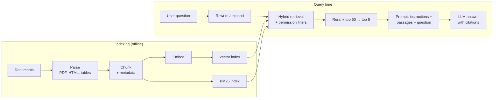

# RAG

!!! abstract "TL;DR"
    **Retrieval-augmented generation** retrieves relevant passages at query time and puts them in the prompt, so the model answers from fresh, private, citable sources instead of only its weights. The pipeline: **index** (parse, chunk, embed, store with metadata) → **retrieve** (hybrid BM25 + vectors, metadata and permission filters) → **rerank** (cross-encoder) → **generate** with instructions to cite and abstain. Most failures are retrieval failures, so evaluate the retriever (recall@k) and the generator (faithfulness) separately. Advanced RAG rewrites queries, adds context to chunks, uses graphs for global questions, and lets an agent search iteratively.

!!! evolution "Where this fits"
    **Before:** [Embeddings & Vector Search](embeddings.md), [prompting](prompting.md), and [why LLMs hallucinate](../llms/pretraining.md). **This page:** grounding answers in data. **Next:** [Tool Calling](tool-calling.md) and [Agents](agents.md) generalize retrieval into actions.

<div class="metro act-4" markdown>

- **Knowledge in weights** <span class="yr">2020</span><br>Frozen at the cutoff, can't cite, fills gaps with plausible text.
- **Fine-tune facts in** <span class="yr">2021+</span><br>Expensive, slow to update, unreliable for new facts.
- **Prompt stuffing** <span class="yr">2022</span><br>Paste documents into the prompt; limited by context and cost.
- **Naive RAG** <span class="yr">2020–2023</span><br>Embed, retrieve top-k chunks, generate.
- **Hybrid search + reranking** <span class="yr">2023</span><br>Keywords plus vectors, then a cross-encoder picks the best.
- **GraphRAG · agentic RAG** <span class="yr">2024+</span><br>Graphs for whole-corpus questions; the model decides what to search and checks itself.

</div>

## Why RAG

| Problem with an LLM alone | How RAG helps |
|---|---|
| Knowledge cutoff | Index updates daily or in real time |
| Private or proprietary data | Retrieved at query time; never trained into weights |
| Hallucination | Answers grounded in quoted sources, with citations |
| No access control | Filter retrieval by the user's permissions |
| Expensive to update | Re-index documents instead of retraining |

## The pipeline



### 1. Parsing

Garbage in, garbage out. Extract clean text and structure from PDFs, HTML, slides and spreadsheets; keep headings, lists and tables; OCR scanned pages or use a vision-language model for complex layouts; remove boilerplate (navigation, footers); keep metadata (source, title, section, date, author, permissions, URL).

### 2. Chunking

Embedding a whole document blurs its topics together; tiny chunks lose context. Chunking sets the unit of retrieval.

| Strategy | How | Good for |
|---|---|---|
| **Fixed size with overlap** | For example 300–800 tokens with 10–20% overlap | A reasonable default |
| **Recursive / structural** | Split by headings, then paragraphs, then sentences | Structured documents (docs, wikis, contracts) |
| **Semantic** | Split where embedding similarity between sentences drops | Long, unstructured text |
| **Document-specific** | Keep tables, code functions, FAQ pairs or slides whole | Mixed content |
| **Small-to-big** | Retrieve small chunks for precision; return their parent section for context | Precise retrieval with enough context |

Too small: answers span chunks and context is lost. Too large: irrelevant text dilutes the embedding and wastes prompt space. **Tune chunk size against retrieval metrics on your own questions.**

### 3. Embedding and indexing

Embed chunks with a model chosen on your data; store vectors with metadata; build a **BM25 index** alongside for exact terms. See [Embeddings & Vector Search](embeddings.md).

### 4. Retrieval

- **Hybrid search:** dense retrieval catches paraphrases; BM25 catches exact names, codes and rare terms. Merge the two ranked lists with **reciprocal rank fusion**: $\text{RRF}(d) = \sum_{\text{lists}} \frac{1}{k + \text{rank}(d)}$, with $k \approx 60$. It needs no score calibration between the two systems.
- **Metadata filters:** date ranges, product, language, document type.
- **Permission filters:** only retrieve chunks the user is allowed to see (document ACLs copied to chunk metadata, enforced in the query). Never rely on the LLM to hide restricted content.
- Retrieve generously (for example the top 50) because a reranker will cut it down.

### 5. Reranking

A cross-encoder (or an LLM) scores each (question, chunk) pair and keeps the top 3–10. It often gives one of the biggest quality gains in the whole pipeline, at the cost of tens to hundreds of milliseconds.

### 6. Generation

```text
Answer the question using only the sources below. Cite sources like [2].
If the sources don't contain the answer, say "I couldn't find this in the documentation."

<sources>
[1] (Billing policy, section 4.2, updated 2026-03-01) ...
[2] (Refund FAQ) ...
</sources>

Question: {question}
```

- Order passages by relevance; put the question after them.
- Require citations and an explicit "not found" path.
- Keep the total context lean: more passages isn't always better, because irrelevant text distracts the model.
- For user-facing answers, show the cited sources so people can verify.

## When RAG fails, and the fix

| Symptom | Likely cause | Fix |
|---|---|---|
| Right document exists but isn't retrieved | Vocabulary mismatch, poor chunking, weak embedder | Hybrid search, query rewriting, better chunking, a domain-tuned embedder |
| Retrieved but ranked too low | No reranker; too few candidates | Rerank a larger candidate set |
| Answer needs facts from several documents | Single-shot retrieval | Query decomposition, multi-hop or agentic retrieval |
| "Summarize the main themes across all documents" fails | Top-k retrieval can't cover a whole corpus | GraphRAG, map-reduce summarization, precomputed summaries |
| Answer contradicts the sources | Model ignored context, or sources conflict | Stronger instructions, citations, newer documents preferred, a faithfulness check |
| Chunk lacks context ("it increased by 5%") | Chunk doesn't say what "it" is | Contextual retrieval: prepend a document and section summary to each chunk |
| Stale answers | Index not updated | Incremental re-indexing, freshness metadata, date-aware ranking |
| Leaks restricted content | Permissions not enforced in retrieval | ACL filters at query time; per-tenant indexes |
| Slow | Many stages, long prompts | Cache embeddings and results, smaller reranker, fewer passages, streaming |

## Advanced RAG techniques

**Before retrieval**

- **Query rewriting:** turn conversational follow-ups ("what about for teams?") into standalone queries using the chat history.
- **Multi-query:** generate several phrasings and merge their results.
- **Decomposition:** split multi-part questions into sub-questions, retrieve for each.
- **HyDE (hypothetical document embeddings):** have the LLM write a hypothetical answer and embed *that*, since answers resemble documents more than questions do.
- **Routing:** choose the right index or tool (product docs, tickets, SQL database) per question.

**During indexing and retrieval**

- **Contextual retrieval:** before embedding, prepend a short, model-generated summary of where the chunk sits in its document, for both the vector and BM25 indexes. Reduces failures from context-free chunks.
- **Parent-document / small-to-big retrieval** and **sentence-window retrieval**.
- **Multi-vector representations:** index summaries, generated questions or late-interaction token vectors per chunk.
- **Structured data:** for tables and databases, text-to-SQL often beats embedding rows.

**After retrieval**

- **Reranking**, deduplication, and **context compression** (extract only the relevant sentences).
- **Ordering** to keep the strongest evidence at the start or end, given "lost in the middle".
- **Corrective RAG / self-checking:** grade the retrieved passages and re-retrieve or fall back to web search if they're weak; check that the answer is supported.

**GraphRAG (2024):** extract entities and relationships from the corpus into a knowledge graph, detect communities, and pre-generate summaries per community. Global questions ("what are the main risks discussed across these 5,000 reports?") are answered from community summaries; local questions combine graph neighborhoods with text chunks. Powerful for whole-corpus sense-making; expensive to build and maintain.

**Agentic RAG:** retrieval becomes a tool the model calls in a loop. It decides whether to search, which source to use, what query to send, reads results, searches again if needed, and verifies before answering. Better for multi-hop and research questions; more latency, cost and variance. See [Agents](agents.md).

## Evaluating a RAG system

Evaluate the parts separately, then end to end.

| Layer | Metric | How |
|---|---|---|
| **Retrieval** | Recall@k, hit rate@k, MRR, NDCG | Labeled questions with known relevant chunks or documents |
| **Context quality** | Context precision (how much retrieved text is relevant) and context recall (whether all needed facts were retrieved) | Human labels or an LLM judge |
| **Generation** | **Faithfulness / groundedness** (every claim supported by the context), answer relevance, correctness against a reference, citation accuracy | LLM judge calibrated against humans; exact checks where possible |
| **End to end** | Task success, deflection or resolution rate, user ratings, escalations | Production metrics and A/B tests |
| **Operations** | Latency per stage, cost per query, index freshness | Tracing and monitoring |

Build the evaluation set from real user questions (including unanswerable ones), and re-run it on every change to chunking, embedder, retriever, reranker, prompt or model. Frameworks such as RAGAS package several of these metrics.

## Prompting vs RAG vs fine-tuning

| | Prompting | RAG | Fine-tuning | Long context |
|---|---|---|---|---|
| Changes | Instructions | Knowledge available at query time | Behavior, format, style, domain language | How much fits in one prompt |
| Best for | Getting started; general tasks | Private, large or changing knowledge; citations; permissions | Consistent outputs, tone, specialized tasks, cheaper small models | Small corpora (a few documents) |
| Update cost | Edit the prompt | Re-index documents | Retrain | Change the input |
| Weakness | Limited by the model's knowledge | Retrieval quality caps answers | Poor at injecting many new facts; maintenance | Cost and latency per call; uneven use of long inputs |

A sensible order: **prompt → add RAG for knowledge → fine-tune for behavior or cost**, and combine them. With very long context windows and prompt caching, loading a small, stable corpus directly can beat building a retrieval pipeline.

## Interview questions

??? question "Walk through a RAG pipeline end to end."
    Offline: parse documents into clean text with structure and metadata, chunk them (by structure with sensible size and overlap), embed chunks, and index them in a vector store plus a BM25 index, keeping source, date and permission metadata. At query time: rewrite the question if it depends on chat history, run hybrid retrieval with metadata and permission filters, rerank the candidates with a cross-encoder, build a prompt with the top passages and instructions to cite and abstain, generate, and return the answer with citations. Then evaluate retrieval and generation separately and monitor in production.

??? question "How do you choose a chunk size?"
    Empirically. Start from the document structure (sections, paragraphs) at a few hundred tokens with 10–20% overlap, then sweep sizes and measure retrieval recall@k and answer quality on real questions. Smaller chunks give precise matches but lose context; larger chunks keep context but dilute embeddings and use prompt space. Small-to-big retrieval (match small, return the parent) and contextual chunk headers reduce the trade-off. Keep tables, code blocks and FAQ entries intact.

??? question "Why use hybrid search?"
    Dense embeddings capture meaning and paraphrases but miss exact tokens such as product codes, error messages, names and acronyms; BM25 is excellent at those but blind to synonyms. Running both and fusing results (reciprocal rank fusion needs no score calibration) consistently improves recall over either alone, especially in technical and enterprise corpora.

??? question "What does a reranker add, and what does it cost?"
    A cross-encoder reranker reads the query and each candidate together, so it judges relevance much more precisely than embedding similarity, often the largest quality gain in the pipeline. The cost is latency and compute: one forward pass per candidate, so you rerank only a shortlist (say 20–100) and keep the top few. Smaller rerankers, batching and caching keep it within latency budgets.

??? question "What is HyDE?"
    Hypothetical Document Embeddings: instead of embedding the user's short question, ask an LLM to write a plausible answer passage and embed that, then retrieve documents near it. Answers look more like documents than questions do, so retrieval improves for some queries. It adds an LLM call of latency and can mislead retrieval when the hypothetical answer is wrong about specifics; combine it with the original query.

??? question "When is GraphRAG worth it?"
    When users ask global, sense-making questions over a large corpus ("what themes recur across these incident reports?") or need relationships between entities across many documents, which top-k chunk retrieval can't answer. It costs a lot to build (LLM extraction over the whole corpus, community detection and summarization) and to keep fresh. For pinpoint factual questions, plain hybrid RAG with reranking is cheaper and often better.

??? question "How do you evaluate a RAG system? Which metrics?"
    Separately and end to end. Retrieval: recall@k, MRR and NDCG on labeled question–document pairs. Context: precision and recall of retrieved information. Generation: faithfulness (claims supported by context), answer relevance, correctness against references, citation accuracy, measured with calibrated LLM judges plus human review. End to end: task success, resolution rate, user feedback. Track latency and cost per stage too. Use real questions, including unanswerable ones, and run the suite on every change.

??? question "How do you handle document permissions in RAG?"
    Copy each document's access-control list into its chunks' metadata at indexing time, keep it in sync when permissions change, and filter retrieval by the requesting user's identity and groups inside the search query, before anything reaches the LLM. For strong isolation, use separate indexes or namespaces per tenant. Never retrieve restricted content and ask the model not to reveal it. Audit and test with users of different roles.

??? question "RAG vs fine-tuning vs long context: when do you use each?"
    RAG for knowledge that is large, private, frequently changing, or needs citations and permissions. Fine-tuning for behavior: consistent format and tone, domain language, tool-use patterns, or making a small model good at one task. Long context for small, stable corpora where loading everything (with prompt caching) is simpler than building retrieval. They combine: a fine-tuned model can answer with RAG, and RAG can feed long context.

??? question "Design a RAG chatbot over one million company documents."
    Clarify users, document types, freshness, permissions, latency and quality targets. Ingestion: connectors per source, parsing with layout handling, structural chunking with contextual headers, embeddings plus BM25, ACL and freshness metadata, incremental updates. Query: conversation-aware rewriting, routing to the right index, hybrid retrieval with permission filters, reranking, a prompt requiring citations and abstention, streaming answers. Evaluation: a labeled set from real questions, retrieval and faithfulness metrics, online feedback. Operations: tracing, cost and latency per stage, caching, prompt-injection defenses for retrieved content, and monitoring of unanswered questions to find content gaps.

??? question "Your RAG system gives confident wrong answers. How do you debug it?"
    Trace a sample of bad answers through each stage. Was the right passage in the corpus? Was it retrieved in the top 50? Did it survive reranking into the prompt? Did the model use it, or contradict it? Each answer points to a different fix: content gaps, retrieval (hybrid search, chunking, embedder), reranking, or generation (prompt, citations, faithfulness checks, model choice). Build these cases into the evaluation set so fixes are measured.

??? question "What is contextual retrieval?"
    A chunk like "Revenue grew 3% over the previous quarter" is ambiguous on its own: which company, which quarter? Contextual retrieval uses an LLM to write a short context for each chunk (document title, section, what it's about) and prepends it before embedding and before BM25 indexing. Retrieval failures from context-free chunks drop noticeably; the cost is one LLM call per chunk at indexing time, made cheaper with prompt caching of the document.

??? question "How do you keep a RAG index fresh?"
    Use change detection from source systems (webhooks, modified timestamps) to re-parse and re-embed only changed documents, delete removed ones, and propagate permission changes quickly. Store document dates and versions in metadata, prefer recent versions when sources conflict, and show dates in citations. Monitor index lag, and schedule full rebuilds when you change the chunker or embedding model.

!!! pitfall "Common mistakes"
    - Tuning the prompt when the real problem is retrieval.
    - Dense-only retrieval for technical content full of codes and names.
    - Stuffing as many chunks as possible into the prompt.
    - Enforcing permissions in the prompt instead of in retrieval.
    - Evaluating only end-to-end answers, so you can't tell which stage failed.
    - Ignoring prompt injection hidden in retrieved documents.

## Revision checklist

- [ ] Draw the indexing and query pipelines
- [ ] Choose chunking strategies and explain how to tune chunk size
- [ ] Explain hybrid search with reciprocal rank fusion and why reranking helps
- [ ] List five RAG failure modes with fixes
- [ ] Explain query rewriting, HyDE, contextual retrieval, GraphRAG and agentic RAG
- [ ] Name retrieval, generation and end-to-end metrics
- [ ] Decide between prompting, RAG, fine-tuning and long context

## Go deeper

- [Retrieval-Augmented Generation for Knowledge-Intensive NLP Tasks (2020)](https://arxiv.org/abs/2005.11401)
- [Anthropic: Introducing Contextual Retrieval](https://www.anthropic.com/research/contextual-retrieval)
- [From Local to Global: A GraphRAG Approach (2024)](https://arxiv.org/abs/2404.16130)
- [Precise Zero-Shot Dense Retrieval without Relevance Labels (HyDE, 2022)](https://arxiv.org/abs/2212.10496)
- [RAGAS documentation](https://docs.ragas.io/)
