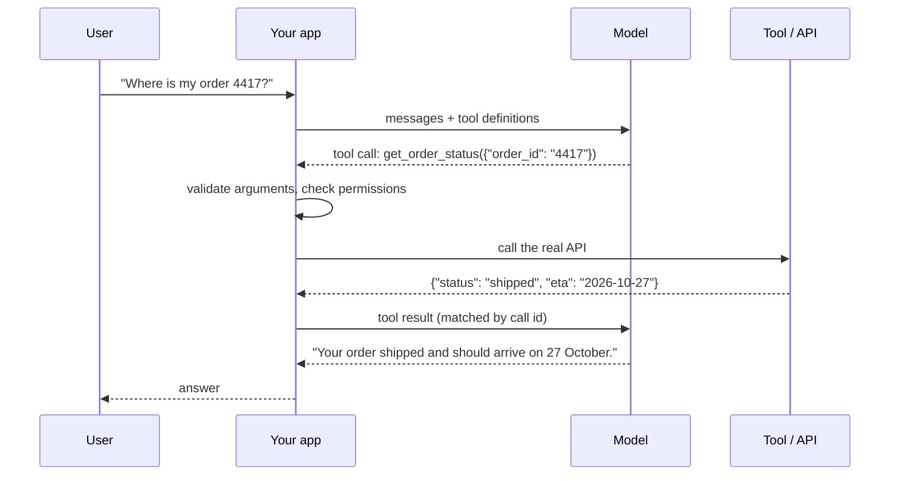

# Tool Calling

!!! abstract "TL;DR"
    Tool (function) calling lets a model act: you describe tools with **names, descriptions and JSON-schema parameters**; the model replies with a **structured call**; **your code executes it** and returns the result; the model continues or answers. The model never runs anything itself. Quality depends heavily on **tool design**: few, well-scoped tools, clear descriptions, typed parameters, concise results and helpful errors. Treat every call as untrusted input: **validate arguments, check the user's permissions, and confirm side effects**.

!!! evolution "Where this fits"
    **Before:** [prompting](prompting.md) and [structured output](prompting.md#structured-outputs); [RAG](rag.md) as a fixed retrieval step. **This page:** letting the model request actions and live data. **Next:** put tool calls in a loop → [AI Agents](agents.md); standardize tool access → [MCP & A2A](mcp.md).

## Why tools

LLMs on their own can't do exact arithmetic reliably, read live or private data, or take actions in other systems. Tools fill those gaps: search, databases, calculators and code execution, internal APIs (orders, tickets, calendars), and other models.

History in brief: Toolformer (2023) taught a model to insert API calls into its own text; in mid-2023 major model APIs added native **function calling**, and it's now a standard capability that agents and MCP build on.

## How it works



1. **Define tools** in the request: a name, a description, and a JSON schema for the parameters.
2. The model decides whether to call one. If it does, it returns a **tool call** (tool name, arguments as JSON, and an id) instead of, or alongside, text.
3. **Your application executes** the call. The model has no direct access to anything.
4. Send the **tool result** back, tied to the call id.
5. The model uses it to answer, or makes more calls. Several independent calls can be requested at once (**parallel tool calls**).

**Tool choice settings** typically include: let the model decide, require some tool call, force a specific tool, or disable tools.

**Under the hood:** tool definitions are rendered into the model's context in a format it was trained on, and the model was fine-tuned to emit calls in a parseable structure. Many APIs offer a strict mode that constrains decoding to the schema so arguments always parse. Tool definitions consume context tokens on every request, which matters when there are dozens of tools.

```python
# Provider-neutral sketch of the tool loop.
tools = [{
    "name": "get_order_status",
    "description": "Look up the shipping status of one order by its ID. "
                   "Use when the user asks where an order is or when it will arrive.",
    "parameters": {
        "type": "object",
        "properties": {
            "order_id": {"type": "string", "description": "Order number, digits only, e.g. '4417'."}
        },
        "required": ["order_id"],
    },
}]

messages = [{"role": "user", "content": user_text}]
for step in range(MAX_STEPS):                      # always bound the loop
    reply = llm.generate(messages=messages, tools=tools)
    messages.append(reply.as_message())
    if not reply.tool_calls:
        break                                      # final answer
    for call in reply.tool_calls:
        try:
            args = validate(call.name, call.arguments)        # schema + business rules
            authorize(current_user, call.name, args)          # the user's permissions
            result = run_tool(call.name, args, timeout_s=10)
        except ToolError as e:
            result = {"error": str(e)}                         # tell the model what went wrong
        messages.append(tool_result_message(call.id, result))
```

## Designing tools models use well

Write tools like documentation for a capable new colleague who can't ask you questions.

| Principle | Example |
|---|---|
| **Clear, specific names** | `search_tickets` and `get_ticket`, not `tool1` or an overloaded `tickets` |
| **Descriptions say when and how to use it** | Purpose, when to use it vs similar tools, what it returns, important limits |
| **Few, well-scoped tools** | Prefer one `schedule_meeting` over `list_users` + `list_events` + `create_event` if that's the real workflow |
| **Typed, constrained parameters** | Enums for fixed choices, formats for dates, required vs optional marked, units stated |
| **Make mistakes hard** | Accept absolute file paths only; require an explicit `confirm: true` for destructive actions |
| **Concise, relevant results** | Return the fields the model needs, not a 5,000-line JSON dump; paginate and truncate with a note |
| **Helpful errors** | "No order 4417 for this customer; orders found: 4471, 4418" lets the model recover |
| **Stable identifiers** | Return IDs the model can pass to the next tool |
| **Namespacing** | Prefix by system (`crm_search`, `billing_refund`) when there are many tools |

Test tools the way you test prompts: run realistic tasks, read the transcripts, and refine descriptions and parameters where the model hesitated or misused them.

## Executing calls safely

- **Validate** arguments against the schema and business rules (does this order belong to this customer? is the amount within limits?).
- **Authorize as the user**, not as the agent: the call should succeed only if the user could do it themselves. Avoid giving the model a super-user token.
- **Confirm side effects:** reads can run automatically; writes, payments, emails and deletions should require explicit confirmation or a policy check, especially early in deployment.
- **Timeouts, retries and idempotency:** network calls fail; retry safely with idempotency keys so a repeated "create refund" doesn't refund twice.
- **Sandbox code execution:** containers, no secrets in the environment, network limits, resource caps.
- **Treat tool results as untrusted data:** a web page or email can contain instructions meant to hijack the model (indirect prompt injection). See [Guardrails & Security](security.md).
- **Log every call** (inputs, outputs, latency, errors) for debugging and audits.

## Structured output and tool calling

Tool calling is also the most reliable way to get structured data out of a model: define a "tool" whose parameters are the schema you want (for example `record_extraction` with fields for name, date and amount) and force the model to call it. Many APIs also offer a direct structured-output mode with the same constrained-decoding guarantees.

## Failure modes

| Failure | Mitigation |
|---|---|
| Picks the wrong tool, or none | Better descriptions that say when to use each; fewer overlapping tools; examples |
| Invents argument values (an order ID the user never gave) | Instruct it to ask the user for missing information; validate against real data |
| Calls tools needlessly | Describe when a tool is *not* needed; measure calls per task |
| Ignores or misreads results | Return concise, labeled results; put errors in plain language |
| Loops (the same failing call repeatedly) | Step limits, duplicate-call detection, error messages that suggest alternatives |
| Overflows context with large results | Truncate, paginate, summarize, or return references the model can fetch selectively |
| Hijacked by injected instructions in results | Least-privilege tools, confirmation for side effects, isolate untrusted content |

## Evaluating tool use

- **Tool selection accuracy:** right tool (or no tool) for each request.
- **Argument correctness:** valid and correct values, measured against expected calls.
- **Task success:** the end state is correct (the refund was issued once, to the right order).
- **Efficiency:** number of calls, tokens, latency.
- **Recovery:** behavior when tools fail or return errors.
- **Safety:** no unauthorized or unconfirmed side effects.

Public benchmarks include the Berkeley Function Calling Leaderboard and τ-bench (multi-turn tasks with simulated users and tools), but your own task suite matters most.

## Interview questions

??? question "How does function calling work under the hood?"
    The application sends tool definitions (name, description, JSON-schema parameters) along with the conversation. They're rendered into the model's context in a format it was fine-tuned on, and the model has learned to emit a structured call (tool name plus JSON arguments, often with an id) when a tool would help. The API parses that into a tool-call object; the application executes the real function and sends back the result tagged with the call id; the model then continues. Constrained decoding in strict modes guarantees the arguments match the schema.

??? question "Does the model execute the tool?"
    No. The model only produces a request describing which tool to call with which arguments. Your code decides whether and how to run it, with your credentials, validation and permission checks. That separation is the main safety control: the application can refuse, ask for confirmation, or sanitize before anything happens.

??? question "How do you design a good tool interface for an LLM?"
    Give each tool a clear name and a description that explains what it does, when to use it versus similar tools, and what it returns. Keep the set small and aligned with real workflows rather than exposing every low-level API endpoint. Use typed parameters with enums, formats and descriptions; return concise, relevant results with stable IDs; paginate large outputs; and return actionable error messages. Then test with realistic tasks and refine based on transcripts.

??? question "How do you validate tool arguments and handle errors?"
    Validate against the JSON schema, then against business rules and the current user's permissions (the record exists, belongs to them, values are in range). On failure, don't crash: return a clear error as the tool result so the model can correct itself, ask the user, or try another approach. Add timeouts, retries with idempotency keys for writes, and a cap on repeated failing calls.

??? question "How do you stop a model from making up arguments?"
    Instruct it to ask the user when required information is missing, mark parameters as required with clear descriptions, validate values against real data (an order ID must exist for this customer), and return informative errors when they don't. Lookup tools (search, list) let the model find real IDs instead of guessing. Evaluate argument correctness on test conversations where information is deliberately missing.

??? question "Which tool calls should require human confirmation?"
    Calls with side effects that are costly, irreversible, external or sensitive: payments and refunds, sending messages or emails, deleting or modifying records, changing permissions, executing code outside a sandbox, and anything affecting other users. Reads and reversible, low-risk actions can run automatically. Start strict and relax confirmations as evaluation and monitoring build confidence.

??? question "Tool calling vs structured output: how are they related?"
    Both make the model emit JSON matching a schema. Tool calling frames it as a request to run a function and supports multi-step loops with results returned to the model; structured output frames it as the final answer's format. You can use a forced tool call purely as a structured-output mechanism, and many APIs implement both with the same constrained decoding.

??? question "What happens when you give a model 100 tools?"
    Tool definitions consume many context tokens on every request (cost, latency, and less room for real context), and selection accuracy drops as tools overlap and descriptions blur together. Mitigations: consolidate tools around workflows, namespace them, load tool subsets dynamically based on the task (tool search or routing), use sub-agents with focused tool sets, and evaluate selection accuracy as the catalog grows.

??? question "What are parallel tool calls and when are they useful?"
    The model requests several independent calls in one turn (for example the weather in three cities, or searching two databases), and the application runs them concurrently and returns all results together. It cuts latency and turns. The application must handle partial failures, and the calls must truly be independent; dependent steps still need sequential turns.

??? question "How do you evaluate an assistant's tool use?"
    Build test conversations with expected outcomes: which tool (or none) should be called, with what arguments, and what the final state should be. Measure tool-selection accuracy, argument correctness, task success on the end state, number of calls and tokens, behavior on tool errors and missing information, and the absence of unauthorized side effects. Run the suite on every prompt, tool or model change, and review transcripts of failures.

!!! pitfall "Common mistakes"
    - Giving the model broad credentials instead of acting with the user's permissions.
    - Exposing raw low-level APIs as dozens of overlapping tools.
    - Returning huge raw payloads as tool results.
    - Running write actions without confirmation or idempotency.
    - No step limit on the tool loop.

## Revision checklist

- [ ] Draw the request → execute → result loop and explain who runs what
- [ ] Write a good tool definition with description and schema
- [ ] List seven tool design principles
- [ ] Explain validation, authorization, confirmation, retries and sandboxing
- [ ] List tool-use failure modes and their fixes
- [ ] Define metrics for evaluating tool use

## Go deeper

- [Anthropic: tool use overview](https://platform.claude.com/docs/en/agents-and-tools/tool-use/overview)
- [Anthropic: Writing effective tools for agents](https://www.anthropic.com/research/writing-tools-for-agents)
- [OpenAI: function calling guide](https://platform.openai.com/docs/guides/function-calling)
- [Toolformer (2023)](https://arxiv.org/abs/2302.04761)
- [τ-bench (2024)](https://arxiv.org/abs/2406.12045)
