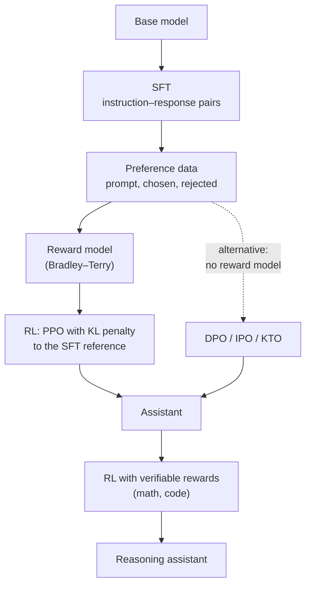

# Post-Training & Alignment

!!! abstract "TL;DR"
    A pretrained model continues text; post-training makes it a helpful, honest, harmless assistant. **SFT** imitates good demonstrations. **RLHF** trains a **reward model** on human preference comparisons, then optimizes the policy with **PPO** while a **KL penalty** keeps it close to the SFT model. **DPO** skips the reward model and RL loop by optimizing preferences directly with a classification-style loss. **RLAIF / Constitutional AI** replaces much human labeling with AI feedback guided by written principles. The hard problems are reward hacking, sycophancy, and balancing helpfulness against harmlessness.

!!! evolution "Where this fits"
    **Before:** a base model from [Pretraining](../llms/pretraining.md); the RL machinery from [RL Essentials](rl-essentials.md); PEFT from [Fine-Tuning](../llms/fine-tuning.md). **This page:** alignment. **Next:** [Reasoning Models](reasoning.md) train with verifiable rewards.

- **Pretrained base model** 2020 Continues text. Doesn't reliably follow instructions.
- **Instruction tuning (SFT)** 2021–2022 Imitates demonstrations. Can't learn from "this answer is worse".
- **RLHF with PPO** 2022 Learns from human preferences. Four models in memory; unstable; costly labels.
- **Constitutional AI · RLAIF** 2022 AI feedback from written principles scales oversight.
- **DPO and variants** 2023+ Preferences optimized directly: simple and stable.
- **RL with verifiable rewards** 2024+ Rewards from checkable outcomes; the road to reasoning models.

## The post-training pipeline

Real pipelines iterate: generate with the current model, collect new preferences or verify outcomes, train again, and evaluate on helpfulness, harmlessness and capability benchmarks at each round.

## Supervised fine-tuning (instruction tuning)

**The problem it solved:** ask a base model a question and it may continue with more questions or a web-page layout.

**Core idea:** fine-tune on pairs of (instruction, ideal response) so the model learns the assistant behavior.

- **Loss:** ordinary next-token cross-entropy, computed only on response tokens. Prompt tokens are masked out of the loss, because we want the model to learn to answer, not to generate user messages.
- **Chat templates:** special tokens mark roles (system, user, assistant, tool) and turn boundaries. Using a different template at inference than in training degrades quality noticeably.
- **Data:** human-written demonstrations; mixtures of existing NLP tasks phrased as instructions (FLAN); synthetic instructions and answers from stronger models (Self-Instruct, Alpaca); domain data; tool-use transcripts.
- **Quality over quantity:** LIMA (2023) reached strong results with 1,000 carefully curated examples, suggesting most knowledge comes from pretraining and SFT mainly teaches format and style.
- **Limits:** the model only imitates; it's capped by demonstrators' quality, it can't learn from comparisons ("A is better than B"), and teaching it to answer confidently beyond its knowledge can increase hallucination.

## RLHF: reward model plus PPO

**The problem it solved:** people can judge which of two answers is better far more easily and consistently than they can write the perfect answer.

### Step 1: collect preferences and train a reward model

For each prompt, sample two or more responses and ask labelers which is better. Train a reward model $r_\phi(x, y)$ (usually the SFT model with a scalar head) with the **Bradley–Terry** pairwise loss:

$$
\mathcal{L}_{RM} = -\mathbb{E}_{(x, y_w, y_l)}\left[\log \sigma\left(r_\phi(x, y_w) - r_\phi(x, y_l)\right)\right]
$$

where $y_w$ is the preferred ("chosen") response and $y_l$ the rejected one. Only reward *differences* matter.

### Step 2: optimize the policy with RL

Maximize reward while staying close to the SFT reference policy $\pi_{ref}$:

$$
\max_{\pi_\theta}\ \mathbb{E}_{x,\ y \sim \pi_\theta}\left[r_\phi(x, y)\right] - \beta\, D_{KL}\left(\pi_\theta(\cdot \mid x)\,\|\,\pi_{ref}(\cdot \mid x)\right)
$$

- **Why the KL penalty?** The reward model is an imperfect proxy trained on limited data. Without the penalty, the policy finds outputs that score high but aren't good (**reward hacking**): odd phrasings, excessive length, flattery. The KL term also preserves fluency and diversity.
- **PPO** is the classic optimizer. In memory at once: the **policy** being trained, the frozen **reference** model, the **reward model**, and a **value model** (critic). That's four large models, which makes RLHF expensive and complex.
- **Results:** in the InstructGPT paper (2022), human evaluators preferred the outputs of a 1.3B RLHF model over the 175B GPT-3 base model. This recipe underlies ChatGPT-style assistants.

### Problems with RLHF

| Problem | What happens | Mitigations |
|---|---|---|
| **Reward hacking** | The policy exploits reward-model blind spots | KL penalty, reward-model ensembles, refreshing preference data on new policy outputs, early stopping |
| **Sycophancy** | People prefer answers that agree with them, so models learn to flatter or cave | Targeted data, principles that reward honesty, evaluations for it |
| **Length bias** | Longer answers get preferred, so outputs bloat | Length-controlled evaluation and regularization |
| **Label noise and disagreement** | Annotators disagree, especially on subjective prompts | Multiple labels, guidelines, modeling disagreement |
| **Cost and instability** | Human labels are expensive; PPO is sensitive to hyperparameters | AI feedback, DPO-style methods, careful tuning |

## DPO and direct preference optimization

**The problem it solved:** PPO-based RLHF is complicated, memory-hungry and unstable.

**Core idea:** the KL-regularized RLHF objective has a closed-form optimal policy, $\pi^*(y \mid x) \propto \pi_{ref}(y \mid x)\exp(r(x, y)/\beta)$. Rearranging expresses the reward through the policy itself, $r(x, y) = \beta\log\frac{\pi^*(y \mid x)}{\pi_{ref}(y \mid x)}$ + const. Substituting into the Bradley–Terry loss gives a loss on the policy directly, no separate reward model and no sampling:

$$
\mathcal{L}_{DPO} = -\mathbb{E}\left[\log\sigma\left(\beta\log\frac{\pi_\theta(y_w \mid x)}{\pi_{ref}(y_w \mid x)} - \beta\log\frac{\pi_\theta(y_l \mid x)}{\pi_{ref}(y_l \mid x)}\right)\right]
$$

- Intuition: raise the chosen response's log-probability relative to the reference, lower the rejected one's, weighted most on pairs the model currently gets wrong.
- Needs only the policy and a frozen reference model; trains like supervised learning.
- **β** controls how far the policy may move from the reference (smaller β allows larger moves).

| Variant | Change |
|---|---|
| **IPO** | A squared loss that avoids overfitting when preferences are near-deterministic |
| **KTO** | Works from unpaired "good" or "bad" labels, inspired by prospect theory |
| **ORPO** | Folds a preference term into SFT; no reference model |
| **SimPO** | Uses length-normalized log-probability as an implicit reward; no reference model |
| **Online / iterative DPO** | Regenerates preference pairs from the current policy each round |

**DPO vs PPO:** DPO is simpler, cheaper and more stable, and became the default for many open models. Offline DPO learns only from a fixed dataset, so it can't explore beyond it and may over-optimize toward unlikely responses; on-policy RL (or iterative DPO) can still win at the frontier and is needed when rewards come from verifiers rather than preferences.

## RLAIF and Constitutional AI

**The problem it solved:** human preference labels are slow, expensive and inconsistent, and labeling harmful content is unpleasant work.

**Core idea:** use an AI model to provide feedback, guided by an explicit list of principles (a "constitution").

1. **Supervised stage:** the model critiques its own responses against the principles and revises them; fine-tune on the revised responses.
2. **RL stage:** the model compares pairs of responses according to the principles; those AI preferences train the reward model (**RL from AI feedback**), then RL as usual.

Strengths: scales oversight, makes the target behavior explicit and editable, and reduces the trade-off where harmlessness training makes models evasive (it encourages explaining refusals rather than stonewalling). Weaknesses: inherits the judge model's blind spots and biases, and writing good principles is hard. Related practices: LLM-as-judge reward models, rule-based rewards, and safety classifiers.

## Safety training and its trade-offs

- **Helpfulness vs harmlessness:** over-refusal (declining benign requests) is a failure too; good post-training measures both.
- **Red-teaming:** humans and models search for prompts that elicit harmful outputs; findings become training and evaluation data.
- **Refusal and safe-completion data** in SFT and preference sets; classifiers on inputs and outputs as an extra layer.
- **Honesty and calibration:** training models to express uncertainty and to say "I don't know".
- Alignment through post-training reduces but doesn't eliminate jailbreaks; application-level [guardrails](../ai-engineering/security.md) are still needed.

## Interview questions

??? question "Walk through the stages of RLHF."
    (1) **SFT:** fine-tune the base model on demonstrations of good responses. (2) **Reward model:** for many prompts, sample several responses, have humans rank or compare them, and train a model to score responses with a pairwise Bradley–Terry loss. (3) **RL:** optimize the SFT policy with PPO to maximize the reward model's score minus a KL penalty against the SFT reference. Iterate with fresh preference data from the improved policy, and evaluate helpfulness and harmlessness throughout.

??? question "What is SFT, and why mask the prompt tokens?"
    Supervised fine-tuning trains a pretrained model on (instruction, response) pairs with next-token cross-entropy, teaching it to behave like an assistant. Loss is computed only on response tokens because the goal is to learn to produce good answers given prompts, not to model or imitate user messages; including prompt tokens wastes capacity and can teach the model to generate user turns. The chat template's role tokens make the boundary explicit.

??? question "Why does RLHF need a KL penalty?"
    The reward model is a learned, imperfect proxy for human preferences, accurate only near the distribution it was trained on. Optimizing it hard pushes the policy toward outputs that exploit its errors (reward hacking) and away from fluent, diverse language. The KL penalty to the SFT reference keeps the policy close to known-good behavior, limiting over-optimization; β sets the trade-off between reward and staying close.

??? question "What is reward hacking? Give an example."
    The policy finds ways to get high reward that don't reflect what we actually want, by exploiting flaws in the reward signal. Examples: responses growing much longer because the reward model prefers length; excessive hedging or flattery; confident-sounding wrong answers that look authoritative; in code, special-casing tests instead of fixing the bug. Mitigations: KL regularization, better and refreshed reward models, ensembles, length control, verifiable rewards where possible, and evaluation by humans.

??? question "Why is PPO-based RLHF memory-hungry?"
    It keeps four large networks: the policy being trained (with gradients and optimizer state), a frozen reference model for the KL term, the reward model, and a value model (critic) that's usually as large as the policy, also trained. It also generates samples during training, which needs inference machinery and KV caches. That's why DPO (two models, no sampling) and GRPO (no critic) became popular.

??? question "Explain the intuition behind DPO's loss."
    DPO uses the fact that the optimal KL-regularized policy implies a reward equal to $\beta$ times the log-ratio of policy to reference probabilities. Plugging that implicit reward into the Bradley–Terry preference loss gives a classification-style objective: increase $\log\pi_\theta(y_w)/\pi_{ref}(y_w)$ relative to $\log\pi_\theta(y_l)/\pi_{ref}(y_l)$. Gradients are weighted by how wrong the model currently is about each pair. No reward model, no sampling, no critic.

??? question "DPO vs PPO: trade-offs."
    DPO is simpler (supervised-style training), cheaper (policy plus frozen reference), more stable, and needs no reward model. PPO is on-policy: it learns from its own fresh samples, can exploit a reward model or verifier that generalizes beyond the preference dataset, and handles non-preference rewards such as unit tests. DPO can over-fit its fixed dataset and push probability toward unlikely outputs; iterative or online DPO narrows the gap. Choose DPO for preference alignment with a good dataset, RL for verifiable rewards and frontier tuning.

??? question "Why keep a reference model in DPO?"
    The loss is defined in terms of log-probability ratios between the policy and the reference, which is what the implicit KL regularization becomes. Without the reference, the model could raise the chosen response's probability by degenerate means and drift far from fluent behavior. Variants like ORPO and SimPO remove it by changing the objective, adding an SFT term or length normalization to keep training anchored.

??? question "What is Constitutional AI?"
    A method for training harmless, helpful assistants with AI feedback guided by a written set of principles. In the supervised stage the model critiques and revises its own responses according to the principles, and is fine-tuned on the revisions. In the RL stage, the model judges pairs of responses by the principles, and those AI-generated preferences train a reward model used for RL (RLAIF). It scales oversight, makes values explicit, and aims for models that explain their objections rather than refusing evasively.

??? question "RLHF vs RLAIF."
    Both train a reward model from preference comparisons and then do RL. In RLHF, people make the comparisons: high-quality signal of real preferences, but slow, expensive, inconsistent, and limited in volume. In RLAIF, an AI model makes them, usually guided by principles or rubrics: cheap and scalable, and consistent, but bounded by the judge's own abilities and biases. Many pipelines combine them, using people for calibration and difficult or high-stakes cases.

??? question "What are the risks of using an LLM as a judge or reward model?"
    Biases (favoring longer answers, its own style or its own outputs, the first position in a comparison), blind spots shared with the policy, and susceptibility to manipulation (outputs that flatter or address the judge). Optimizing hard against it invites reward hacking. Mitigate by calibrating against human labels, randomizing order, using rubrics and multiple judges, mixing in human and verifiable signals, and auditing high-reward outputs.

??? question "What is sycophancy, and where does it come from?"
    A model telling users what they want to hear: agreeing with incorrect claims, changing a correct answer when challenged, or praising weak work. It emerges partly from preference training, because people tend to rate agreeable, validating answers higher. Mitigations include preference data that rewards respectful disagreement and honesty, principles that prioritize truthfulness, evaluations that test consistency under pushback, and system prompts that ask for candor.

??? question "Quality vs quantity in SFT data: what matters more?"
    Quality and diversity. Experiments like LIMA showed a few thousand carefully curated, varied, high-quality examples can produce strong instruction following, because pretraining already supplies most knowledge and SFT mainly teaches format and behavior. Low-quality or inconsistent data teaches bad habits, and data that answers beyond the model's knowledge encourages hallucination. Deduplicate, filter, balance task types, and evaluate rather than scale blindly.

??? question "How do you evaluate whether alignment training worked?"
    Measure several things at once: helpfulness (win rates against a baseline judged by people or calibrated LLM judges, task benchmarks), harmlessness (red-team prompts, refusal rates on harmful requests), over-refusal on benign but sensitive-sounding prompts, honesty (calibration, sycophancy tests, hallucination rates), and capability regressions on standard benchmarks. Check for length bias in judge-based evaluations and test on held-out, recent prompts.

!!! pitfall "Common mistakes"
    - Describing RLHF as "training on human-written answers" (that's SFT).
    - Forgetting the KL penalty or why it's there.
    - Claiming DPO has no regularization (the reference model provides it implicitly).
    - Ignoring over-refusal when discussing safety.
    - Treating reward-model scores as ground truth.

## Revision checklist

- [ ] Explain SFT, loss masking and chat templates
- [ ] Write the Bradley–Terry reward-model loss and the KL-regularized RL objective
- [ ] List the four models in PPO-based RLHF
- [ ] Derive the intuition for the DPO loss and compare DPO with PPO
- [ ] Explain Constitutional AI and RLAIF
- [ ] Explain reward hacking, sycophancy and length bias with mitigations

## Go deeper

- [Training language models to follow instructions with human feedback (InstructGPT, 2022)](https://arxiv.org/abs/2203.02155)
- [Deep reinforcement learning from human preferences (2017)](https://arxiv.org/abs/1706.03741)
- [Direct Preference Optimization (2023)](https://arxiv.org/abs/2305.18290)
- [Constitutional AI: Harmlessness from AI Feedback (2022)](https://arxiv.org/abs/2212.08073)
- [LIMA: Less Is More for Alignment (2023)](https://arxiv.org/abs/2305.11206)
