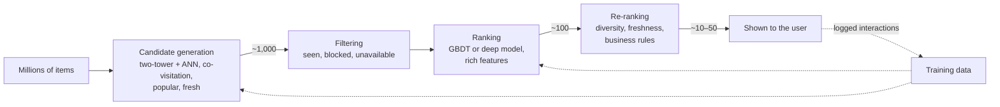

# Recommender Systems

!!! abstract "TL;DR"
    Recommenders predict what each user will want from millions of items. **Collaborative filtering** learns from interaction patterns; **matrix factorization** represents users and items as vectors whose dot product predicts affinity. Production systems use **stages**: fast candidate retrieval (two-tower models plus approximate nearest-neighbor search) narrows millions of items to hundreds, a heavier **ranking** model scores them, and **re-ranking** adds diversity and business rules. The hard parts are cold start, implicit feedback, position bias and feedback loops.

!!! evolution "Where this fits"
    **Before:** [kNN](knn-nb-svm.md) (neighbors), [SVD and PCA](unsupervised.md) (low rank), [ranking metrics](../foundations/evaluation.md). **This page:** the most common ML system design topic. **Next:** two-tower retrieval is the same machinery as [dense retrieval for RAG](../ai-engineering/embeddings.md); full designs are on [ML System Design](../production/ml-system-design.md).

## Feedback: explicit vs implicit

| | Explicit | Implicit |
|---|---|---|
| Examples | Star ratings, thumbs up or down | Clicks, views, watch time, purchases, skips |
| Volume | Sparse | Abundant |
| Meaning | Clear preference, positive or negative | Noisy; a non-click may mean "didn't see it", not "dislike" |
| Typical loss | Regression on ratings (RMSE) | Ranking or classification losses with negative sampling |

Most real systems run on implicit feedback, which is why negative sampling and bias correction matter so much.

## Approaches

### Content-based filtering

Recommend items similar to what a user liked, using item features (text, category, embeddings of images or descriptions). Works for new items and niche users, but tends to over-specialize (more of the same) and needs good item features.

### Collaborative filtering

Use the interaction matrix alone: users who behaved similarly will like similar things.

- **User–user:** find users similar to you (cosine or Pearson similarity on their interaction vectors) and recommend what they liked.
- **Item–item:** recommend items similar to the ones you interacted with, where similarity is computed from co-interaction patterns. Item–item is more stable (items change less than users) and was popularized by Amazon's "customers who bought this also bought".

### Matrix factorization

Approximate the sparse user–item matrix $R$ ($m$ users × $n$ items) as a product of low-rank factors:

$$
R \approx U V^\top \qquad \hat r_{ui} = u_u^\top v_i + b_u + b_i + \mu
$$

with user vectors $u_u$ and item vectors $v_i$ of dimension $k \ll \min(m, n)$, plus user, item and global biases. Train on observed entries only, with L2 regularization:

$$
\min \sum_{(u,i)\ \text{observed}} \left(r_{ui} - \hat r_{ui}\right)^2 + \lambda\left(\|u_u\|^2 + \|v_i\|^2\right)
$$

- **SGD** or **alternating least squares (ALS)**: fix item vectors and solve for users in closed form, then swap; parallel and suited to implicit feedback with confidence weights.
- The Netflix Prize (2006–2009) made matrix factorization the standard approach.
- Plain SVD needs a full matrix, so in practice we use regularized factorization on observed entries.

### Neural recommenders

| Model | Idea |
|---|---|
| **Two-tower (dual encoder)** | A user tower and an item tower each produce an embedding; score = dot product. Item embeddings are precomputed and indexed for fast retrieval. |
| **Wide & Deep (2016)** | A linear "wide" part memorizes feature crosses; a deep part generalizes through embeddings. |
| **DeepFM, DCN** | Learn feature interactions automatically (factorization machines, cross networks). |
| **DLRM** | Embedding tables for sparse IDs plus MLPs for dense features, with pairwise interactions. |
| **Sequential models** | Transformers or RNNs over a user's recent history (for example SASRec, BERT4Rec) to capture short-term intent. |

## The multi-stage architecture

- **Why stages?** Scoring millions of items with a heavy model per request is impossible within a latency budget of roughly 100–200 ms. Cheap, high-recall retrieval narrows the set; expensive, high-precision ranking orders it.
- **Retrieval** is optimized for recall@k; it often merges several sources (embedding similarity, co-visitation, trending, followed creators).
- **Ranking** predicts engagement (click, watch time, purchase, often several objectives combined) with many features: user history, item stats, context (time, device), and cross features.
- **Re-ranking** enforces diversity (for example maximal marginal relevance), freshness, fairness to creators, and policy.

### Training a two-tower retriever

Positives are observed interactions. Negatives are usually **in-batch negatives** (other users' positives in the same batch), trained with a softmax or contrastive loss. Because popular items appear as in-batch negatives more often, apply a **log-frequency correction** so popular items aren't over-penalized. Add **hard negatives** (items the user saw and skipped) for sharper ranking.

## The hard problems

| Problem | What happens | Mitigations |
|---|---|---|
| **Cold start: new users** | No history | Onboarding questions, popular and trending items, context (location, device, referrer), fast session-based updates |
| **Cold start: new items** | No interactions | Content features and embeddings, exploration slots, creator priors |
| **Position bias** | Top slots get clicked more regardless of quality | Log positions, model position as a feature at training and fix it at serving, randomization, inverse propensity weighting |
| **Popularity bias** | Popular items get more exposure and more data | Frequency correction, calibrated diversity, exposure caps |
| **Feedback loops** | The model trains on data its own choices produced | Exploration (bandits), random holdout traffic, counterfactual evaluation |
| **Implicit negatives** | Non-interaction isn't dislike | Negative sampling, impressions as negatives, confidence weighting |
| **Short-term vs long-term** | Clickbait raises clicks, lowers satisfaction | Multi-objective ranking, long-term holdouts, satisfaction surveys |

## Evaluation

- **Offline:** recall@k and hit rate for retrieval; NDCG, MAP and AUC for ranking; coverage, diversity and novelty; always on a **time-based split** (train on the past, evaluate on the next period).
- **Online:** click-through rate, watch time, conversion, retention, session length; guardrails like latency and complaint rates.
- Offline metrics computed on logs from the old model are biased by its choices; counterfactual methods (inverse propensity scoring) and interleaving help.

## Interview questions

??? question "Collaborative filtering vs content-based filtering."
    Collaborative filtering uses only interaction patterns (users who liked X also liked Y); it discovers non-obvious relationships and needs no item features, but fails on new users and items (cold start) and favors popular items. Content-based filtering uses item and user features; it works for new items and niche interests but needs good features and tends to recommend more of the same. Production systems are hybrids, for example two-tower models that include both IDs and content features.

??? question "Explain matrix factorization for recommendations."
    Represent each user and item by a $k$-dimensional vector so that their dot product (plus biases) predicts the interaction. Learn the vectors by minimizing squared error on observed entries with L2 regularization, using SGD or alternating least squares. The low rank forces the model to find latent factors (genre, style, price level) shared across users and items, which generalizes to unobserved pairs.

??? question "How do you handle cold start?"
    **New users:** popular or trending items, items popular in their context (location, device, traffic source), a short onboarding to collect preferences, and quick adaptation from the first few interactions in the session. **New items:** content-based embeddings (text, image, metadata) so the item tower can embed them without history, creator or category priors, and exploration slots (bandits) to gather interactions. Measure cold-start segments separately.

??? question "Why use candidate generation and ranking as separate stages?"
    Latency and cost. A rich ranking model with hundreds of features can score a few hundred items per request, not millions. Candidate generation uses cheap methods (precomputed item embeddings with approximate nearest-neighbor search, co-visitation lists) optimized for recall, so the ranker only sees plausible items and can optimize precision. Stages also let teams improve retrieval and ranking independently.

??? question "How is a two-tower model trained and served?"
    Train with positive (user, item) pairs from interactions and negatives from other items in the batch, using a softmax or contrastive loss over dot-product scores, with a correction for item popularity. At serving time, precompute all item embeddings and load them into an approximate nearest-neighbor index; compute the user embedding per request from recent features and retrieve the top items by dot product. Rebuild the index regularly to include new items.

??? question "What is position bias and how do you correct for it?"
    Items shown higher get more clicks regardless of relevance, so naive training on click logs learns "position" rather than quality and reinforces the existing ranking. Corrections: include position as a feature during training and set it to a constant at serving; inverse propensity weighting using click-propensity estimates per position (from randomized experiments); and occasional randomized ordering to measure propensities.

??? question "How do you evaluate a recommender offline and online?"
    Offline, on a time-based split: recall@k and hit rate for retrieval, NDCG or MAP for ranking, plus coverage, diversity and novelty, broken down by user segment (new vs heavy users). Online, with an A/B test: the primary engagement or business metric (watch time, purchases, retention), guardrails (latency, complaints, creator exposure), and long-term holdouts to catch short-term gains that hurt satisfaction.

??? question "What are feedback loops in recommendation, and why are they dangerous?"
    The model decides what users see, users can only interact with what they see, and the next model trains on those interactions. Items the model ignores never get data, popular items get more popular, and errors compound. Use exploration (a share of traffic for bandit-style exploration or random items), log impressions and propensities, keep a small random holdout to measure true preferences, and diversify.

??? question "How do you handle implicit feedback with no explicit negatives?"
    Treat interactions as positives with confidence weights (watch time, repeat purchases), and sample negatives: random items, in-batch negatives, or impressions the user saw but skipped (the most informative). Use ranking losses (BPR, sampled softmax) instead of rating regression. Account for exposure: an item never shown is unknown, not disliked.

??? question "Design a 'people you may know' or 'similar items' feature."
    Candidates from graph signals (friends of friends, shared groups or contacts) or from co-interaction and embedding similarity for items; rank with features such as mutual connections, interaction recency, embedding similarity and context, trained on accept or click labels; re-rank for diversity and privacy rules; evaluate offline with recall@k and AUC on a time split, online with acceptance rate and downstream engagement; guard against privacy harms (don't surface sensitive connections) and feedback loops.

!!! pitfall "Common mistakes"
    - Random splits instead of time-based splits.
    - Treating unclicked items as disliked without considering exposure.
    - Optimizing click-through alone and getting clickbait.
    - Ignoring cold-start segments in evaluation.
    - Forgetting latency budgets when proposing a heavy ranking model.

## Revision checklist

- [ ] Compare explicit and implicit feedback
- [ ] Write the matrix factorization objective and how ALS works
- [ ] Draw the retrieval → ranking → re-ranking funnel with rough sizes
- [ ] Explain two-tower training with in-batch negatives and popularity correction
- [ ] List cold start, position bias and feedback loop mitigations

## Go deeper

- [Deep Neural Networks for YouTube Recommendations (2016)](https://research.google/pubs/deep-neural-networks-for-youtube-recommendations/)
- [Wide & Deep Learning for Recommender Systems (2016)](https://arxiv.org/abs/1606.07792)
- [Matrix Factorization Techniques for Recommender Systems (Koren, Bell, Volinsky, 2009)](https://ieeexplore.ieee.org/document/5197422)
