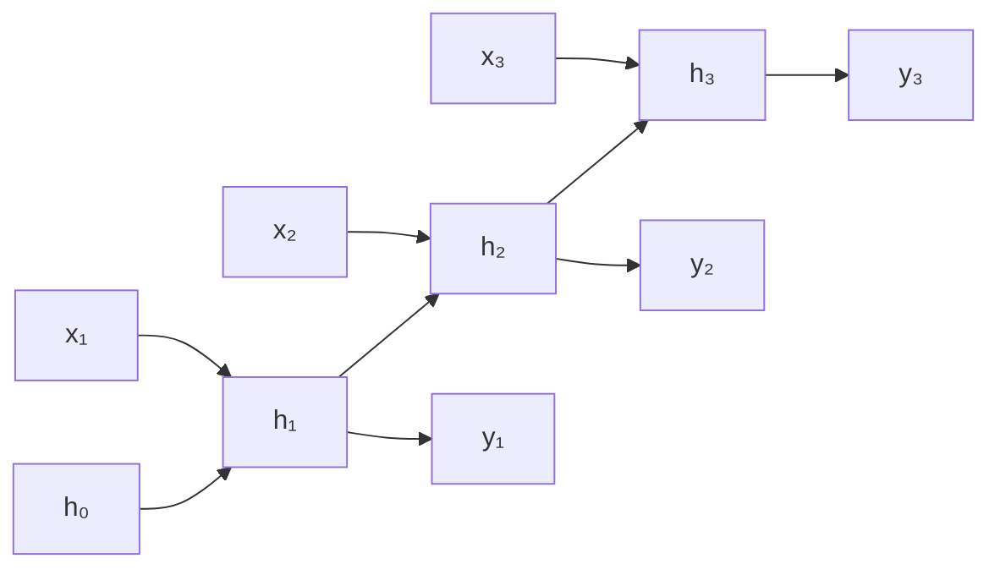
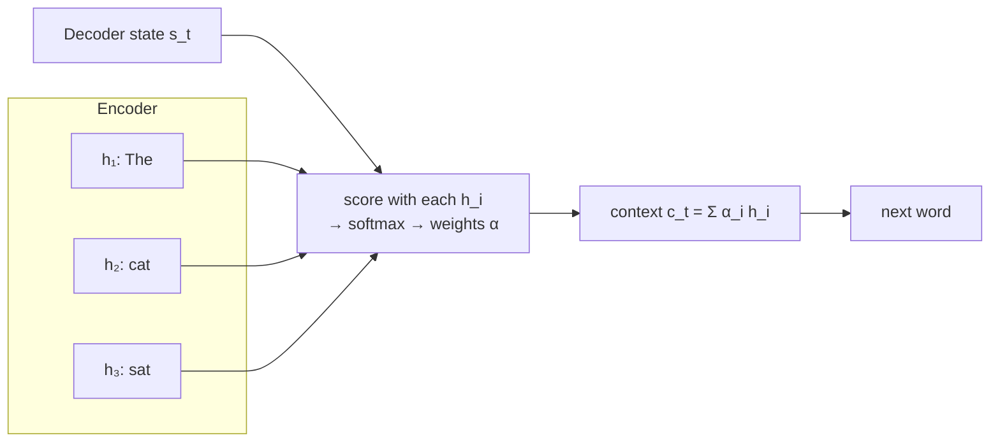

# Sequence Models (RNN to Attention)

!!! abstract "TL;DR"
    Text started as **counts** (bag of words, TF-IDF, n-grams), which ignore meaning. **word2vec** learned dense word vectors from context. **RNNs** read sequences with a hidden state but forget long-range information because gradients vanish, and they can't be parallelized over time. **LSTMs and GRUs** add gates that protect memory. **Seq2seq** encoder–decoders made translation work but squeezed the input into one vector; **attention** let the decoder look back at every input state, and that idea became the Transformer.

!!! evolution "Where this fits"
    **Before:** [Neural Network Fundamentals](neural-networks.md) and [Training](training.md). **This page:** the background you need to explain *why* attention was invented. **Next:** [The Transformer](../llms/transformer.md) keeps attention and drops recurrence.

- **Bag of words · TF-IDF · n-grams** 1950s–1990s Counts. No meaning, short context.
- **word2vec · GloVe · fastText** 2013–2016 Dense meaning, but one vector per word.
- **RNN** 1986–1990 Sequence memory, but vanishing gradients and no parallelism.
- **LSTM · GRU** 1997 · 2014 Gates keep memory for hundreds of steps. Still sequential.
- **Seq2seq** 2014 Encoder–decoder for translation; one fixed-size context vector.
- **Attention** 2014–2015 The decoder attends to all encoder states. Still on top of RNNs.
- **Transformer** 2017 Attention only.

## Representing text as numbers

### Bag of words, TF-IDF and BM25

**The problem:** models need fixed-size numeric input; text is a variable-length sequence of symbols.

- **Bag of words:** a vector of word counts over the vocabulary. Order and meaning are lost; vectors are huge and sparse.
- **TF-IDF** weights each term by how rare it is across documents: $\text{tfidf}(t, d) = \text{tf}(t, d) \cdot \log\frac{N}{\text{df}(t)}$. Common words like "the" get low weight.
- **BM25** improves on TF-IDF with term-frequency saturation (the 10th occurrence adds less than the 2nd) and document-length normalization. It's still the keyword half of [hybrid search in RAG](../ai-engineering/rag.md), because it's excellent at exact terms, names, codes and IDs.

### n-gram language models

A language model assigns probabilities to sequences. An n-gram model approximates $P(w_t \mid w_{<t}) \approx P(w_t \mid w_{t-n+1}, \dots, w_{t-1})$ from counts. It needs **smoothing** (add-k, Kneser–Ney) for unseen n-grams, and its context window is tiny because the number of possible n-grams explodes with $n$.

### Word embeddings: word2vec, GloVe, fastText

**The problem:** one-hot vectors treat "car" and "automobile" as unrelated as "car" and "banana".

**Core idea:** *you shall know a word by the company it keeps.* Learn dense vectors (100–300 dimensions) so words used in similar contexts are close.

| Method | How it learns | Notes |
|---|---|---|
| **word2vec skip-gram** (2013) | Predict context words from the center word | Good for rare words |
| **word2vec CBOW** | Predict the center word from its context | Faster; good for frequent words |
| **Negative sampling** | Instead of a softmax over the whole vocabulary, classify the true context word against a few random "negative" words | Makes training cheap; an early form of contrastive learning |
| **GloVe** (2014) | Factorize global word co-occurrence statistics | Combines counting and prediction |
| **fastText** (2016) | Represent a word as a sum of character n-gram vectors | Handles misspellings and unseen words |

Famous property: $\vec{king} - \vec{man} + \vec{woman} \approx \vec{queen}$. Limitation: **one vector per word**, so "bank" (river) and "bank" (money) share a vector; and embeddings absorb social biases present in text. Contextual embeddings (ELMo, BERT) fixed the first problem.

## Recurrent neural networks

**The problem:** feed-forward networks take fixed-size input, but sentences, audio and time series have variable length and order matters.

**Core idea:** read one step at a time and carry a hidden state that summarizes everything seen so far, reusing the same weights at every step:

$$
h_t = \tanh(W_h h_{t-1} + W_x x_t + b) \qquad y_t = W_y h_t
$$

- **Training:** unroll the network through time and backpropagate (**backpropagation through time**, BPTT); for long sequences, truncate it to a fixed window.
- **Shapes of tasks:** many-to-one (sentiment), one-to-many (image captioning), many-to-many aligned (tagging) or unaligned (translation).
- **Bidirectional RNNs** run a second RNN backward and concatenate states. Useful for tagging and classification, impossible for generation, where the future isn't known.

### Why RNNs struggle

1. **Vanishing and exploding gradients.** The gradient from step $t$ back to step $k$ contains a product of $t - k$ Jacobians $\frac{\partial h_i}{\partial h_{i-1}} = \text{diag}(\tanh') \cdot W_h$. If their norms are below 1, the product shrinks exponentially, so the model can't learn dependencies more than about 10–20 steps back; above 1, it explodes (fixed by gradient clipping).
2. **No parallelism over time.** $h_t$ needs $h_{t-1}$, so a sequence of 1,000 tokens needs 1,000 sequential steps. GPUs are wasted.
3. **A fixed-size bottleneck.** All history must fit into one hidden vector.

## LSTM

**The problem it solved:** plain RNNs forget after a few steps.

**Core idea:** add a separate **cell state** that flows through time with only element-wise, **additive** updates, controlled by gates that decide what to forget, what to write and what to expose.

$$
\begin{aligned}
f_t &= \sigma(W_f[h_{t-1}, x_t] + b_f) &&\text{forget gate: what to erase}\\
i_t &= \sigma(W_i[h_{t-1}, x_t] + b_i) &&\text{input gate: what to write}\\
\tilde c_t &= \tanh(W_c[h_{t-1}, x_t] + b_c) &&\text{candidate content}\\
c_t &= f_t \odot c_{t-1} + i_t \odot \tilde c_t &&\text{cell state update}\\
o_t &= \sigma(W_o[h_{t-1}, x_t] + b_o) &&\text{output gate: what to expose}\\
h_t &= o_t \odot \tanh(c_t)
\end{aligned}
$$

**Why it helps gradients:** $\frac{\partial c_t}{\partial c_{t-1}} = f_t$ (element-wise). When the forget gate stays near 1, the gradient passes through many steps nearly unchanged, instead of being multiplied by a weight matrix and a squashing derivative each step. Initializing the forget-gate bias to about 1 helps.

**Parameters:** four gate blocks, each with input and recurrent weights: $4\left(h(h + d) + h\right)$ for hidden size $h$ and input size $d$, about four times a plain RNN.

LSTMs powered speech recognition, handwriting recognition and machine translation from about 2014 to 2017.

## GRU

**The problem it solved:** LSTMs are heavy.

**Core idea:** merge the forget and input gates into one **update gate** $z_t$, add a **reset gate** $r_t$, and drop the separate cell state:

$$
z_t = \sigma(W_z[h_{t-1}, x_t]),\quad r_t = \sigma(W_r[h_{t-1}, x_t]),\quad \tilde h_t = \tanh(W[r_t \odot h_{t-1}, x_t]),\quad h_t = (1 - z_t)\odot h_{t-1} + z_t \odot \tilde h_t
$$

Three blocks instead of four, so about 25% fewer parameters and faster training, with similar accuracy on most tasks.

| | Plain RNN | LSTM | GRU |
|---|---|---|---|
| Memory over long ranges | Poor | Good | Good |
| Gates | None | Forget, input, output | Update, reset |
| Parameter blocks | 1 | 4 | 3 |
| Separate cell state | No | Yes | No |
| Parallel over time | No | No | No |

## Seq2seq: encoder–decoder

**The problem it solved:** translation maps a sequence to another sequence of a different length.

**Core idea:** an encoder RNN reads the source and compresses it into a context vector (its final hidden state); a decoder RNN generates the target one token at a time from that vector.

- **Teacher forcing:** during training, feed the decoder the *true* previous token rather than its own prediction. Fast and stable, but creates **exposure bias**: at inference the model sees its own mistakes, which it never saw in training. Scheduled sampling mixes in the model's own predictions.
- **Decoding:** greedy (take the most likely token) or **beam search** (keep the top $B$ partial translations at each step).
- **The bottleneck:** one fixed-size vector must hold the entire source sentence, so quality dropped sharply for long sentences. Reversing the source word order helped, a clue that distance was the problem.

## Attention

**The problem it solved:** the single context vector bottleneck.

**Core idea:** at every decoding step, compute a weighted average of **all** encoder hidden states, with weights given by how relevant each source position is to what the decoder is producing now.

$$
e_{t,i} = \text{score}(s_{t-1}, h_i),\qquad \alpha_{t,i} = \frac{\exp(e_{t,i})}{\sum_j \exp(e_{t,j})},\qquad c_t = \sum_i \alpha_{t,i}\, h_i
$$

| Variant | Score function | Notes |
|---|---|---|
| **Additive (Bahdanau, 2014)** | $v^\top \tanh(W_1 s + W_2 h)$ | A small MLP; the first neural attention for translation |
| **Multiplicative (Luong, 2015)** | $s^\top W h$ or $s^\top h$ | Cheaper; a matrix product |
| **Scaled dot-product (2017)** | $\frac{q^\top k}{\sqrt{d_k}}$ | What Transformers use |

The attention weights act as a soft **alignment** between source and target words, which you can visualize. Long-sentence translation improved dramatically.

**What came next, and why:** attention was doing the important work, but it still sat on top of slow, sequential RNNs. "Attention Is All You Need" (2017) removed the recurrence: every token attends to every other token directly (**self-attention**), all positions are computed in parallel, and positional encodings supply order. See [The Transformer](../llms/transformer.md).

## Interview questions

??? question "Explain TF-IDF and when BM25 is better."
    TF-IDF scores a term in a document by its frequency in the document times the log of its inverse document frequency, so terms that are frequent here but rare overall score high. BM25 refines this with term-frequency saturation (repeated occurrences add diminishing value) and normalization by document length relative to the average, with parameters $k_1$ and $b$. BM25 ranks better in practice and remains a strong baseline and the keyword component of hybrid search.

??? question "Skip-gram vs CBOW."
    Skip-gram predicts each context word from the center word; it learns good vectors for rare words and works well with small data, but is slower. CBOW predicts the center word from the averaged context; it's faster and better for frequent words. Both are trained with negative sampling or hierarchical softmax rather than a full softmax over the vocabulary.

??? question "What is negative sampling?"
    Computing a softmax over a vocabulary of hundreds of thousands of words for every training pair is expensive. Negative sampling replaces it with binary classification: push up the score of the true (word, context) pair and push down the scores of a few randomly sampled "negative" words, drawn from a smoothed unigram distribution (frequency to the power 0.75). It's cheap and works well, and it's an early example of contrastive learning.

??? question "Why can't word2vec handle words with several meanings?"
    It learns exactly one vector per word type, regardless of context, so "bank" in "river bank" and "bank account" share one vector that blends both meanings. Contextual models (ELMo, then BERT and GPT) compute a different vector for each occurrence based on the surrounding words.

??? question "Explain backpropagation through time."
    Unroll the RNN over the sequence into a deep feed-forward network whose layers share weights, run the forward pass, then backpropagate from the losses at each step back through all time steps, summing the gradient contributions for the shared weights. For long sequences, **truncated BPTT** backpropagates only through the last $k$ steps to save memory and compute, at the cost of not learning dependencies longer than $k$.

??? question "Why do RNNs have vanishing gradients?"
    The gradient from a late step to an early step is a product of one Jacobian per intervening step, each involving the recurrent weight matrix and the derivative of tanh (at most 1, usually less). If the largest singular value of these factors is below 1, the product shrinks exponentially with distance, so early inputs barely influence learning. Above 1, it explodes. LSTMs, GRUs, careful initialization and gradient clipping address this.

??? question "Why can't RNNs be parallelized across time?"
    Each hidden state depends on the previous one, $h_t = f(h_{t-1}, x_t)$, so step $t$ can't start until step $t-1$ is finished, during training as well as inference. You can parallelize across the batch but not along the sequence, so training on long sequences is slow and GPUs are underused. Transformers compute all positions at once during training.

??? question "Walk through each LSTM gate."
    The **forget gate** decides how much of each component of the previous cell state to keep. The **input gate** decides how much of the new candidate content to write. The **candidate** is a tanh layer proposing new content. The cell state becomes forget ⊙ old + input ⊙ candidate. The **output gate** decides how much of the (tanh-squashed) cell state to expose as the hidden state. All gates are sigmoids of the previous hidden state and current input.

??? question "Why does the LSTM cell state help gradients flow?"
    The cell state is updated additively: $c_t = f_t \odot c_{t-1} + i_t \odot \tilde c_t$. Its derivative with respect to $c_{t-1}$ is just $f_t$, element-wise, with no weight-matrix multiplication or squashing derivative in that path. When forget gates are close to 1, gradients pass through many steps almost unchanged, much like the identity path in a ResNet.

??? question "What is the parameter count of an LSTM layer?"
    Four gate blocks (forget, input, candidate, output), each with an input weight matrix $(h \times d)$, a recurrent matrix $(h \times h)$ and a bias $(h)$: $4(hd + h^2 + h)$. For $d = h = 256$ that's $4(65{,}536 + 65{,}536 + 256) = 525{,}312$. A GRU has three blocks, so about $3/4$ of that.

??? question "LSTM vs GRU: when would you pick each?"
    They perform similarly on most tasks. GRUs have fewer parameters and train faster, which helps with smaller datasets or tight compute. LSTMs have a separate cell state and an output gate, which can help on tasks needing very precise, long-term memory control. Today both are mostly replaced by Transformers, except in small on-device or streaming models.

??? question "What are teacher forcing and exposure bias?"
    Teacher forcing feeds the decoder the ground-truth previous token during training, which makes training fast and stable. But at inference the decoder conditions on its own predictions, a distribution it never saw during training, so early mistakes can compound: that mismatch is exposure bias. Mitigations include scheduled sampling, sequence-level training objectives, and, for LLMs, post-training on the model's own generations (RLHF).

??? question "How did attention fix the seq2seq bottleneck?"
    Instead of compressing the whole source into the final encoder state, the decoder computes, at every step, relevance scores between its current state and every encoder state, normalizes them with softmax, and uses the weighted sum as a context vector. Information about any source word is available directly at every decoding step, so long sentences no longer degrade, and the weights provide an interpretable alignment.

??? question "Additive vs dot-product attention."
    Additive (Bahdanau) attention scores with a small feed-forward network, $v^\top\tanh(W_1 q + W_2 k)$; it works well when query and key dimensions differ and was used first. Dot-product (Luong) attention uses $q^\top k$ or $q^\top W k$, which is faster and maps onto efficient matrix multiplication. Transformers use scaled dot-product attention, dividing by $\sqrt{d_k}$ to stop large dot products from saturating the softmax.

??? question "Beam search vs greedy decoding."
    Greedy decoding takes the single most likely token at each step; it's fast but can miss sequences whose first tokens look less likely. Beam search keeps the $B$ highest-scoring partial sequences at each step and returns the best complete one, usually giving better translations and summaries. It's slower, tends to favor short and generic outputs (so length normalization is used), and is a poor fit for open-ended chat, where sampling gives more natural text.

!!! pitfall "Common mistakes"
    - Saying LSTMs completely solve long-range dependencies (they extend the range; they don't make it unlimited).
    - Using bidirectional RNNs for autoregressive generation.
    - Forgetting that attention was first added to RNNs, before Transformers.
    - Confusing the cell state with the hidden state in LSTMs.

## Revision checklist

- [ ] Explain TF-IDF, BM25 and the limits of counting
- [ ] Explain word2vec, negative sampling and the one-vector-per-word problem
- [ ] Explain the three weaknesses of RNNs
- [ ] Write the LSTM equations and why the cell state helps gradients
- [ ] Compare LSTM and GRU
- [ ] Explain seq2seq, teacher forcing, exposure bias and the bottleneck
- [ ] Explain attention with the score → softmax → weighted sum steps

## Go deeper

- [Colah: Understanding LSTM Networks](https://colah.github.io/posts/2015-08-Understanding-LSTMs/)
- [Stanford CS224n](https://web.stanford.edu/class/cs224n/)
- [Neural Machine Translation by Jointly Learning to Align and Translate (2014)](https://arxiv.org/abs/1409.0473)
- [Efficient Estimation of Word Representations in Vector Space (word2vec, 2013)](https://arxiv.org/abs/1301.3781)
