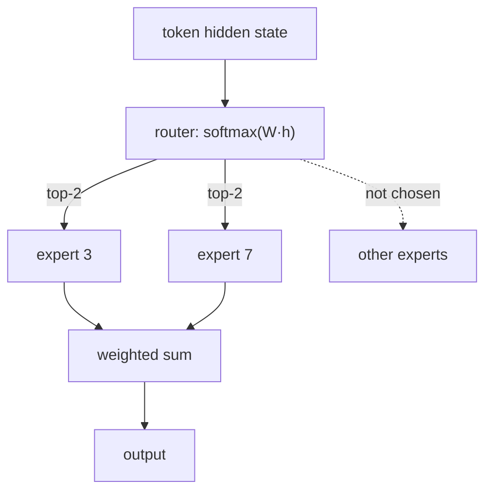

# Efficient Attention & MoE

!!! abstract "TL;DR"
    Attention's cost grows with the square of sequence length, and generation is limited by memory, not arithmetic. The **KV cache** avoids recomputing past tokens but grows with context; **MQA, GQA and MLA** shrink it by sharing or compressing keys and values. **FlashAttention** computes exact attention in on-chip tiles, so the $n \times n$ matrix never hits GPU memory. **Sparse, linear and state-space** alternatives trade some quality for sub-quadratic cost. **Mixture of experts** grows parameters without growing compute per token.

!!! evolution "Where this fits"
    **Before:** [The Transformer](transformer.md) and its $O(n^2)$ attention. **This page:** making it fast and long. **Next:** [Pretraining & LLMs](pretraining.md) scales it; [Inference & Serving](inference.md) applies these ideas in production.

- **Full multi-head attention** 2017 Quadratic in length; every head stores its own keys and values.
- **KV cache** 2017+ Reuse past keys and values when generating. Memory grows with context.
- **Multi-query attention** 2019 All heads share one key/value head: tiny cache, some quality loss.
- **Sparse · sliding-window attention** 2019–2020 Attend locally plus a few global tokens.
- **FlashAttention** 2022 Exact attention in on-chip tiles; linear memory, much faster.
- **Grouped-query attention** 2023 Groups of heads share K/V: near-full quality, small cache.
- **State-space models (Mamba)** 2023 Linear-time sequence layers, often mixed with attention.
- **Multi-head latent attention** 2024 Compress K/V into a small latent vector per token.

## Where the time and memory go

Generation has two phases:

- **Prefill:** process the whole prompt in parallel. Large matrix multiplications; **compute-bound**.
- **Decode:** produce one token at a time. Each step reads all model weights and the whole KV cache from GPU memory to do relatively little arithmetic; **memory-bandwidth-bound**.

So the levers differ: prefill benefits from faster matrix math, decode from moving fewer bytes (smaller weights via quantization, smaller KV caches, batching many requests so each weight read serves many tokens).

## The KV cache

**The problem:** at decode step $t$, attention needs keys and values for all $t$ previous tokens. Recomputing them every step would make generating $n$ tokens cost $O(n^2)$ projections.

**Core idea:** store each token's keys and values per layer the first time they're computed; each new token computes only its own and attends over the cache.

$$
\text{KV cache bytes} = 2 \times \text{layers} \times \text{KV heads} \times d_{head} \times \text{sequence length} \times \text{batch} \times \text{bytes per value}
$$

??? example "Worked example: how big is the cache?"
    A 7B model with 32 layers, 32 heads of dimension 128, in FP16 (2 bytes): per token $2 \times 32 \times 32 \times 128 \times 2 = 524{,}288$ bytes, about **0.5 MB per token**. A 4,096-token context is about 2 GB per sequence; a batch of 16 such sequences needs 32 GB, more than the model's own 14 GB of weights.

    A 70B model with grouped-query attention (80 layers, 8 KV heads of 128): $2 \times 80 \times 8 \times 128 \times 2 \approx 0.33$ MB per token. GQA keeps a model ten times larger at a smaller per-token cache.

The cache, not the weights, often limits batch size and context length in serving. Hence the methods below, plus KV-cache quantization (8-bit or 4-bit), paging (vLLM's PagedAttention) and prefix sharing.

## Sharing keys and values: MQA, GQA and MLA

| Method | Keys/values per layer | Cache size vs MHA | Quality | Used in |
|---|---|---|---|---|
| **Multi-head (MHA)** | One K/V per query head | 1× | Baseline | Original Transformer, GPT-3 |
| **Multi-query (MQA)** | One K/V shared by all heads | $1/h$ | Some degradation, less stable training | PaLM, Falcon |
| **Grouped-query (GQA)** | One K/V per group of query heads (for example 8 groups) | $g/h$ | Close to MHA | LLaMA 2 70B, LLaMA 3, Mistral, most open LLMs |
| **Multi-head latent (MLA)** | A low-rank latent vector per token, projected up to K/V per head | Much smaller than GQA | Comparable to MHA | DeepSeek-V2, V3 |

GQA can also be created from an existing MHA checkpoint by mean-pooling key and value heads into groups and briefly continuing training ("uptraining").

## FlashAttention

**The problem:** standard attention computes the $n \times n$ score matrix, writes it to GPU high-bandwidth memory (HBM), reads it back for the softmax, writes the probabilities, and reads them again to multiply by $V$. Those memory transfers, not the arithmetic, dominate the time, and the matrix needs $O(n^2)$ memory.

**Core idea:** be **IO-aware.** Split $Q$, $K$ and $V$ into blocks that fit in fast on-chip SRAM, compute attention block by block, and never write the full matrix to HBM.

- **Online softmax:** keep a running maximum and running sum for each query row, so partial results from each key block can be combined exactly, rescaling as the maximum changes.
- **Backward pass:** recompute attention blocks from $Q$, $K$, $V$ instead of storing the matrix. More arithmetic, much less memory traffic, and faster overall.
- **Exact:** the output is the same as standard attention (up to floating-point rounding); it's not an approximation.
- **Results:** memory becomes linear in sequence length, and attention runs several times faster, enabling longer contexts. FlashAttention-2 improved parallelism and work partitioning; FlashAttention-3 targets newer GPU features such as asynchronous execution and FP8.

## Sparse and linear attention

| Approach | Idea | Cost | Trade-off |
|---|---|---|---|
| **Sliding-window** | Each token attends to the previous $w$ tokens; stacked layers widen the reach | $O(nw)$ | Distant tokens interact only through many layers (Mistral 7B used a 4,096-token window) |
| **Sparse patterns** (Longformer, BigBird) | Local windows plus a few global tokens plus random links | $O(n)$ | Fixed patterns can miss needed interactions |
| **Low-rank** (Linformer) | Project keys and values to a fixed length | $O(nk)$ | Assumes the attention matrix is low-rank |
| **Kernel / linear attention** (Performer, linear Transformers) | Replace softmax with a feature map so $(QK^\top)V$ becomes $Q(K^\top V)$ | $O(n d^2)$ | Usually lower quality than softmax attention |
| **Attention sinks** (StreamingLLM) | Keep the first few tokens plus a recent window in the cache | Constant memory | For streaming, not for recalling details from the middle |

## State-space models and hybrids

**The problem:** a fixed-size recurrent state makes inference cost per token constant, but classic RNNs train slowly and forget.

**Core idea:** structured state-space models (S4, 2021) and **Mamba** (2023) use a linear recurrence that can be trained in parallel (with convolutions or a parallel scan) and run as a recurrence at inference: constant memory per token and linear time in sequence length. Mamba makes the state-space parameters depend on the input ("selective"), so the model can choose what to remember.

- Strengths: linear scaling, fast long-sequence inference, no KV cache growth.
- Weaknesses: weaker at precise recall from long contexts (copying, looking up a specific fact) than attention.
- **Hybrids** interleave a few attention layers with many SSM layers to get most of both.

## Long context

- **Position scaling:** RoPE models extended beyond their training length with position interpolation, NTK-aware scaling or YaRN, plus a short fine-tune on long documents.
- **Training long:** context (sequence) parallelism and ring attention split one long sequence across GPUs.
- **Using long context well:** accuracy tends to drop for information in the **middle** of very long prompts ("lost in the middle"), and quality can decline as irrelevant context accumulates. Long windows don't remove the need for retrieval or careful [context engineering](../ai-engineering/context-engineering.md).
- **Cost:** prefill grows with prompt length, and the KV cache grows linearly; **prompt caching** of stable prefixes cuts repeated cost.

## Mixture of experts

**The problem:** in a dense model every parameter is used for every token, so more capacity always means more compute per token.

**Core idea:** replace each FFN with $E$ expert FFNs and a **router** that sends each token to its top-$k$ experts (often $k = 1$ or 2). Total parameters grow with $E$; compute per token grows only with $k$.

- **Load balancing:** without help, the router sends most tokens to a few experts, which then dominate and the rest never train. An **auxiliary loss** encourages even usage, for example Switch Transformer's $\alpha N \sum_i f_i P_i$ (fraction of tokens routed to expert $i$ times its average router probability). DeepSeek-V3 instead adjusts per-expert bias terms to balance load without an auxiliary loss.
- **Capacity factor:** cap tokens per expert per batch; overflow tokens skip the layer through the residual connection.
- **Expert parallelism:** experts live on different GPUs and tokens are exchanged with all-to-all communication, which becomes a bottleneck.
- **Fine-grained and shared experts:** many small experts plus one or more always-on shared experts (DeepSeekMoE) improve specialization.

| Model | Total parameters | Active per token | Routing |
|---|---|---|---|
| Switch Transformer (2021) | Up to 1.6T | Small fraction | Top-1 |
| Mixtral 8×7B (2023) | About 47B | About 13B | Top-2 of 8 per layer |
| DeepSeek-V3 (2024) | 671B | 37B | Top-8 of 256 routed experts plus 1 shared |

**Trade-offs:** much better quality per FLOP, but **all experts must be in memory** (serving memory follows total parameters while speed follows active parameters), routing can be unstable, batches must be large to keep experts busy, and fine-tuning is trickier.

## Interview questions

??? question "What is the KV cache and why does it help?"
    During autoregressive generation, each new token attends to all previous tokens' keys and values, which don't change once computed. Caching them per layer means each step only computes the new token's query, key and value and attends over the cache, turning per-token work from re-processing the whole prefix into a single step. The cost is memory that grows linearly with context length and batch size, which often limits how many requests a GPU can serve.

??? question "Compute the KV-cache size for a model."
    Multiply 2 (keys and values) × layers × KV heads × head dimension × tokens × batch × bytes per value. For 32 layers, 32 KV heads of size 128 in FP16: $2 \cdot 32 \cdot 32 \cdot 128 \cdot 2 = 524{,}288$ bytes, about 0.5 MB per token, so 8,192 tokens × batch 8 ≈ 34 GB. With 8 KV heads (GQA) it's a quarter of that.

??? question "MHA vs MQA vs GQA."
    Multi-head attention gives every query head its own key and value projections: best quality, largest cache. Multi-query attention shares a single key/value head across all query heads: the cache shrinks by the number of heads, decode gets much faster, but quality and training stability can suffer. Grouped-query attention is the middle ground: query heads are split into groups that share K/V (for example 64 query heads, 8 KV heads), giving most of MQA's savings with near-MHA quality. Most current open models use GQA.

??? question "How does FlashAttention speed up attention without approximating it?"
    Standard attention is limited by memory traffic: it writes and reads the full $n \times n$ score and probability matrices to and from GPU HBM. FlashAttention tiles $Q$, $K$ and $V$ into blocks that fit in on-chip SRAM, computes each block's contribution, and combines blocks exactly using an online softmax (running max and sum per row). The full matrix is never materialized, memory becomes $O(n)$, and the backward pass recomputes blocks instead of storing them. Same result, far fewer memory transfers, several times faster.

??? question "Prefill vs decode: which is compute-bound and which is memory-bound?"
    Prefill processes all prompt tokens in parallel with large matrix multiplications, so it's compute-bound and drives time-to-first-token. Decode generates one token per step per sequence, reading every weight and the KV cache for a small amount of arithmetic, so it's memory-bandwidth-bound and drives time per output token. Batching helps decode because one weight read serves many sequences; quantization and smaller caches help because fewer bytes move.

??? question "What is sliding-window attention, and what does it give up?"
    Each token attends only to the previous $w$ tokens, so cost and KV memory scale with $nw$ instead of $n^2$. Information can still travel farther than $w$ through stacked layers (the receptive field grows by about $w$ per layer), but distant interactions are indirect and weaker. Some models alternate windowed and full-attention layers to keep exact long-range access.

??? question "What's the idea behind linear attention, and why isn't it standard?"
    Softmax attention computes $\text{softmax}(QK^\top)V$, which needs the $n \times n$ matrix. Linear attention replaces the softmax similarity with a kernel feature map $\phi$, so $(\phi(Q)\phi(K)^\top)V = \phi(Q)(\phi(K)^\top V)$ can be computed right to left in $O(n)$, and it can even run as a recurrence. In practice these approximations lose quality, especially on precise retrieval from context, so softmax attention with FlashAttention remains the default, with linear-time layers used in hybrids.

??? question "What is Mamba, and how does it differ from a Transformer?"
    Mamba is a selective state-space model: a linear recurrence whose parameters depend on the input, so it can decide what to keep in its fixed-size state. It trains in parallel with a hardware-aware scan and runs as a recurrence at inference, giving linear time and constant memory per token with no KV cache. Transformers keep every past token's keys and values and can look any of them up exactly, which makes them better at copying and precise recall; hybrids combine a few attention layers with many Mamba layers.

??? question "How do models extend their context length?"
    Architecturally, with RoPE scaling (position interpolation, NTK-aware scaling, YaRN) so positions beyond the trained range map onto rotations the model has seen, followed by fine-tuning on long sequences. Systems-wise, with FlashAttention, context parallelism for training, and KV-cache paging, quantization or eviction for serving. And practically by evaluating long-context use, since models often under-use information in the middle of long prompts.

??? question "How does mixture-of-experts routing work?"
    A router (a linear layer plus softmax) scores all experts for each token, the top-$k$ experts process it, and their outputs are combined with the router weights. Only those $k$ experts' FFN weights are used for that token. An auxiliary load-balancing loss or bias adjustment keeps tokens spread across experts, and a capacity limit caps tokens per expert per batch.

??? question "Why does MoE need a load-balancing mechanism?"
    Routing is learned, and early on some experts happen to perform slightly better, receive more tokens, improve further, and attract even more: a rich-get-richer collapse where a few experts do everything and the rest stay untrained. Imbalance also overloads some GPUs while others idle. A balancing loss (penalizing uneven token fractions and router probabilities) or per-expert bias adjustments keep utilization even.

??? question "Total vs active parameters in MoE: which determines memory and which determines speed?"
    **Memory** is set by total parameters: every expert must be loaded somewhere, so a 47B-total MoE needs memory like a 47B dense model. **Compute per token** is set by active parameters: each token uses only its top-$k$ experts plus shared layers, so it runs roughly like a 13B dense model. Serving MoEs therefore needs large memory but gives high throughput per FLOP, especially at large batch sizes.

??? question "What is the 'lost in the middle' problem?"
    When relevant information is placed in the middle of a long prompt, models retrieve and use it less reliably than when it's near the beginning or end. It shows that a large context window isn't the same as using all of it well. Mitigations: put the most important content at the start or end, retrieve less but better, summarize, and evaluate long-context tasks directly.

!!! pitfall "Common mistakes"
    - Calling FlashAttention an approximation.
    - Forgetting that the KV cache, not the weights, often limits batch size.
    - Saying MoE reduces memory (it reduces compute per token).
    - Assuming a long context window means the model uses all of it well.

## Revision checklist

- [ ] Explain prefill vs decode and which resource limits each
- [ ] Compute KV-cache size for MHA and GQA models
- [ ] Compare MHA, MQA, GQA and MLA
- [ ] Explain FlashAttention's tiling and online softmax
- [ ] Describe sliding-window, sparse, linear attention and SSMs, with their trade-offs
- [ ] Explain MoE routing, load balancing, and total vs active parameters

## Go deeper

- [FlashAttention (2022)](https://arxiv.org/abs/2205.14135)
- [GQA: Training Generalized Multi-Query Transformer Models (2023)](https://arxiv.org/abs/2305.13245)
- [Mamba: Linear-Time Sequence Modeling with Selective State Spaces (2023)](https://arxiv.org/abs/2312.00752)
- [Switch Transformers (2021)](https://arxiv.org/abs/2101.03961)
- [Lost in the Middle (2023)](https://arxiv.org/abs/2307.03172)
