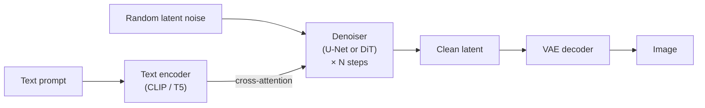

# Generative Models

!!! abstract "TL;DR"
    Generative models learn to produce new data. **Autoencoders** compress but can't sample well. **VAEs** shape the latent space into a Gaussian, so sampling works, but outputs are blurry. **GANs** make sharp images through an adversarial game but are unstable and drop modes. **Diffusion models** learn to remove noise step by step: stable training, high quality, easy text conditioning, slow sampling. **Latent diffusion** (Stable Diffusion) runs diffusion in a compressed space; **DiTs, flow matching and distillation** make it faster and more scalable. **Multimodal LLMs** connect vision and audio encoders to language models.

!!! evolution "Where this fits"
    **Before:** [CNNs and U-Net](../deep-learning/cnn-vision.md), [CLIP](../deep-learning/cnn-vision.md), [the Transformer](transformer.md). **This page:** generating images, audio and video, and models that see. **Next:** [Alignment & Reasoning](../alignment/rl-essentials.md) returns to language models.

- **Autoencoder** 1980s · 2006 Compress and reconstruct. The latent space has holes, so random samples look bad.
- **VAE** 2013 A smooth Gaussian latent space; easy sampling, blurry outputs.
- **GAN** 2014 Generator vs discriminator: sharp but unstable, with mode collapse.
- **Diffusion (DDPM)** 2020 Learn to denoise step by step. Stable, diverse, slow to sample.
- **Latent diffusion** 2022 Diffuse in a compressed latent space with text conditioning.
- **DiT · flow matching · few-step distillation** 2023+ Transformer denoisers, straighter paths, 1–4 step sampling; images and video.

## The families at a glance

| Family | Learns | Sampling | Strengths | Weaknesses |
|---|---|---|---|---|
| **Autoregressive** (GPT, PixelCNN) | Exact likelihood, one token at a time | Sequential | Exact likelihood; best for text | Slow for high-dimensional data |
| **VAE** | A lower bound on likelihood | One decoder pass | Stable; smooth latent space | Blurry samples |
| **GAN** | Implicitly, through a discriminator | One generator pass | Sharp, fast | Unstable; mode collapse; no likelihood |
| **Normalizing flow** | Exact likelihood via invertible maps | One pass | Exact likelihood and sampling | Restrictive architectures |
| **Diffusion / score-based** | To denoise (equivalently, the score $\nabla_x \log p$) | Many denoising steps (fewer with distillation) | Quality, diversity, stable training, conditioning | Slow sampling, compute-heavy |

## Autoencoders

**The problem:** learn compact representations without labels.

**Core idea:** an encoder compresses $x$ to a small code $z$, a decoder reconstructs $\hat x$, and training minimizes reconstruction error.

- An undercomplete linear autoencoder learns the same subspace as PCA; non-linear ones learn curved manifolds.
- **Denoising** autoencoders reconstruct clean inputs from corrupted ones (a precursor of diffusion and of BERT-style masking). **Sparse** autoencoders keep few units active, and are now used to find interpretable features inside LLMs.
- Uses: compression, denoising, anomaly detection (high reconstruction error means unusual), pretraining.

**Weakness:** nothing forces the latent space to be continuous or filled in, so decoding a random $z$ often gives garbage. It's not a real generative model.

## Variational autoencoders

**The problem it solved:** autoencoders can't sample.

**Core idea:** encode each input to a **distribution** $q_\phi(z \mid x) = \mathcal{N}(\mu, \sigma^2)$, sample $z$, decode, and pull every encoding toward a standard normal prior so the whole latent space is usable.

Maximize the **evidence lower bound (ELBO)** on $\log p(x)$:

$$
\text{ELBO} = \underbrace{\mathbb{E}_{q_\phi(z\mid x)}\left[\log p_\theta(x \mid z)\right]}_{\text{reconstruction}} - \underbrace{D_{KL}\left(q_\phi(z \mid x)\,\|\,\mathcal{N}(0, I)\right)}_{\text{keep codes near the prior}}
$$

- **Reparameterization trick:** sampling isn't differentiable, so write $z = \mu + \sigma \odot \epsilon$ with $\epsilon \sim \mathcal{N}(0, I)$; gradients then flow through $\mu$ and $\sigma$.
- For Gaussians the KL term has a closed form: $\frac12\sum_j\left(\mu_j^2 + \sigma_j^2 - \log\sigma_j^2 - 1\right)$.
- **Why blurry?** A Gaussian (MSE-like) reconstruction loss rewards averaging over plausible outputs, and the KL pressure limits how much detail $z$ carries.
- **β-VAE** weights the KL term to encourage disentangled factors. **Posterior collapse:** a powerful decoder ignores $z$ (KL goes to zero). **VQ-VAE** uses a discrete codebook of latents; such tokenizers turn images and audio into tokens for autoregressive and multimodal models.
- A VAE is the image compressor inside Stable Diffusion.

## Generative adversarial networks

**The problem it solved:** likelihood-based models of the time produced blurry images.

**Core idea:** a **generator** $G$ maps noise $z$ to samples; a **discriminator** $D$ tries to tell real from generated; they play a minimax game:

$$
\min_G \max_D\ \mathbb{E}_{x \sim p_{data}}[\log D(x)] + \mathbb{E}_{z}[\log(1 - D(G(z)))]
$$

- For a fixed generator the optimal discriminator is $D^*(x) = \frac{p_{data}(x)}{p_{data}(x) + p_g(x)}$, and the generator's objective becomes minimizing the Jensen–Shannon divergence between $p_{data}$ and $p_g$.
- **Non-saturating loss:** in practice $G$ maximizes $\log D(G(z))$, because the original term gives vanishing gradients when $D$ easily rejects early fakes.

| Problem | What happens | Fixes |
|---|---|---|
| **Mode collapse** | The generator produces only a few kinds of outputs that fool $D$ | Minibatch discrimination, unrolled GANs, WGAN, diversity terms |
| **Instability / non-convergence** | The two players oscillate | WGAN with gradient penalty, spectral normalization, two learning rates (TTUR), careful architectures |
| **Vanishing gradients** | A perfect $D$ gives $G$ no signal | Non-saturating loss, Wasserstein loss |
| **Evaluation** | No likelihood to report | FID, Inception Score, precision and recall for generative models |

Landmarks: DCGAN (convolutional GANs), conditional GANs, **CycleGAN** (unpaired image-to-image translation), **StyleGAN** (high-resolution faces with a style-based generator), and GAN losses inside super-resolution and some diffusion distillation methods. **FID** compares the mean and covariance of Inception-network features between real and generated images; lower is better.

## Normalizing flows

Transform a simple distribution through a sequence of **invertible** functions with tractable Jacobian determinants, so the change-of-variables formula gives exact likelihoods: $\log p(x) = \log p(z) + \log\left|\det \frac{\partial z}{\partial x}\right|$. Examples: RealNVP, Glow. Exact likelihood and one-pass sampling, but the invertibility constraint limits architectures. Their continuous-time descendants connect to flow matching below.

## Diffusion models

**The problem it solved:** GANs are unstable and drop modes; VAEs are blurry.

**Core idea:** destroy data gradually with noise, and train a network to reverse one small step at a time.

### Forward process (fixed)

Add Gaussian noise over $T$ steps with a schedule $\beta_t$. With $\bar\alpha_t = \prod_{s \le t}(1 - \beta_s)$, you can jump straight to any step:

$$
x_t = \sqrt{\bar\alpha_t}\, x_0 + \sqrt{1 - \bar\alpha_t}\, \epsilon, \qquad \epsilon \sim \mathcal{N}(0, I)
$$

{ loading=lazy }
{ loading=lazy }

The cosine schedule keeps more signal through the middle steps, so fewer steps are wasted on nearly pure noise.

### Reverse process (learned)

Train a network $\epsilon_\theta(x_t, t)$ (originally a U-Net) to predict the noise that was added, with a simple regression loss:

$$
\mathcal{L} = \mathbb{E}_{x_0, \epsilon, t}\left[\left\|\epsilon - \epsilon_\theta\!\left(\sqrt{\bar\alpha_t}x_0 + \sqrt{1 - \bar\alpha_t}\,\epsilon,\ t\right)\right\|^2\right]
$$

- Predicting the noise is equivalent to learning the **score** $\nabla_x \log p(x_t)$, the direction toward higher data density (the score-matching view). Variants predict $x_0$ or a "velocity" $v$ instead.
- **Sampling:** start from pure noise $x_T$ and repeatedly denoise. DDPM used about 1,000 stochastic steps; **DDIM** and modern ODE solvers produce good samples in about 20–50 deterministic steps.

### Guidance and conditioning

- **Conditioning:** feed the condition (class label, text embedding, image) into the denoiser, usually through cross-attention to text-encoder outputs (CLIP or T5).
- **Classifier guidance** used a separate noisy-image classifier's gradient to steer samples.
- **Classifier-free guidance (CFG):** train one model both with and without the condition (randomly dropping it), then extrapolate at sampling time:

$$
\hat\epsilon = \epsilon_\theta(x_t, \varnothing) + w\left(\epsilon_\theta(x_t, c) - \epsilon_\theta(x_t, \varnothing)\right)
$$

  A guidance scale $w > 1$ follows the prompt more closely at the cost of diversity, and very high values over-saturate images.

## Latent diffusion and beyond

**The problem:** diffusion in pixel space at 1024×1024 is very expensive.

**Core idea (Stable Diffusion):** compress images with a VAE (8× downsampling per side), run diffusion in that latent space, and decode at the end.

- **ControlNet** adds spatial conditions (edges, depth, pose) through a trainable copy of the encoder. **DreamBooth**, **textual inversion** and **LoRA** personalize a model on a few images. **Inpainting** and image-to-image start from a partially noised real image.
- **DiT (Diffusion Transformer):** replace the U-Net with a Transformer over latent patches; it scales with compute like LLMs and underlies many recent image and video models.
- **Flow matching / rectified flow:** learn a velocity field that moves samples along (nearly) straight paths from noise to data; simpler training and fewer sampling steps.
- **Few-step generation:** consistency models, progressive and adversarial distillation reach good samples in 1–4 steps.
- **Video:** spatio-temporal latents and Transformer denoisers generate clips; consistency over time is the hard part.

## Multimodal LLMs

**The problem:** text-only LLMs can't read images, charts, documents or screens, or listen.

**Core idea:** turn other modalities into embeddings or tokens the language model can attend to.

| Design | How | Examples |
|---|---|---|
| **Projector (late fusion)** | A pretrained vision encoder (CLIP or SigLIP ViT) produces patch features; a small MLP projects them into the LLM's embedding space as "image tokens" | LLaVA (2023) and many open models |
| **Cross-attention / resampler** | Insert cross-attention layers so a frozen LLM attends to visual features, often compressed by a resampler | Flamingo (2022) |
| **Native (early fusion)** | Train one model on interleaved text, image (and audio) tokens from the start | Recent frontier models |

**Training stages** (LLaVA-style): first align by training the projector on image–caption pairs with encoder and LLM frozen; then visual instruction tuning on question–answer and conversation data, often unfreezing the LLM.

**Practical notes:** high-resolution images are tiled into many patches, and image tokens are expensive; OCR-free document understanding and chart reading are major uses; visual hallucination (describing objects that aren't there), counting and fine spatial reasoning remain weak spots. **Speech:** Whisper is an encoder–decoder speech recognizer trained on large weakly supervised data; speech-to-speech models handle audio end to end. **Computer-use agents** rely on multimodal models reading screenshots.

## Risks to mention

Deepfakes and impersonation, non-consensual imagery, copyright and training-data consent, memorization of training images, and bias in generated content. Mitigations include content provenance standards (C2PA), watermarking, safety classifiers on prompts and outputs, and dataset curation.

## Interview questions

??? question "Autoencoder vs VAE: why can't a plain autoencoder generate good samples?"
    A plain autoencoder only learns to reconstruct training inputs; nothing constrains where codes land, so the latent space has gaps and irregular regions, and decoding a random point often produces nonsense. A VAE encodes each input as a distribution and adds a KL penalty pulling every encoding toward a standard normal, so the latent space is continuous and covered: sampling $z \sim \mathcal{N}(0, I)$ and decoding gives plausible outputs.

??? question "Explain the two terms of the VAE ELBO."
    The **reconstruction term** $\mathbb{E}_q[\log p(x \mid z)]$ rewards decoding the input accurately from its sampled code. The **KL term** $D_{KL}(q(z \mid x)\,\|\,p(z))$ penalizes encodings that stray from the prior, which regularizes the latent space and makes sampling possible. Maximizing their difference maximizes a lower bound on the data log-likelihood; their balance (scaled by β in β-VAE) trades sharpness against latent-space structure.

??? question "Why is the reparameterization trick needed?"
    The ELBO requires sampling $z$ from $q(z \mid x)$, and you can't backpropagate through a random sampling step. Writing $z = \mu + \sigma \odot \epsilon$ with $\epsilon \sim \mathcal{N}(0, I)$ moves the randomness into an input that doesn't depend on the parameters, so $z$ becomes a deterministic, differentiable function of $\mu$ and $\sigma$, and gradients reach the encoder.

??? question "Why are VAE samples blurry?"
    With a Gaussian likelihood, the reconstruction term is effectively MSE, which is minimized by the average of all plausible outputs for a given code, and averages of sharp images are blurry. The KL term also limits how much information each code carries, so fine detail isn't encoded. Remedies: perceptual or adversarial losses (VAE-GAN), discrete latents (VQ-VAE), or using the VAE only as a compressor while another model (diffusion, autoregressive) models the latents.

??? question "Explain the GAN objective."
    The discriminator maximizes $\mathbb{E}[\log D(x)] + \mathbb{E}[\log(1 - D(G(z)))]$, learning to output high probability for real data and low for fakes; the generator minimizes the same expression, learning to produce samples the discriminator accepts. At the optimal discriminator, the generator is minimizing the Jensen–Shannon divergence between data and generated distributions. In practice the generator maximizes $\log D(G(z))$ to avoid weak gradients early in training.

??? question "What is mode collapse, and how is it mitigated?"
    The generator finds a few outputs that fool the discriminator and produces only those, ignoring the rest of the data distribution: low diversity despite good-looking samples. Mitigations: Wasserstein loss with gradient penalty (smoother, more informative gradients), minibatch discrimination or feature statistics that let the discriminator detect lack of diversity, unrolled GAN training, spectral normalization, and multiple generators. Diffusion models largely avoid it by design.

??? question "Why did WGAN help?"
    The original objective relates to the Jensen–Shannon divergence, which saturates when real and generated distributions don't overlap, giving the generator vanishing gradients. WGAN minimizes an approximation of the Wasserstein (earth-mover) distance, which still changes smoothly when distributions are far apart, using a critic constrained to be 1-Lipschitz (by weight clipping, or better, a gradient penalty). Training is more stable and the critic's loss correlates with sample quality.

??? question "What does FID measure?"
    Fréchet Inception Distance embeds real and generated images with an Inception network, fits a Gaussian (mean and covariance) to each set of features, and computes the Fréchet distance between the two Gaussians. Lower is better; it captures both quality and diversity. Caveats: it depends on the feature network, needs many samples, is biased with small sample sizes, and doesn't measure prompt alignment (use CLIP score or human preference for that).

??? question "Explain the forward and reverse processes in diffusion models."
    The forward process gradually adds Gaussian noise according to a fixed schedule until the data becomes pure noise; thanks to Gaussian properties, $x_t$ can be sampled directly from $x_0$ as $\sqrt{\bar\alpha_t}x_0 + \sqrt{1 - \bar\alpha_t}\epsilon$. The reverse process is learned: a network predicts the added noise (or the clean image, or a velocity) at each step, and sampling starts from noise and denoises step by step to generate new data.

??? question "What does the diffusion network predict, and what is the loss?"
    Commonly the noise $\epsilon$ that was added to produce $x_t$, trained with mean squared error between the true and predicted noise at a randomly sampled timestep. Predicting noise is equivalent to estimating the score (gradient of log density) up to scaling. Alternatives predict the clean image $x_0$ or the velocity $v$, which can be more stable at some noise levels; all are interconvertible.

??? question "What is classifier-free guidance?"
    Train one denoiser both with the condition (such as the text prompt) and without it, by randomly dropping the condition during training. At sampling time, compute both predictions and extrapolate: $\hat\epsilon = \epsilon(x_t, \varnothing) + w(\epsilon(x_t, c) - \epsilon(x_t, \varnothing))$. Guidance scale $w$ trades diversity for prompt adherence and image quality. It removed the need for a separate classifier and is standard in text-to-image models.

??? question "Why is diffusion sampling slow, and how is it sped up?"
    Each sample needs many sequential denoising steps (hundreds to a thousand originally), each a full network evaluation. Speed-ups: better samplers and ODE solvers (DDIM, DPM-Solver) needing 20–50 steps; latent diffusion so each step is cheaper; flow matching with straighter trajectories; and distillation (progressive, consistency, adversarial) to 1–4 steps. Smaller or quantized denoisers and caching also help.

??? question "Why diffuse in latent space?"
    Pixel space is enormous (a 1024×1024 RGB image has about 3 million values), and most of that detail is perceptually redundant. A VAE compresses images about 8× per side into a latent that keeps the semantic and perceptual content; running diffusion there cuts compute and memory dramatically, enabling high resolution on consumer GPUs, while the VAE decoder restores detail.

??? question "How does text conditioning work in Stable Diffusion?"
    A text encoder (CLIP's, and in newer models also T5) turns the prompt into a sequence of token embeddings. The denoiser attends to them through cross-attention layers: queries from image latent features, keys and values from the text embeddings, so each region of the image can draw on relevant words. Classifier-free guidance strengthens the effect at sampling time.

??? question "What is flow matching?"
    A way to train continuous-time generative models by regressing a neural velocity field onto a target velocity that transports noise to data along a chosen path, often a straight line between a noise sample and a data sample (rectified flow). Sampling integrates that velocity field from noise to data. Training is simple and stable, and straighter paths allow good samples with fewer integration steps; several recent image models use it.

??? question "How does a LLaVA-style model connect a vision encoder to an LLM?"
    A pretrained vision encoder (a CLIP or SigLIP ViT) turns the image into patch features; a small projector (linear layer or MLP) maps each feature into the LLM's embedding space; those vectors are inserted into the token sequence as image tokens alongside the text. Training first aligns the projector on image–caption pairs with the other parts frozen, then instruction-tunes on visual question answering and conversation data.

??? question "Early vs late fusion in multimodal models."
    **Late fusion** encodes each modality with its own pretrained encoder and combines them later (projector or cross-attention into an LLM): cheaper, reuses strong unimodal models, modular. **Early fusion** tokenizes all modalities into one sequence and trains a single model on them jointly from the start: deeper cross-modal interaction and native generation in several modalities, but much more expensive and harder to train.

??? question "How would you build question answering over scanned PDFs?"
    Options: (1) OCR plus layout parsing into text and tables, then a normal RAG pipeline; (2) a vision-language model that reads page images directly (better for charts, forms and complex layouts); or (3) retrieval over page-image embeddings with a VLM answering from the top pages. Production often mixes them: extract text for search, render pages for the VLM, cite page numbers, and evaluate on real documents for extraction accuracy and faithfulness.

!!! pitfall "Common mistakes"
    - Claiming GANs provide likelihoods.
    - Forgetting that diffusion's forward process has no learned parameters.
    - Saying classifier-free guidance needs a separate classifier.
    - Assuming multimodal models "see" fine detail reliably.

## Revision checklist

- [ ] Compare autoregressive, VAE, GAN, flow and diffusion models
- [ ] Write the ELBO and explain the reparameterization trick
- [ ] Write the GAN objective, the optimal discriminator, and fixes for mode collapse
- [ ] Write the diffusion forward process and noise-prediction loss
- [ ] Explain classifier-free guidance and latent diffusion
- [ ] Describe DiT, flow matching and few-step distillation
- [ ] Explain a LLaVA-style multimodal model and its training stages

## Go deeper

- [Lilian Weng: What are Diffusion Models?](https://lilianweng.github.io/posts/2021-07-11-diffusion-models/)
- [Denoising Diffusion Probabilistic Models (2020)](https://arxiv.org/abs/2006.11239)
- [High-Resolution Image Synthesis with Latent Diffusion Models (2021)](https://arxiv.org/abs/2112.10752)
- [Classifier-Free Diffusion Guidance (2022)](https://arxiv.org/abs/2207.12598)
- [Generative Adversarial Networks (2014)](https://arxiv.org/abs/1406.2661) and [Auto-Encoding Variational Bayes (2013)](https://arxiv.org/abs/1312.6114)
- [Visual Instruction Tuning (LLaVA, 2023)](https://arxiv.org/abs/2304.08485)
