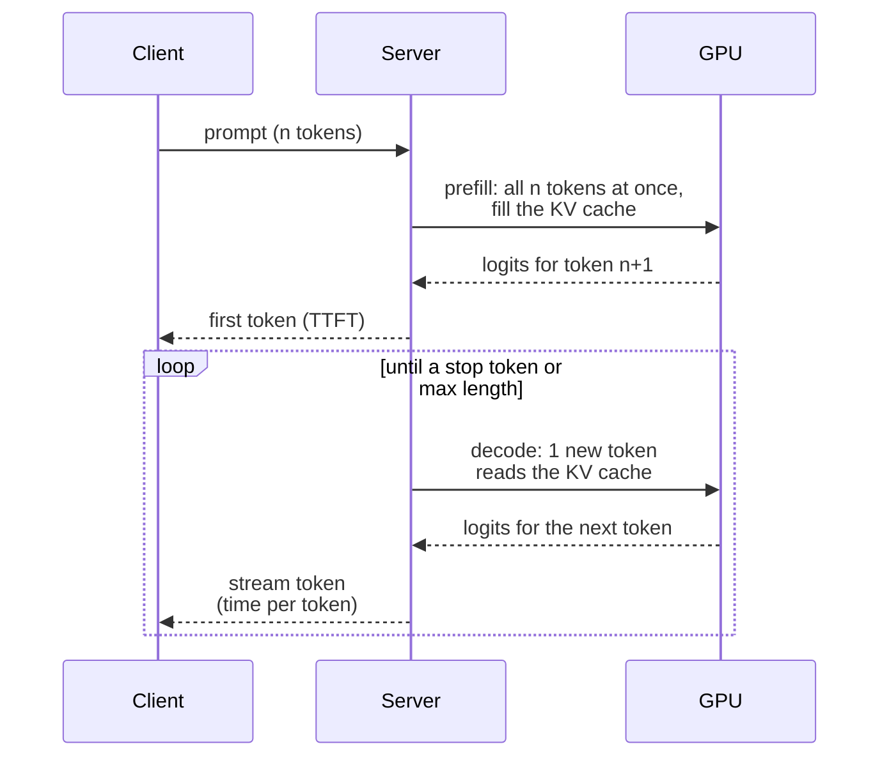

# Inference & Serving

!!! abstract "TL;DR"
    Generating text has two phases: **prefill** (process the prompt in parallel; compute-bound; sets time to first token) and **decode** (one token at a time; memory-bandwidth-bound; sets time per token). Serving is about keeping GPUs busy without blowing latency: **continuous batching**, **PagedAttention** for the KV cache, **prefix caching**, **quantization**, and **speculative decoding**, which drafts several tokens with a small model and verifies them in one pass without changing the output distribution. Estimate cost from tokens per request, throughput per GPU and GPU price.

!!! evolution "Where this fits"
    **Before:** [Efficient Attention & MoE](efficient-attention.md) (KV cache, GQA, FlashAttention) and [Fine-Tuning & Efficiency](fine-tuning.md) (quantization). **This page:** running models in production. **Next:** applications built on top: [prompting](../ai-engineering/prompting.md), [RAG](../ai-engineering/rag.md), [agents](../ai-engineering/agents.md).

## How generation works

- **Prefill** runs big matrix multiplications over the whole prompt: **compute-bound**. Long prompts mean slow first tokens.
- **Decode** produces one token per sequence per step. Each step reads every weight and the sequence's KV cache from GPU memory to do a little arithmetic: **memory-bandwidth-bound**.

??? example "Back-of-envelope: the decode speed limit"
    At batch size 1, each decode step must read all weights once. A 7B model in FP16 is about 14 GB; with about 3 TB/s of memory bandwidth, one step takes at least $14 / 3000 \approx 4.7$ ms, so about **210 tokens per second at most**, whatever the compute. In 4-bit (about 3.5 GB) the limit rises to about 850 tokens per second. Batching 32 sequences reads the weights once for 32 tokens, which is why throughput rises with batch size until compute or KV-cache memory runs out.

## Metrics that matter

| Metric | Meaning | Driven by |
|---|---|---|
| **Time to first token (TTFT)** | Delay before the first token appears | Queueing, prompt length (prefill), retrieval or tool calls before generation |
| **Time per output token / inter-token latency** | Gap between streamed tokens | Decode speed, batch size, model size |
| **End-to-end latency** | TTFT + output tokens × time per token | Both, plus output length |
| **Throughput** | Tokens per second across all requests | Batching, memory, hardware utilization |
| **Goodput** | Throughput that meets latency targets | The trade-off between batching and latency |
| **Cost per million tokens** | Dollars per input and output token | Throughput per GPU and GPU price |

Measure percentiles (p50, p95, p99), not averages, and separate input and output tokens: output tokens are far more expensive because they're generated sequentially.

## Batching

| Strategy | How | Problem it solves |
|---|---|---|
| **Static batching** | Wait for a full batch, run it to completion | Short requests wait for the longest one; GPUs idle |
| **Dynamic batching** | Group requests that arrive within a time window | Better, but still finishes batches together |
| **Continuous (in-flight) batching** | At every decode step, finished sequences leave and new ones join | Keeps the GPU full; large throughput gains |
| **Chunked prefill** | Split long prompts into chunks interleaved with decode steps | Long prompts no longer stall everyone else's decoding |
| **Prefill–decode disaggregation** | Run prefill and decode on separate GPU pools | Each phase gets hardware and batching suited to it |

## Managing KV-cache memory

- **PagedAttention (vLLM, 2023):** store each sequence's KV cache in fixed-size blocks allocated on demand, like pages of virtual memory, instead of one contiguous region sized for the maximum length. Fragmentation and over-reservation largely disappear, so many more sequences fit, and blocks can be shared.
- **Prefix caching:** requests that start with the same tokens (a long system prompt, shared documents, few-shot examples, earlier turns of a conversation) reuse the cached keys and values instead of recomputing prefill. SGLang's RadixAttention organizes cached prefixes as a tree. Hosted APIs expose this as **prompt caching**, usually priced well below normal input tokens, so put stable content first.
- **KV-cache quantization** (8-bit or 4-bit) and offloading to CPU memory extend capacity further.
- **Smaller caches by design:** GQA, MLA and sliding-window attention (see [Efficient Attention](efficient-attention.md)).

## Speculative decoding

**The problem:** decode is memory-bound, so the GPU has spare compute while it waits on memory; generating one token per expensive pass wastes it.

**Core idea:** a small, fast **draft** model proposes $k$ tokens; the large **target** model scores all $k$ in one parallel pass (like a short prefill); accept the longest prefix that the target agrees with, then continue.

- **Acceptance rule:** accept draft token $x$ with probability $\min\left(1, \frac{p_{target}(x)}{p_{draft}(x)}\right)$; on rejection, sample a replacement from the normalized difference $\max(0, p_{target} - p_{draft})$. This makes the output distribution **exactly** the target model's, so quality is unchanged.
- **Speed-up** depends on how often the draft agrees (the acceptance rate); 2–3× is common for well-matched pairs.
- **Variants:** Medusa (extra prediction heads on the target model itself), EAGLE (a light draft head using the target's hidden features), lookahead decoding, and **prompt-lookup / n-gram drafting**, which copies candidate continuations from the prompt and works well for editing and RAG answers that quote their sources.

## Other speed-ups

- **Quantization:** weight-only INT4/INT8 for memory-bound decode; FP8 weights and activations on newer GPUs. See [Fine-Tuning & Efficiency](fine-tuning.md).
- **Kernels:** FlashAttention for prefill, decode-optimized attention kernels, fused operations, CUDA graphs to cut launch overhead.
- **Parallelism for latency:** tensor parallelism across GPUs in a node splits each step's work, lowering per-token latency for big models.
- **Structured output:** constrained decoding avoids retries for malformed JSON.
- **Shorter outputs:** ask for concise answers, set `max_tokens`, and stop on sentinel sequences. Output tokens dominate latency and cost.

## Serving engines

| Engine | Notes |
|---|---|
| **vLLM** | PagedAttention, continuous batching, prefix caching, many quantization formats, multi-LoRA serving |
| **SGLang** | RadixAttention prefix caching, fast structured generation, strong for agent-style workloads |
| **TensorRT-LLM** | NVIDIA-optimized kernels and FP8; high performance, more build effort |
| **Hugging Face TGI** | Production server with continuous batching |
| **llama.cpp / Ollama** | Quantized models on CPUs, laptops and edge devices |

Around the engine: an API gateway with authentication and rate limits, request queues, autoscaling on queue depth or GPU utilization, and observability (tokens, latency percentiles, errors, cost per request).

## Routing, caching and cost control

- **Model routing and cascades:** send easy requests to a small, cheap model and escalate hard ones (by classifier, confidence or task type) to a large one.
- **Response caching:** exact-match caching for repeated requests; **semantic caching** (embedding similarity) for near-duplicates, with care for freshness and personalization.
- **Prompt hygiene:** trim retrieved context, summarize history, keep stable prefixes for prompt caching.
- **Batch APIs** for offline workloads at lower prices.
- **Multi-LoRA serving:** many fine-tuned adapters share one base model in memory.

??? example "Worked example: estimating serving cost"
    A support assistant handles 1 million requests a day, each with 2,000 input tokens (system prompt plus retrieved context) and 300 output tokens.

    **Hosted API:** with prices of, say, P₁ per million input tokens and P₂ per million output tokens, daily cost is $2{,}000 \times P_1 + 300 \times P_2$ (because 1M requests × 2,000 tokens = 2,000M input tokens). If the 1,500-token system prompt and instructions are identical across requests, prompt caching bills most of those input tokens at a large discount.

    **Self-hosted:** if one GPU sustains 2,500 output tokens per second at your latency target, 300M output tokens a day need $300\text{M} / (2{,}500 \times 86{,}400) \approx 1.4$ GPU-days of decode, plus prefill capacity and headroom for peak traffic (often 3–5× the average). Multiply GPUs by hourly price to compare.

??? example "“How would you cut LLM serving cost by half?”"
    1. **Measure first:** cost per request split into input and output tokens, by feature and route.
    2. **Use fewer tokens:** shorter system prompts, retrieve fewer but better chunks, summarize history, cap output length.
    3. **Cache:** prompt caching for stable prefixes; response or semantic caching for repeats.
    4. **Route:** a small model for easy requests, escalating only when needed; or distill or fine-tune a small model for the main task.
    5. **Serve efficiently** (if self-hosting): continuous batching, quantization, prefix caching, speculative decoding, right-sized GPUs, autoscaling.
    6. **Batch offline work** through batch APIs.
    7. **Guard quality** with an evaluation set so savings don't silently degrade answers.

## Interview questions

??? question "Prefill vs decode: what's the difference, and which is the bottleneck?"
    Prefill processes all prompt tokens at once to build the KV cache and produce the first token; it's dominated by large matrix multiplications, so it's compute-bound and determines time to first token. Decode generates tokens one at a time; each step reads all the weights and the KV cache for a small amount of arithmetic, so it's memory-bandwidth-bound and determines time per token. Long prompts hurt TTFT; long outputs hurt total latency.

??? question "What is continuous batching and why does it matter?"
    Instead of running a fixed batch until every sequence finishes, the scheduler updates the batch at each decode step: finished sequences leave and waiting requests join immediately. GPUs stay full despite very different output lengths, and short requests don't wait for long ones. It's one of the largest throughput wins in LLM serving and is standard in vLLM, TGI, TensorRT-LLM and SGLang.

??? question "Explain PagedAttention."
    Naive servers reserve a contiguous KV-cache region per sequence sized for the maximum length, wasting most of it through over-reservation and fragmentation. PagedAttention splits the cache into fixed-size blocks allocated on demand and tracked with a block table, like virtual-memory pages, and the attention kernel reads keys and values from non-contiguous blocks. Waste drops to near zero, many more sequences fit in memory (higher batch sizes and throughput), and blocks can be shared across sequences, for example for common prefixes or parallel sampling.

??? question "How does speculative decoding keep the output identical in distribution?"
    A draft model proposes tokens; the target model computes its own probabilities for all of them in one pass. Each draft token $x$ is accepted with probability $\min(1, p_{target}(x)/p_{draft}(x))$; at the first rejection, a token is sampled from the normalized residual $\max(0, p_{target} - p_{draft})$ and the rest of the draft is discarded. This rejection-sampling scheme provably yields samples from exactly the target distribution, so speed improves without changing quality; the speed-up depends on the acceptance rate.

??? question "What limits decode speed at batch size 1, and how do you estimate it?"
    Memory bandwidth. Each token requires reading all model weights (plus the KV cache) from GPU memory, so the minimum time per token is roughly model bytes ÷ bandwidth. A 7B FP16 model (14 GB) on a GPU with about 3 TB/s is limited to about 210 tokens per second; quantizing to 4 bits raises the ceiling about fourfold. Batching amortizes the weight reads across sequences, which is why throughput grows with batch size.

??? question "What's the difference between latency and throughput in LLM serving, and how do you trade them off?"
    Latency is how fast one request completes (TTFT and time per token); throughput is total tokens per second across all users. Larger batches raise throughput and lower cost per token but increase each request's per-token latency and queueing. Set latency targets (p95 TTFT and inter-token latency), then maximize goodput, the throughput that meets those targets, with batching, chunked prefill, and separate pools for latency-sensitive and batch traffic.

??? question "What is prefix caching and when does it help?"
    Reusing the KV cache for a shared beginning of the prompt instead of recomputing prefill. It helps when many requests share long prefixes: system prompts, tool definitions, few-shot examples, the same document in a RAG or agent loop, and multi-turn chats where each turn resends history. It cuts TTFT and cost substantially. Put stable content first and variable content last so prefixes actually match.

??? question "What is semantic caching, and what are its risks?"
    Storing previous responses keyed by an embedding of the request and returning a cached answer when a new request is similar enough. It saves cost and latency for repetitive queries. Risks: returning a wrong answer for a subtly different question (the similarity threshold matters), stale answers when data changes, and leaking personalized or permissioned answers across users. Scope caches by user or tenant, set expiry, and evaluate the false-hit rate.

??? question "How would you serve 50 fine-tuned variants of one base model?"
    Fine-tune them as LoRA adapters and use multi-LoRA serving: one copy of the base model in GPU memory, adapters loaded or swapped per request, and kernels that batch requests for different adapters together (as vLLM and others support). This avoids 50 full model copies. Group heavy-traffic adapters on dedicated replicas and keep a cache of hot adapters on the GPU.

??? question "How do you choose between a hosted API and self-hosting an open model?"
    Hosted APIs give top quality, no infrastructure work, elastic scale and fast iteration, priced per token. Self-hosting gives control over data residency, latency and customization, and can be cheaper at high, steady volume, but needs GPU capacity planning, serving expertise, monitoring and upgrades. Decide on quality for your task (measured on your eval set), data and compliance needs, volume and traffic shape, latency targets and team skills; many teams use both, routing by task.

??? question "Why does TTFT increase in RAG and agent applications?"
    Before generation starts, the application may embed the query, search an index, rerank, call tools, and then send a much longer prompt, which lengthens prefill. Each step adds latency, and agent loops repeat it per step. Mitigations: parallelize retrieval steps, cache embeddings and results, trim context, use prefix caching for stable parts, stream partial results, and run cheap steps on small models.

!!! pitfall "Common mistakes"
    - Reporting average latency instead of percentiles.
    - Treating input and output tokens as equally expensive.
    - Thinking speculative decoding changes output quality.
    - Sizing GPUs on weights alone and forgetting the KV cache.
    - Optimizing cost without an evaluation set to catch quality regressions.

## Revision checklist

- [ ] Explain prefill vs decode and the resource each is bound by
- [ ] Estimate decode tokens per second from model size and bandwidth
- [ ] Define TTFT, time per token, throughput and goodput
- [ ] Explain continuous batching, chunked prefill and PagedAttention
- [ ] Explain speculative decoding and its acceptance rule
- [ ] Walk through cost estimation and a plan to cut cost by half

## Go deeper

- [Efficient Memory Management for LLM Serving with PagedAttention (2023)](https://arxiv.org/abs/2309.06180)
- [Fast Inference from Transformers via Speculative Decoding (2022)](https://arxiv.org/abs/2211.17192)
- [vLLM documentation](https://docs.vllm.ai/)
- [SGLang documentation](https://docs.sglang.ai/)
