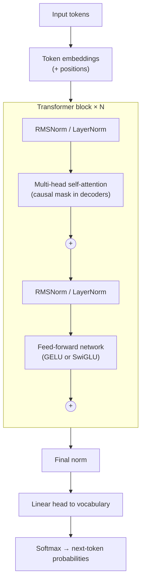

# The Transformer

!!! abstract "TL;DR"
    The Transformer (2017) replaced recurrence with **self-attention**: every token builds its new representation as a weighted mix of all tokens' values, with weights from query–key similarity, $\text{softmax}(QK^\top/\sqrt{d_k})V$. **Multiple heads** capture different relationships; **positional encodings** (now usually RoPE) supply order; a **feed-forward network** processes each token; **residual connections and normalization** keep deep stacks trainable. It trains in parallel and connects distant tokens directly, at $O(n^2)$ cost in sequence length. Decoder-only Transformers trained on next-token prediction are today's LLMs.

!!! evolution "Where this fits"
    **Before:** [attention on top of RNNs](../deep-learning/sequence-models.md) fixed the seq2seq bottleneck but stayed sequential. **This page:** attention only. **Next:** [Efficient Attention & MoE](efficient-attention.md) attacks the quadratic cost; [Pretraining & LLMs](pretraining.md) scales it up.

## The architecture at a glance



Each block has two sublayers, and each sublayer is wrapped in a residual connection: **attention** lets tokens exchange information; the **feed-forward network** transforms each token independently. This page shows the Pre-LN arrangement used by modern LLMs: $x \leftarrow x + \text{Attn}(\text{Norm}(x))$, then $x \leftarrow x + \text{FFN}(\text{Norm}(x))$.

## Self-attention

**The problem it solved:** RNNs process tokens one after another (slow to train) and pass information between distant tokens through many steps (it fades).

**Core idea:** every token looks at every other token directly, in one step, and takes a weighted average of what they offer.

### Queries, keys and values

Each token's vector $x_i$ is projected three ways with learned matrices:

- **Query** $q_i = x_i W_Q$: what this token is looking for.
- **Key** $k_j = x_j W_K$: what each token offers to be matched against.
- **Value** $v_j = x_j W_V$: the information each token passes on if attended to.

Think of a library search: the query is your request, keys are the catalogue entries, values are the books. You take a mix of books weighted by how well each catalogue entry matches your request.

$$
\text{Attention}(Q, K, V) = \text{softmax}\left(\frac{QK^\top}{\sqrt{d_k}}\right)V
$$

With $n$ tokens, $Q$ and $K$ are $(n, d_k)$ and $V$ is $(n, d_v)$. $QK^\top$ is an $(n, n)$ score matrix; softmax over each row turns scores into weights that sum to 1; multiplying by $V$ gives each token a new $(d_v)$ vector.

### Why divide by √d_k

If query and key components are roughly independent with mean 0 and variance 1, their dot product has variance $d_k$. With $d_k = 128$, raw scores have a standard deviation around 11, which pushes softmax toward a one-hot output where its gradients are nearly zero, so learning stalls. Dividing by $\sqrt{d_k}$ restores unit variance.

### Masks

- **Causal mask** (decoders): position $i$ may only attend to positions $\le i$. Scores for future positions are set to $-\infty$ before the softmax so they get exactly zero weight. This is what makes next-token training honest: the model can't peek at the token it's predicting. A large negative number instead of $-\infty$ is used in practice to avoid NaNs.
- **Padding mask:** ignore padding tokens in batches of unequal length.

{ loading=lazy }
{ loading=lazy }

### Costs and benefits

| | RNN | Self-attention |
|---|---|---|
| Sequential operations per layer | $O(n)$ | $O(1)$: all positions at once |
| Path length between two tokens | $O(n)$ | $O(1)$ |
| Compute per layer | $O(n\,d^2)$ | $O(n^2 d)$ for attention, plus $O(n\,d^2)$ for projections and FFN |
| Memory for attention weights | — | $O(n^2)$ per head (avoided by FlashAttention) |

For short sequences the $O(nd^2)$ projections dominate; past a few thousand tokens the $O(n^2d)$ attention term does, which is why long context needs [efficient attention](efficient-attention.md).

## Multi-head attention

**The problem:** a single softmax produces one weighted average per token, but tokens relate in several ways at once: syntax, coreference, position, topic.

**Core idea:** run $h$ attention operations in parallel on smaller projections, each with $d_k = d_{model}/h$, then concatenate and project back:

$$
\text{MultiHead}(X) = \text{Concat}(\text{head}_1, \dots, \text{head}_h)\,W_O,\qquad \text{head}_i = \text{Attention}(XW_Q^{(i)}, XW_K^{(i)}, XW_V^{(i)})
$$

- The total cost is about the same as one full-width head, because each head is $h$ times narrower.
- Parameters: $W_Q, W_K, W_V, W_O$ are each $d \times d$, so $4d^2$ per layer (plus biases if used).
- Heads specialize. Some attend to the previous token, some track syntax; **induction heads** find an earlier occurrence of the current token and copy what followed it, a mechanism behind in-context learning.
- Many heads turn out to be redundant and can be pruned; sharing keys and values across heads (MQA, GQA) saves memory at inference. See [Efficient Attention](efficient-attention.md).

## Positional information

**The problem:** attention is permutation-invariant. Without position information, "dog bites man" and "man bites dog" look identical.

| Method | How | Strengths | Weaknesses | Used in |
|---|---|---|---|---|
| **Sinusoidal** (2017) | Add $\sin(pos/10000^{2i/d})$ and $\cos(\cdot)$ of different frequencies to embeddings | No parameters; any length in principle | Poor extrapolation in practice | Original Transformer |
| **Learned absolute** | A trainable vector per position | Simple, flexible | Hard limit at the trained length | BERT, GPT-2 |
| **Relative bias** | Add a learned bias to scores based on distance $i - j$ | Generalizes across positions | Extra computation | T5 |
| **RoPE** (2021) | Rotate query and key vectors by position-dependent angles | Relative by construction, no parameters, extendable | Extrapolation still needs scaling tricks | LLaMA, Mistral, Qwen, most open LLMs |
| **ALiBi** (2021) | Subtract a head-specific penalty proportional to distance from scores | Extrapolates to longer inputs well | Strong recency bias | BLOOM, MPT |

### RoPE in one paragraph

Split each query and key into pairs of dimensions and treat each pair as a 2-D vector. At position $m$, rotate pair $i$ by angle $m\theta_i$ with $\theta_i = 10000^{-2i/d}$ (so different pairs rotate at different speeds). Because rotating $q$ by $m\theta$ and $k$ by $n\theta$ leaves their dot product depending only on the angle difference, $q_m'^\top k_n' = q_m^\top R_{(n-m)\theta}\, k_n$: attention scores depend on **relative** position, with no added parameters. To extend context after training, rescale the rotation frequencies: **position interpolation**, **NTK-aware scaling** and **YaRN**.

## The feed-forward network

Each token passes independently through a two-layer MLP: $\text{FFN}(x) = W_2\,\phi(W_1 x)$, typically widening from $d$ to $4d$ and back, with GELU. LLaMA-style models use **SwiGLU**, $W_2(\text{SiLU}(W_1x) \odot W_3x)$, with hidden size about $\tfrac{8}{3}d$ so the parameter count stays near $8d^2$.

- Attention moves information **between** tokens; the FFN transforms it **within** each token.
- FFNs hold about two-thirds of a block's parameters, and research suggests they act like key–value memories that store much of a model's factual knowledge.
- Mixture-of-experts models replace this FFN with many expert FFNs and a router.

## Residuals and normalization

- **Residual connections** ($x + F(x)$) give gradients a direct path through dozens of layers, exactly as in [ResNet](../deep-learning/cnn-vision.md).
- **Normalization:** LayerNorm in the original and in BERT/GPT-2; **RMSNorm** in most recent LLMs (cheaper, equally good).
- **Pre-LN** (normalize each sublayer's input) trains deep stacks more stably than the original **Post-LN** and needs less warmup. A final normalization sits before the output head.

## Three ways to use the block

| Architecture | Attention | Training objective | Examples | Best for |
|---|---|---|---|---|
| **Encoder-only** | Bidirectional | Masked-token prediction | BERT, RoBERTa, DeBERTa | Classification, extraction, embeddings, reranking |
| **Decoder-only** | Causal | Next-token prediction | GPT series, LLaMA, Mistral, Qwen, Claude-style chat models | Generation, chat, general-purpose LLMs |
| **Encoder–decoder** | Bidirectional encoder; causal decoder with **cross-attention** to the encoder | Span corruption or seq2seq | Original Transformer, T5, BART, Whisper | Translation, summarization, speech recognition |

**Cross-attention:** queries come from the decoder; keys and values come from the encoder's outputs. It's how a decoder "reads" the source sentence or the audio.

**Why decoder-only won for general LLMs:** one simple objective (predict the next token) uses every token of every document as a training signal, scales cleanly, and frames every task as text continuation, so a single model can do translation, summarization, coding and chat. Inference also benefits from caching keys and values. Encoders remain the right tool for cheap, fast embeddings and classifiers.

## Tokenization

**The problem:** word-level vocabularies explode and can't represent new words; character-level sequences are too long.

**Core idea:** split text into **subword** units: common words become single tokens, rare words are built from pieces.

**Byte-pair encoding (BPE):** start from characters (or bytes), count adjacent pairs across the corpus, merge the most frequent pair into a new token, and repeat until the vocabulary reaches the target size. Encoding new text applies the learned merges in order.

??? example "BPE on a tiny corpus"
    Corpus: "low" ×5, "lower" ×2, "newest" ×6, "widest" ×3. Starting from characters, the most frequent pairs are "e s" and "s t" (9 times each, from newest and widest). Merging "e s" gives "es", and then "es t" (9) becomes "est"; breaking the tie the other way gives "st" then "e st", reaching the same token. Next come "l o" (7) → "lo" and "lo w" (7) → "low", and so on. Frequent words end up as single tokens, and an unseen word like "lowest" is still encodable as "low" + "est".

| Tokenizer | How merges are chosen | Used by |
|---|---|---|
| **Byte-level BPE** | Most frequent pair, over bytes, so any text is representable (no unknown token) | GPT-2 onward, LLaMA 3 |
| **WordPiece** | The pair that most increases likelihood | BERT |
| **Unigram LM (SentencePiece)** | Start large and prune tokens that least reduce likelihood; treats spaces as a symbol | T5, earlier LLaMA, many multilingual models |

**Vocabulary size** (typically 32k–256k) is a trade-off: larger vocabularies give shorter sequences (cheaper attention, more text per context window) but a larger embedding matrix and output softmax, and rarer tokens with less training signal.

**Quirks tokenization explains:** counting letters in a word ("strawberry" may be 2–3 tokens, so the model never sees individual letters), digit-by-digit arithmetic, sensitivity to leading spaces and capitalization, and non-English text costing more tokens per word (higher cost and shorter effective context).

## Embeddings and the output head

Token IDs index an embedding matrix of shape $(V, d)$. The output head maps the final hidden state back to $V$ logits. Many models **tie** these two matrices (use the same weights), which saves $V \times d$ parameters and often helps smaller models; many large models leave them untied.

## Counting parameters and FLOPs

Per block, ignoring biases and norms: attention $4d^2$ + FFN $8d^2$ = **$12d^2$**.

??? example "Worked example: a 7B-class model"
    With $d = 4096$ and $L = 32$ layers: $12 \times 4096^2 \times 32 \approx 6.4$ billion parameters in the blocks. A 32,000-token vocabulary adds $32{,}000 \times 4096 \approx 131$ million for embeddings, doubled if the output head is untied. Total: about 6.7 billion, which is LLaMA-7B's size.

**FLOPs per token:** a forward pass costs about $2N$ FLOPs for a model with $N$ parameters (one multiply and one add per weight), plus attention's $O(n \cdot d)$ per layer for a context of length $n$. Training (forward plus backward) costs about $6N$ per token, so training a 7B model on 2 trillion tokens needs about $6 \times 7\times10^9 \times 2\times10^{12} \approx 8.4\times10^{22}$ FLOPs.

## Training and inference

- **Training (teacher forcing):** feed the whole sequence at once; the causal mask lets every position predict its next token in parallel; the loss is cross-entropy averaged over positions.
- **Inference (autoregressive):** generate one token at a time, appending each to the input. Recomputing everything for each new token would be wasteful, so implementations cache past keys and values (the **KV cache**). See [Efficient Attention](efficient-attention.md) and [Inference & Serving](inference.md).

## Code: attention from scratch

```python
import numpy as np

def softmax(x, axis=-1):
    x = x - x.max(axis=axis, keepdims=True)        # numerical stability
    e = np.exp(x)
    return e / e.sum(axis=axis, keepdims=True)

def scaled_dot_product_attention(Q, K, V, causal=False):
    """Q: (..., n, d_k), K: (..., m, d_k), V: (..., m, d_v) -> (..., n, d_v)."""
    d_k = Q.shape[-1]
    scores = Q @ K.swapaxes(-1, -2) / np.sqrt(d_k)  # (..., n, m)
    if causal:
        n, m = scores.shape[-2:]
        future = np.triu(np.ones((n, m), dtype=bool), k=1)
        scores = np.where(future, -1e9, scores)     # large negative instead of -inf avoids NaNs
    weights = softmax(scores, axis=-1)
    return weights @ V

def multi_head_attention(X, W_q, W_k, W_v, W_o, num_heads, causal=True):
    """X: (n, d_model); each W: (d_model, d_model)."""
    n, d_model = X.shape
    d_head = d_model // num_heads

    def split_heads(T):                             # (n, d_model) -> (heads, n, d_head)
        return T.reshape(n, num_heads, d_head).transpose(1, 0, 2)

    Q, K, V = (split_heads(X @ W) for W in (W_q, W_k, W_v))
    heads = scaled_dot_product_attention(Q, K, V, causal)  # (heads, n, d_head)
    concat = heads.transpose(1, 0, 2).reshape(n, d_model)  # join heads back
    return concat @ W_o
```

Be ready to explain every shape, why the mask uses a large negative number, and how you'd add a padding mask (combine it with the causal mask before the softmax).

## Interview questions

??? question "Explain queries, keys and values intuitively."
    Each token produces three vectors from its embedding. The **query** says what the token is looking for, each **key** says what a token can be matched on, and each **value** is the content a token contributes if attended to. The dot product of a query with every key scores relevance; softmax turns scores into weights; the output is the weighted sum of values. Separating keys from values lets what you match on differ from what you pass along.

??? question "Why divide by √d_k in attention?"
    For random vectors with unit-variance components, $q \cdot k$ has variance $d_k$, so with large head dimensions the raw scores have large magnitude. Softmax of large scores is nearly one-hot, with gradients close to zero, which stalls training. Dividing by $\sqrt{d_k}$ keeps the scores' variance around 1 so softmax stays in a range with useful gradients.

??? question "What are the time and memory costs of self-attention?"
    Computing $QK^\top$ and multiplying by $V$ costs $O(n^2 d)$ time per layer for $n$ tokens and dimension $d$, and storing the attention matrix costs $O(n^2)$ memory per head. Projections and the FFN cost $O(n d^2)$. So attention dominates for long sequences. In exchange, all positions are processed in parallel and any two tokens interact in one step. FlashAttention removes the $O(n^2)$ memory without changing the result.

??? question "What does the causal mask do, and why use −∞ rather than 0?"
    It stops each position from attending to later positions, so during training position $t$ predicts token $t+1$ without seeing it, and every position can be trained in parallel. The mask is applied to the scores before softmax: setting a score to $-\infty$ makes its weight $e^{-\infty} = 0$ after normalization. Setting the weight to 0 after softmax would break normalization; setting the score to 0 would still give the future token a positive weight.

??? question "Why use multiple attention heads instead of one big head?"
    One softmax yields a single distribution of attention per token, which must average over all the kinds of relationships at once. Several narrower heads can each attend to different positions for different reasons (previous token, subject of the sentence, matching brackets) and their outputs are combined. Because each head has dimension $d/h$, the total compute and parameters match one full-width head.

??? question "How many parameters are in a multi-head attention layer, and in a Transformer block?"
    Attention: $W_Q$, $W_K$, $W_V$ and $W_O$, each $d \times d$, so $4d^2$ (plus $4d$ for biases if used), independent of the number of heads. FFN with a $4d$ hidden layer: $2 \times d \times 4d = 8d^2$. A block is therefore about $12d^2$, plus small normalization parameters. With grouped-query attention, $W_K$ and $W_V$ shrink in proportion to the number of key–value heads.

??? question "Why does a Transformer need positional encoding?"
    Self-attention treats its input as a set: permuting the tokens permutes the outputs identically, so without position information word order is invisible. Positional encodings inject order, either by adding position vectors to the embeddings (sinusoidal, learned) or by making attention scores depend on relative position (relative biases, RoPE, ALiBi).

??? question "Explain RoPE intuitively."
    RoPE rotates each two-dimensional slice of the query and key vectors by an angle proportional to the token's position, with different slices rotating at different frequencies. A dot product between two rotated vectors depends only on the difference of their angles, so the attention score between positions $m$ and $n$ depends on $m - n$: relative position, encoded without extra parameters and inside the attention computation itself. Context can be extended later by rescaling the frequencies (position interpolation, NTK scaling, YaRN).

??? question "Compare sinusoidal, learned, RoPE and ALiBi positional encodings."
    **Sinusoidal:** fixed, added to embeddings, no parameters, weak extrapolation in practice. **Learned absolute:** a vector per position, flexible, but capped at the trained length. **RoPE:** rotates queries and keys so scores depend on relative position; the default in modern LLMs; extendable with frequency scaling. **ALiBi:** adds a linear distance penalty per head to the scores; extrapolates well beyond the training length but imposes a recency bias.

??? question "What does the feed-forward network in a Transformer block do?"
    It's a two-layer MLP applied to each token independently, usually widening to about $4d$ with a GELU or SwiGLU non-linearity. Attention mixes information across tokens; the FFN transforms each token's representation, adding non-linear capacity. It holds most of the block's parameters, and interpretability research suggests FFN layers store much factual knowledge as key–value-like associations. MoE layers replace it with many expert FFNs.

??? question "Why does the Transformer use residual connections and layer normalization?"
    Residual connections give each sublayer an identity path, so gradients reach early layers directly and each sublayer only needs to learn a refinement; without them, deep stacks are very hard to train. Normalization keeps activations at a stable scale across layers, which allows higher learning rates. Pre-LN (normalizing each sublayer's input) preserves a clean residual path and is more stable for deep models than Post-LN.

??? question "Encoder-only vs decoder-only vs encoder–decoder: when do you use each?"
    **Encoder-only** (BERT): bidirectional context, ideal for classification, entity extraction, embeddings and rerankers; small and fast. **Decoder-only** (GPT, LLaMA): causal attention and next-token prediction, ideal for generation and general-purpose assistants. **Encoder–decoder** (T5, BART, Whisper): a bidirectional encoder for the input plus a decoder with cross-attention, strong when input and output are different sequences, as in translation, summarization and speech recognition.

??? question "Why are most LLMs decoder-only?"
    Next-token prediction turns every token of raw text into a training example and scales smoothly with data and compute. Any task can be phrased as text in, text out, so one model handles everything. The architecture is simpler (one stack, one objective), generation is natural, and the KV cache makes inference efficient. At large scale it matched or beat encoder–decoder models on most tasks, so the field converged on it.

??? question "What is cross-attention?"
    Attention where the queries come from one sequence and the keys and values from another. In an encoder–decoder model, each decoder layer has a cross-attention sublayer whose queries come from the decoder's states and whose keys and values come from the encoder's output, letting the decoder consult the source while generating. Multimodal models use the same mechanism to attend from text to image features, and diffusion models use it to condition on text.

??? question "How does BPE tokenization work?"
    Start with a vocabulary of characters (or bytes). Repeatedly find the most frequent adjacent pair of tokens in the training corpus and merge it into a new token, recording the merge, until the vocabulary reaches the target size. To tokenize new text, apply the merges in the learned order. Frequent words become single tokens and rare words split into subwords, so there's no unknown-word problem (with byte-level BPE, any string is representable).

??? question "Why can LLMs struggle to count the letters in a word?"
    They don't see letters. "strawberry" might be tokenized as two or three subword tokens, so the model must have memorized the spelling of each token to count characters, and that information is only indirectly present in training data. The same applies to digits in arithmetic (numbers split into irregular chunks). Reasoning step by step, spelling the word out, or using a code tool works around it.

??? question "How does vocabulary size affect a model?"
    A larger vocabulary encodes text in fewer tokens, so more fits in the context window and attention is cheaper per document, and multilingual coverage improves. But the embedding and output matrices grow ($V \times d$ each), the output softmax costs more, and rare tokens get little training signal. Smaller vocabularies mean longer sequences. Modern LLMs use roughly 32k to 256k tokens.

??? question "What is weight tying?"
    Using the same matrix for the input token embeddings and the output projection to vocabulary logits (transposed). It saves $V \times d$ parameters, which is significant for small models with large vocabularies, and often improves quality because both directions learn a shared representation of each token. Larger models often untie them for extra capacity.

??? question "Estimate the parameter count of a 32-layer Transformer with d = 4096."
    Each block has about $12d^2$ parameters ($4d^2$ attention, $8d^2$ FFN): $12 \times 4096^2 \approx 201$ million per layer, so about 6.4 billion for 32 layers. Add embeddings: vocabulary × $d$, for example $32{,}000 \times 4096 \approx 131$ million (twice that if the output head is untied). Total about 6.7 billion, matching LLaMA-7B.

??? question "How many FLOPs does it take to train a model?"
    Roughly $6N$ FLOPs per training token for $N$ parameters: about $2N$ for the forward pass and $4N$ for the backward pass. So training cost ≈ $6ND$ for $D$ tokens. For a 7B model on 2T tokens: $6 \times 7\times10^9 \times 2\times10^{12} = 8.4\times10^{22}$ FLOPs. At a sustained $4\times10^{14}$ FLOP/s per GPU that's about $2.1\times10^8$ GPU-seconds, roughly 58,000 GPU-hours. This ignores attention's extra cost for long contexts.

??? question "How is a Transformer trained versus how it generates text?"
    In training, the entire sequence is fed at once and the causal mask lets every position predict its next token in parallel with teacher forcing; the loss is the average cross-entropy. In generation, the model produces one token at a time: run the prompt (prefill), sample a token, append it, and repeat. To avoid recomputing keys and values for all previous tokens at every step, they're cached (KV cache), so each new token costs time proportional to the context length.

??? question "How does attention compare with convolution and recurrence in its built-in assumptions?"
    Convolution assumes locality and translation equivariance; recurrence assumes sequential order and a compressed running state. Attention assumes almost nothing: any token can interact with any other, with content-dependent weights. That flexibility makes it powerful and general but data-hungry, and position must be added explicitly. With enough data, the weaker assumptions win; with little data, the stronger biases of CNNs or RNNs can help.

??? question "What are induction heads?"
    A pair of attention heads, often in consecutive layers, that implement "find where the current token appeared before and predict the token that followed it". The first head copies information about the previous token into each position; the second searches for earlier positions whose previous token matches the current one and copies what came next. They appear abruptly during training and are thought to underlie much of in-context learning, such as repeating patterns and copying from the prompt.

!!! pitfall "Common mistakes"
    - Saying the scaling is by $d_{model}$ instead of $\sqrt{d_k}$.
    - Claiming multi-head attention has more parameters than single-head attention of the same width.
    - Applying the causal mask after the softmax.
    - Forgetting that self-attention is permutation-invariant without positional information.
    - Confusing cross-attention with self-attention.
    - Quoting attention as $O(n^2)$ without mentioning the $O(nd^2)$ terms that dominate short sequences.

## Revision checklist

- [ ] Draw a Pre-LN Transformer block from memory
- [ ] Write the attention formula and explain Q, K, V and √d_k
- [ ] Explain causal and padding masks
- [ ] Count parameters of a block ($12d^2$) and of a 7B model
- [ ] Explain RoPE and compare positional encodings
- [ ] Compare encoder-only, decoder-only and encoder–decoder models
- [ ] Walk through BPE and two tokenization quirks
- [ ] Implement scaled dot-product and multi-head attention in NumPy

## Go deeper

- [Attention Is All You Need (2017)](https://arxiv.org/abs/1706.03762)
- [The Illustrated Transformer](https://jalammar.github.io/illustrated-transformer/)
- [The Annotated Transformer](https://nlp.seas.harvard.edu/annotated-transformer/)
- [RoFormer: Rotary Position Embedding (2021)](https://arxiv.org/abs/2104.09864)
- [Karpathy: Let's build GPT](https://karpathy.ai/zero-to-hero.html)
