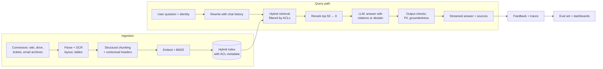

# GenAI System Design

!!! abstract "TL;DR"
    GenAI design rounds test judgment: start with the **simplest architecture that could work** (a prompt, then RAG, then tools, then an agent, then fine-tuning), choose models by measured quality, latency and cost, and spend real time on **evaluation, guardrails, permissions, cost and latency**. Strong answers define success metrics early, propose an evaluation set before building, and explain how the system improves after launch.

!!! evolution "Where this fits"
    **Before:** the whole [AI Engineering](../ai-engineering/prompting.md) section, [Inference & Serving](../llms/inference.md), [MLOps & LLMOps](mlops.md). **This page:** putting it together under interview conditions.

## A framework for GenAI designs

| Step | What to cover |
|---|---|
| **1. Clarify** | Users and tasks; what a good answer looks like; risk level; latency target (TTFT and total); cost per request; data sources and permissions; languages; volume and peaks; compliance |
| **2. Choose the architecture** | Prompt only → RAG → tool calling → workflow → agent; fine-tuning only where behavior or cost demands it. Justify each step up. |
| **3. Choose models** | Hosted vs open weights; size tiers; routing between a small and a large model; embedding and reranking models; measured on your eval set |
| **4. Knowledge and data** | Ingestion, parsing, chunking, indexing, freshness, permissions, PII handling |
| **5. Context and prompts** | System prompt, retrieved context, tools, memory; layout for prompt caching |
| **6. Evaluation** | An offline set from real tasks; programmatic checks, calibrated judges, human review; online metrics and A/B tests |
| **7. Safety** | Prompt injection, data leakage, output handling, approvals for actions, abuse, over-refusal |
| **8. Serving and operations** | Streaming, caching, batching, rate limits, fallbacks, tracing, cost and quality monitoring, rollout of prompt and model versions |

## Worked design: an enterprise knowledge assistant

**Clarify.** Employees ask questions over 1 million internal documents (wikis, policies, tickets, PDFs, slides) in several languages. Answers must cite sources and respect document permissions. Target: first token under 2 s, full answer under 8 s; cost under a few cents per question; 50,000 questions a day.

**Architecture.**

**Key decisions.**

- **Permissions:** sync ACLs from each source into chunk metadata; filter in the retrieval query by the user's groups; re-sync on permission changes. The model never sees what the user can't.
- **Retrieval quality:** hybrid search (names, acronyms and ticket IDs need BM25), a cross-encoder reranker, contextual chunk headers, query rewriting for follow-ups, routing to specialized indexes (HR policies vs engineering docs).
- **Generation:** cite every claim with source links; abstain when sources are insufficient; prefer newer documents when they conflict; a mid-sized model for most questions, escalating to a stronger model for complex synthesis.
- **Freshness:** incremental re-indexing from change feeds; show document dates.
- **Evaluation:** a few hundred real questions labeled with the documents that answer them (retrieval recall@k) and reference answers or key facts (faithfulness and correctness judged by a calibrated LLM judge), unanswerable questions, and permission tests with users of different roles.
- **Cost:** about 4,000 input tokens (instructions plus 8 passages) and 400 output tokens per question; stable instructions cached; repeated questions answered from a semantic cache scoped by permissions.
- **Online:** thumbs up/down, citation clicks, "no answer" rates by topic (to find content gaps), latency per stage, cost per answer.

## Worked design: a support agent that takes actions

**Clarify.** Handle customer chats for an e-commerce company: answer questions, track orders, process returns and refunds within policy, escalate otherwise. Success: resolution rate, customer satisfaction, correct actions, and no unauthorized refunds.

**Architecture.**

- **Router (workflow):** classify intent; simple FAQs go to a RAG answer; account actions go to the agent; sensitive cases (legal threats, safety) go straight to humans.
- **Agent with tools:** `lookup_customer`, `get_order`, `search_policy`, `create_return`, `issue_refund(order_id, amount, reason)`, `escalate_to_human(summary)`, all acting with the authenticated customer's scope.
- **Policy enforcement in code:** refunds above a threshold, outside the return window, or repeated within 30 days require human approval regardless of what the model says; idempotency keys prevent double refunds.
- **Context:** customer profile and order summary loaded up front; policies retrieved on demand; conversation compacted for long chats.
- **Handoff:** escalation includes a structured summary so the human doesn't restart the conversation.

**Evaluation.** Replay historical conversations with known correct outcomes in a simulator with mocked tools; check end states (correct refund amount, correct order, policy followed) over several runs per case; red-team with manipulative customers ("my manager said I get a full refund") and injected instructions in order notes. **Rollout:** shadow mode (agent proposes, humans act), then autonomous on low-risk intents, then wider.

## Worked design: a coding agent for internal repositories

**Clarify.** Engineers assign issues (bug fixes, small features, test additions) to an agent that opens pull requests for review. Success: share of PRs merged with little rework; safety: no secrets leaked, no unreviewed changes to protected branches.

**Harness.**

- **Sandbox:** a container per task with the repository checked out, dependencies installed, network limited to package mirrors, no production credentials.
- **Tools:** code search, file read, edit by diff, run tests and linters, run a command (allow-listed), create a branch and PR. Pushing to protected branches is denied by policy.
- **Context:** a repository instructions file (build and test commands, conventions); search on demand rather than loading the repository; truncated test output; compaction for long sessions; sub-agents for broad exploration.
- **Verification:** run relevant tests before declaring done; add or update tests; run the linter and type checker; summarize changes and test evidence in the PR description.
- **Budgets:** step, time and cost limits per task; escalation with a summary when stuck.

**Evaluation.** A suite of past issues with their hidden tests (SWE-bench-style) from your own repositories; measure resolution rate (pass@1 and pass^k), review rework, time and cost per task; monitor merged-PR revert rates in production.

## Worked design: document extraction at scale

**Clarify.** Extract fields (supplier, dates, line items, totals, tax IDs) from 2 million invoices a month in varied layouts and languages, some scanned; feed an accounting system; accuracy above 99% on totals, with human review for uncertain cases.

**Pipeline.**

1. **Ingest and classify** document type; route known templates to cheap template extractors.
2. **Extract** with a vision-language model (or OCR plus an LLM) using **structured output** against a strict schema.
3. **Validate** with business rules: line items sum to the subtotal, tax rates valid, dates plausible, supplier exists in the vendor master data, totals match purchase orders.
4. **Confidence routing:** auto-accept when validations pass and confidence is high; otherwise send to a human review queue showing the document with highlighted fields.
5. **Learn from corrections:** reviewer fixes become evaluation cases and fine-tuning data (a fine-tuned smaller model can cut cost at this volume).

**Cost and throughput.** Batch processing through batch APIs or self-hosted models; measure cost per document and straight-through-processing rate; field-level precision and recall per document type and language.

## Worked design: an LLM gateway for many teams

**Clarify.** Dozens of internal teams want LLM access with consistent security, cost control and observability across several model providers and self-hosted models.

**Components.**

- **Unified API** with authentication per team and per application.
- **Routing:** by model name, capability, cost tier and availability; **fallback** to another provider on errors or rate limits.
- **Policies:** PII redaction, data-residency rules per request, allowed models per team, content safety checks.
- **Quotas and rate limits** per team; budgets with alerts.
- **Caching:** provider prompt caching passthrough, plus optional response caching scoped per application.
- **Observability:** traces with tokens, latency, cost and model version per request; dashboards per team; sampled quality evaluations.
- **Evaluation service:** teams register eval suites; model upgrades are tested against them before rollout.

**Trade-offs:** an extra network hop (a few milliseconds), a central dependency (needs high availability and graceful degradation), and the balance between central control and team flexibility.

## Back-of-envelope for GenAI designs

??? example "Tokens, cost and capacity"
    For 50,000 requests a day at 4,000 input and 400 output tokens each: 200M input and 20M output tokens a day. With hosted prices of P₁ and P₂ per million input and output tokens, daily cost ≈ 200·P₁ + 20·P₂; if 3,000 of the input tokens are a cached prefix, most of the input cost is billed at the cached rate.

    Self-hosting: 20M output tokens a day is about 230 output tokens per second on average; with peaks of 5× and a target of 50 tokens per second per user, size GPUs for roughly 1,200 tokens per second of decode plus prefill capacity for 1M input tokens per hour at peak, then add headroom and redundancy.

    Latency: TTFT ≈ queueing + retrieval and reranking (100–400 ms) + prefill (grows with prompt length); total ≈ TTFT + output tokens × time per token (for example 400 × 20 ms = 8 s), which is why streaming matters.

## Interview questions

??? question "How do you decide between prompting, RAG, tools, an agent or fine-tuning in a design?"
    Start with the simplest thing that might work and measure it on an evaluation set. Add RAG when the problem is knowledge that's private, large or changing. Add tools when the system must read live data or take actions. Use a workflow when the steps are known, and an agent only when the path depends on what's discovered. Fine-tune when you need consistent behavior or format that prompting can't reach, or to replace a large model with a cheaper small one at high volume. Each step adds cost and complexity, so justify it with evidence.

??? question "How do you reduce the latency of a RAG assistant?"
    Stream tokens so users see progress; parallelize retrieval sources; use a fast embedding model and cache query embeddings; rerank fewer candidates or use a smaller reranker; trim the prompt (fewer, better passages) and cache stable prefixes; route simple questions to a smaller, faster model; keep services close together; and set per-stage latency budgets with tracing to find the slowest step.

??? question "How do you handle multi-tenancy in an LLM application?"
    Isolate data per tenant: separate indexes or namespaces, ACL filters enforced in retrieval, caches keyed by tenant (and user where needed), and per-tenant encryption where required. Isolate resources with per-tenant quotas and rate limits. Keep per-tenant configuration (prompts, allowed tools, models) and per-tenant observability and cost attribution. Test isolation explicitly, including prompt-injection attempts to reach other tenants' data.

??? question "How do you roll out a new model or prompt version safely?"
    Run the offline evaluation suite (including safety and slice metrics) and compare with the current version; check cost and latency; deploy in shadow mode or to internal users; then canary to a small share of traffic with online metrics and guardrails monitored; expand gradually with the ability to roll back instantly. Version prompts and models together, and record which version served each request.

??? question "What would you log for an LLM application, and how do you handle privacy?"
    Per request: inputs, retrieved context IDs, tool calls and results, outputs, model and prompt versions, tokens, latency per stage, cost, guardrail decisions and user feedback, linked as a trace. For privacy: redact or tokenize PII before logging, restrict access, set retention limits, honor deletion requests, avoid logging content from restricted sources, and make sure provider agreements cover data use.

??? question "Hosted API or open-weights model for a new product?"
    Measure quality on your evaluation set first. Hosted APIs offer the strongest models, no infrastructure, and fast iteration, priced per token with less control over data location and model changes. Open models give control over deployment, data residency, latency and fine-tuning, and can be cheaper at steady high volume, but need serving expertise, GPU capacity and upgrades. Many products start hosted, then move high-volume, narrow tasks to fine-tuned open models, keeping a hosted model for hard cases.

??? question "How do you design for hallucination risk in a high-stakes domain such as healthcare or finance?"
    Ground every answer in approved sources with citations and require abstention when sources are insufficient; restrict scope to supported questions; add verification (groundedness checks, rule checks on numbers); keep a human in the loop for decisions; show confidence and sources in the UI; evaluate with domain experts on representative and adversarial cases; monitor in production with sampled expert review; and meet regulatory requirements for audit trails.

!!! pitfall "Common mistakes"
    - Proposing an agent or fine-tuning before showing why prompting and RAG aren't enough.
    - No evaluation plan until the end of the interview.
    - Enforcing permissions or policies only in the prompt.
    - Ignoring cost per request and latency budgets.
    - No rollout or fallback plan for model and prompt changes.

## Revision checklist

- [ ] Recite the GenAI design framework
- [ ] Design the enterprise knowledge assistant with permissions, evaluation and cost
- [ ] Design the support agent with policy enforcement and safe rollout
- [ ] Design the coding agent's harness and evaluation
- [ ] Design document extraction with validation and confidence routing
- [ ] Do token, cost and latency estimates

## Go deeper

- [Anthropic: Building effective agents](https://www.anthropic.com/research/building-effective-agents)
- [Chip Huyen: Building A Generative AI Platform](https://huyenchip.com/2024/07/25/genai-platform.html)
- [Eugene Yan: Patterns for Building LLM-based Systems & Products](https://eugeneyan.com/writing/llm-patterns/)
