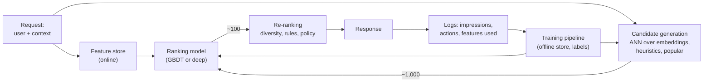

# ML System Design

!!! abstract "TL;DR"
    Design rounds reward **structure and trade-offs** more than any single algorithm. Use the same eight steps every time: **clarify** requirements and scale, **frame** it as an ML problem with metrics, design **data and labels**, **features**, a **model** that starts simple, **training**, **evaluation** offline and online, then **serving and monitoring**. Most designs reuse the same blocks: multi-stage retrieval and ranking, implicit labels with delays and biases, a feature store, calibrated scores, A/B tests and drift monitoring.

!!! evolution "Where this fits"
    **Before:** every modeling page, [Evaluation & Metrics](../foundations/evaluation.md), [Recommender Systems](../classical-ml/recommender-systems.md), [MLOps](mlops.md). **This page:** combining them under interview conditions. **Next:** [GenAI System Design](genai-system-design.md) for LLM-based systems.

## The eight-step framework

| Step | What to cover | Time (45 min) |
|---|---|---|
| **1. Clarify** | The business goal; users; scale (users, items, QPS); latency budget; freshness; constraints (privacy, fairness, cost, regions) | 5 min |
| **2. Frame** | Input, output and ML task type (classification, ranking, regression); the business metric and the offline metric that tracks it; what a mistake costs | 5 min |
| **3. Data and labels** | Sources; explicit vs implicit labels; label delay and noise; sampling and class imbalance; leakage risks; privacy | 5 min |
| **4. Features** | User, item, context, interaction and cross features; embeddings; real-time vs batch features | 5 min |
| **5. Model** | A baseline (heuristic or logistic regression), then a stronger model (GBDT, two-tower, deep ranker); multi-stage if the candidate set is large | 8 min |
| **6. Training** | Loss, negative sampling, imbalance handling, time-based validation, retraining cadence | 4 min |
| **7. Evaluation** | Offline metrics and slices; online A/B test with primary and guardrail metrics | 5 min |
| **8. Serving and monitoring** | Architecture, latency budget per stage, caching, feature store, ANN index, fallbacks; drift, feedback loops, retraining, fairness | 8 min |

**Habits that score well:** state assumptions with numbers, propose a baseline before a complex model, say what you'd measure, name trade-offs explicitly ("this improves recall at the cost of 20 ms"), and keep the interviewer involved ("should I go deeper on features or serving?").

## Building blocks you'll reuse

| Block | Key points |
|---|---|
| **Multi-stage funnel** | Cheap, high-recall retrieval narrows millions of items; an expensive, precise ranker orders hundreds |
| **Implicit labels** | Clicks, watch time, purchases: abundant but biased (position, exposure) and sometimes delayed |
| **Negative sampling and downsampling** | Sample negatives to manage imbalance and cost; **recalibrate** probabilities afterwards if they're used directly |
| **Feature store** | Same feature definitions offline and online; point-in-time-correct training data |
| **Calibration** | Required whenever scores feed money or thresholds (bids, risk limits) |
| **Exploration** | A small share of traffic for new items and to break feedback loops |
| **Evaluation** | Time-based offline splits; online A/B tests with guardrails; long-term holdouts |
| **Monitoring** | Data quality, drift, prediction distribution, delayed-label performance, latency, cost |

??? example "Back-of-envelope numbers to have ready"
    - 100 million daily active users × 20 requests a day ≈ 2 billion requests a day ≈ **23,000 QPS** on average; plan for peaks of 2–5×.
    - 1 billion items × 128-dimensional float32 embeddings ≈ **512 GB**; product quantization to 32 bytes per item ≈ 32 GB.
    - A latency budget of 200 ms might split into: feature fetch 20 ms, retrieval 30 ms, ranking 80 ms, re-ranking and business logic 20 ms, network and overhead the rest.
    - Logging 1 KB per impression at 10 billion impressions a day ≈ **10 TB a day** of training data.

## Worked design: video or news feed recommendations

**Clarify.** Personalized home feed; 100M+ daily users, millions of items, many new items per day; goal: long-term engagement and satisfaction, not just clicks; latency about 200 ms.

**Frame.** Rank candidates by predicted value, combining several predicted outcomes: $\text{score} = w_1 P(\text{click}) + w_2\, \mathbb{E}[\text{watch time}] + w_3 P(\text{like}) - w_4 P(\text{skip or hide})$. Offline: recall@k for retrieval; NDCG and AUC per objective for ranking. Online: watch time per user, retention, satisfaction surveys; guardrails: latency, creator diversity, report rates.

**Data and labels.** Impressions with outcomes (click, watch time, likes, shares, hides), user history, item metadata and content embeddings. Biases: position bias, exposure bias (only shown items get labels), and popularity bias. Label delay for long-term signals.

**Features.** User (history embeddings, preferences, demographics if allowed), item (topic, creator, age, quality signals, content embeddings), context (time, device, session), and cross features (user–creator affinity, similarity between item and recent history).

**Model.** Retrieval from several sources (two-tower embeddings with ANN, recent creators followed, trending, fresh items) merged to about 1,000; a multi-task deep ranker (shared bottom with heads per objective, or mixture-of-experts heads) or a GBDT baseline; re-ranking for diversity, freshness and policy.

**Training.** In-batch negatives with popularity correction for retrieval; impressions as negatives for ranking; position as a training feature set to a constant at serving; daily or continuous training; time-based validation.

**Evaluation.** Offline per objective and per segment (new users, heavy users, regions); online A/B test with long enough duration to see retention; holdout groups for long-term effects.

**Serving and monitoring.** Precomputed item embeddings in an ANN index refreshed frequently; user embedding computed per request; ranking on GPU or CPU with batching; caching for repeated requests; fallback to popular items. Monitor engagement, diversity, creator exposure, drift and feedback loops; reserve exploration traffic for new items.

**Follow-ups to expect:** cold start for new users and items; clickbait (optimize satisfaction, not clicks); filter bubbles (diversity constraints, exploration); how to choose the objective weights (business trade-offs, experiments).

## Worked design: e-commerce search ranking

**Clarify.** Query → ranked products; tens of millions of products; latency about 100–300 ms; goal: purchases and successful searches.

**Frame.** Learning to rank. Relevance labels from clicks, add-to-cart and purchases (graded), plus human relevance judgments for a sample. Offline: NDCG@10, MRR; online: conversion per search, revenue per search, zero-result rate, query reformulation rate.

**Data.** Query logs with impressions and actions; product catalog; human-rated query–product pairs. Biases: position bias (use randomization or propensity weighting), presentation bias.

**Pipeline.**

1. **Query understanding:** spelling correction, tokenization, category and attribute extraction ("red running shoes size 9"), query embeddings.
2. **Retrieval:** BM25 over titles and attributes plus dense retrieval with a bi-encoder, merged; filters for availability and region.
3. **Ranking:** LambdaMART (GBDT with a ranking objective) using text match scores, embedding similarity, product popularity, price, ratings, personalization features; optionally a cross-encoder on the top candidates.
4. **Re-ranking:** business rules (sponsored slots, diversity across brands), deduplication.

**Trade-offs and follow-ups:** relevance vs revenue (keep relevance primary, guard with quality metrics); long-tail queries (dense retrieval helps); latency of cross-encoders (only on the top 20–50); evaluating rankers efficiently (interleaving).

## Worked design: payment fraud detection

**Clarify.** Score every card transaction in real time (under ~100 ms) to approve, decline or send to review; fraud rate about 0.1–1%; review team capacity is limited; costs differ sharply between missed fraud and blocked good customers.

**Frame.** Binary classification with extreme imbalance, used with thresholds: auto-decline above a high threshold, review in a middle band, approve below. Offline: PR-AUC, recall at a fixed false-positive rate, and expected money saved; online: fraud losses, false decline rate, review queue size.

**Data and labels.** Transactions, account history, device and network signals, merchant data. Labels come from chargebacks and investigations with **delays of weeks**, and are noisy; declined transactions have no outcome label (selection bias).

**Features.** Velocity features (transactions per card, device or IP in the last minute, hour, day), deviation from the customer's usual amount and location, merchant risk, device fingerprint, graph features (shared devices, cards and addresses linking accounts), time of day.

**Model.** Rules as a baseline and safety net; GBDT with class weights; graph-based features or models for fraud rings; anomaly detection to catch new patterns. Calibrate scores so thresholds map to costs.

**Training and evaluation.** Time-based splits; wait for label maturity or use partial labels carefully; evaluate per segment (new accounts, merchant categories); test against recent attacks.

**Serving and monitoring.** Streaming feature computation for velocity counts; low-latency online feature store; model scoring service with rule overrides; explanations (top contributing features) for reviewers; feedback from reviews flowing into labels. Monitor drift closely, because fraudsters adapt; keep a small random sample of approvals for unbiased estimates.

## Worked design: ad click-through prediction

**Clarify.** Predict $P(\text{click} \mid \text{user, ad, context})$ for ad auctions; billions of requests per day; latency of a few milliseconds per candidate; the prediction directly sets prices.

**Frame.** Binary classification where **calibration matters**: expected value = bid × predicted click probability (or conversion probability), so a model that's 20% over-confident overcharges or overspends. Offline: log loss and calibration (alongside AUC); online: revenue, advertiser ROI, user experience guardrails.

**Data.** Impressions and clicks (and delayed conversions), very sparse categorical features (user IDs, ad IDs, publisher, keywords). Massive volume, so negatives are downsampled; correct probabilities afterward with $p = \frac{p'}{p' + (1 - p')/w}$, where $w$ is the negative sampling rate.

**Model.** Logistic regression with hashed feature crosses as the classic baseline; factorization machines; deep CTR models (Wide & Deep, DeepFM, DCN) with embeddings for sparse IDs; frequent or online updates because ads and users change quickly.

**Follow-ups:** delayed conversion feedback; position and auction bias; cold-start ads (content features, exploration budget); privacy changes reducing user-level signals.

## Worked design: content moderation

**Clarify.** Detect policy-violating posts (hate, harassment, violence, spam, nudity) across text, images and video, in many languages; millions of posts per day; some need action within minutes; human reviewers are the scarce resource.

**Frame.** Multi-label classification per policy, with thresholds per policy and action (remove automatically, down-rank, send to review). Metrics: precision and recall per policy and language; prevalence of violating content actually seen by users; reviewer workload; appeal overturn rate.

**Data.** Reviewer decisions (expensive, inconsistent between reviewers), user reports (noisy), policy definitions that change over time; severe class imbalance; adversarial users who adapt (misspellings, images of text).

**Model.** Fine-tuned multilingual text encoders and vision models, or a multimodal model; LLM classifiers prompted with the policy text, which adapt quickly when policies change; hash matching for known harmful media; ensembles with rules for spam.

**Serving.** Pre-publication checks for the most severe categories, post-publication scanning, prioritized review queues ordered by predicted severity and reach; active learning to send uncertain cases to reviewers.

**Follow-ups:** fairness across languages and dialects (per-group error rates), policy changes (update prompts or relabel), adversarial evasion, reviewer wellbeing, transparency and appeals.

## Interview questions

??? question "How do you choose the offline metric for a system design problem?"
    Start from the business goal and what a mistake costs, then pick the offline metric that best tracks it and can be computed from available labels: NDCG or recall@k for ranking and retrieval; PR-AUC or recall at a fixed false-positive rate for rare-event detection; log loss and calibration when probabilities drive money; per-objective metrics for multi-task rankers. State the online metric it's a proxy for, and the guardrails that must not get worse.

??? question "Why propose a baseline before a complex model?"
    It sets a reference point for whether complexity pays off, ships value quickly, exposes data and pipeline problems early, and is easier to debug and monitor. In interviews it shows judgment. A heuristic, logistic regression or a GBDT often captures most of the achievable value; you then add complexity where measurements show the baseline falls short.

??? question "How do you handle delayed labels, like chargebacks that arrive weeks later?"
    Train on data old enough for labels to have matured, accepting some staleness; use early proxy signals (customer disputes, reviewer decisions) as provisional labels; model the delay explicitly or weight recent examples; evaluate on matured periods; and monitor leading indicators (score distributions, rule hit rates) while waiting. Mention the selection bias from declined transactions that never get labels, and keep a small random sample to estimate it.

??? question "What is position bias and how does it affect a ranking system design?"
    Items in higher positions get more clicks regardless of relevance, so training on raw clicks teaches the model to reproduce its previous ranking. Handle it by including position as a training feature (set to a fixed value when serving), weighting clicks by inverse propensity estimated from randomization experiments, using interleaving for evaluation, and collecting human relevance labels for a sample.

??? question "When do you need calibrated probabilities in a design?"
    Whenever the score is used as a probability rather than just for ordering: expected-value calculations such as ad bidding, pricing and credit limits; thresholds tied to costs or review capacity; combining scores from several models or objectives; and showing confidence to users. Downsampling, class weights and boosting all distort calibration, so recalibrate on held-out data (Platt scaling, isotonic regression) and monitor calibration in production.

??? question "How do you handle a multi-objective ranking problem?"
    Predict each objective separately (click, watch time, like, hide) with a multi-task model, then combine them in a scoring formula with weights reflecting business priorities, tuned through online experiments. Alternatives: constrained optimization (maximize engagement subject to quality or diversity constraints), or Pareto analysis of trade-offs. Keep the objectives observable separately in dashboards so a regression in one isn't hidden by the combined score.

??? question "How would you scale a design from one country to global?"
    Data: language and regional differences in features and labels, and data-residency laws. Models: multilingual encoders, regional fine-tuning or features, and per-region evaluation slices (fairness across languages). Serving: regional deployments to meet latency, replicated feature stores and indexes, and capacity for different traffic peaks. Operations: per-region monitoring and gradual rollouts by region.

??? question "How do you prevent feedback loops in a recommender or fraud system?"
    Keep a small share of traffic for exploration or random selection so you observe outcomes the model wouldn't have chosen; log propensities so you can correct for selection with inverse propensity weighting; monitor diversity and coverage; and evaluate with holdouts unaffected by the model. In fraud, approve a small random sample of borderline cases (within risk limits) to measure true fraud rates.

!!! pitfall "Common mistakes"
    - Jumping to a model architecture before clarifying the goal and scale.
    - Choosing accuracy for imbalanced problems, or AUC when calibration matters.
    - Ignoring label delay, position bias and feedback loops.
    - Random splits in time-dependent systems.
    - Designing without latency budgets or monitoring.

## Revision checklist

- [ ] Recite the eight steps with time allocation
- [ ] Draw the retrieval → ranking → re-ranking architecture with logging and training
- [ ] Do the back-of-envelope numbers for QPS, embedding storage and logs
- [ ] Walk through each worked design in under 10 minutes
- [ ] Explain position bias, delayed labels, calibration and feedback loops

## Go deeper

- [Chip Huyen, Designing Machine Learning Systems (O'Reilly, 2022)](https://huyenchip.com/)
- Ali Aminian and Alex Xu, *Machine Learning System Design Interview* (ByteByteGo, 2023)
- [Google: Rules of Machine Learning](https://developers.google.com/machine-learning/guides/rules-of-ml)
- [Deep Neural Networks for YouTube Recommendations (2016)](https://research.google/pubs/deep-neural-networks-for-youtube-recommendations/)
