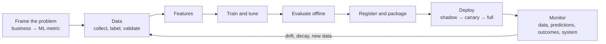

# MLOps & LLMOps

!!! abstract "TL;DR"
    Model code is a small part of a production ML system; most failures come from **data and infrastructure**. MLOps makes the lifecycle reliable: **version** data, code and models; compute features the **same way in training and serving**; **deploy gradually** (shadow, canary, A/B); **monitor** inputs, predictions, outcomes and system health; **detect drift** and retrain. LLMOps adds prompts and retrieval as versioned artifacts, **tracing** of every call, evaluation in CI, and tracking **cost, latency and quality** per request.

!!! evolution "Where this fits"
    **Before:** every modeling page, plus [Evaluation & Metrics](../foundations/evaluation.md) and [Evaluating LLM Systems](../ai-engineering/evaluation.md). **This page:** running models in production. **Next:** [ML System Design](ml-system-design.md) and [GenAI System Design](genai-system-design.md) put it all together.

## The ML lifecycle

- **Framing:** map the business goal to an ML metric and decide whether ML is needed at all; a rules-based baseline is often the right first release.
- **Data:** sources, labeling (human, weak supervision, LLM-assisted with review), data validation (schemas, ranges, null rates) before training.
- **Training pipelines:** reproducible, parameterized, automated (orchestrated with tools like Airflow, Kubeflow, or managed platforms).
- **Registry:** each model version stored with its data snapshot, code commit, hyperparameters, metrics and approval status.

**Hidden technical debt** (Sculley et al., 2015) names recurring problems: glue code, pipeline jungles, undeclared consumers of model outputs, feedback loops, configuration sprawl, and dependence on unstable data.

## Reproducibility and versioning

| Artifact | How to version |
|---|---|
| Code | Git |
| Data | Immutable snapshots, data versioning tools (DVC, lakeFS, table formats with time travel) |
| Features | Feature definitions in code; feature store with versions |
| Models | Model registry (MLflow, cloud registries) with lineage |
| Experiments | Tracking of parameters, metrics and artifacts (MLflow, Weights & Biases) |
| Environment | Pinned dependencies, containers |
| Prompts and retrieval config (LLM apps) | Stored and versioned like code, with evaluation results |

## Feature stores and training–serving skew

**Training–serving skew:** the model sees features computed differently in production than in training, and quietly underperforms. Common causes: separate code paths (SQL for training, Java for serving), different handling of missing values or time zones, stale online features, and future data leaking into training features.

**Feature stores** address it:

- One feature definition, used to build both the **offline store** (historical values in a warehouse, for training) and the **online store** (low-latency key-value lookups, for serving).
- **Point-in-time-correct joins:** when building training data, take each feature's value *as of the prediction time* of each example, never a later value.
- Reuse across teams, monitoring of freshness, and lineage. Examples: Feast, Tecton, and the feature stores in cloud ML platforms.

## Deployment patterns

| Pattern | When |
|---|---|
| **Batch prediction** | Scores needed periodically (nightly churn scores, weekly recommendations); simplest and cheapest |
| **Online (real-time) inference** | Per-request predictions with latency budgets (fraud checks, ranking) behind a REST or gRPC service |
| **Streaming** | Features from event streams (Kafka, Flink) for fresh signals such as velocity counts |
| **Edge / on-device** | Privacy, offline use, or ultra-low latency; requires compression and quantization |

| Rollout strategy | How |
|---|---|
| **Shadow** | The new model receives live traffic but its predictions aren't used; compare outputs, latency and errors |
| **Canary** | Route a small percentage of traffic to the new model; expand if healthy |
| **A/B test** | Randomized split to measure business impact |
| **Blue–green** | Two full environments; switch traffic and switch back instantly if needed |
| **Rollback** | Always keep the previous version ready |

**Serving concerns:** latency budgets (p95, p99), batching, caching, autoscaling, model servers (Triton, TorchServe, KServe, BentoML), hardware choice, and graceful fallbacks (a simpler model or a rule) when the model service fails.

## Monitoring and drift

| What to monitor | Examples |
|---|---|
| **Data quality** | Schema violations, null rates, out-of-range values, missing features |
| **Input drift** | Feature distributions vs training (PSI, KL or Jensen–Shannon divergence, Kolmogorov–Smirnov test) |
| **Prediction drift** | Distribution of scores and predicted classes |
| **Model performance** | Accuracy, precision and recall once labels arrive (often delayed) |
| **Business metrics** | Conversion, losses prevented, user satisfaction |
| **System health** | Latency, throughput, errors, resource use, cost |

Types of shift:

- **Covariate (data) drift:** $P(x)$ changes (new user demographics, a new device type).
- **Label (prior) shift:** $P(y)$ changes (fraud rate doubles during holidays).
- **Concept drift:** $P(y \mid x)$ changes (fraudsters change tactics, so the same features mean something new).

**Population stability index:** $\text{PSI} = \sum_i (a_i - e_i)\ln\frac{a_i}{e_i}$ over bins, with expected ($e$) and actual ($a$) proportions. A common rule of thumb: below 0.1 stable, 0.1–0.25 moderate shift, above 0.25 significant.

**When labels are delayed or absent:** monitor input and prediction drift as leading indicators, use proxy labels (early outcomes), and sample cases for human labeling.

## Retraining

- **Scheduled** (daily, weekly) for steadily changing domains; **triggered** by drift or performance alerts; **online / incremental** for fast-moving signals such as ads.
- Validate every retrained model against the current production model on recent data before promotion (champion vs challenger).
- Watch for **feedback loops**: a model's predictions shape the data it's retrained on (recommendations, fraud blocking that hides outcomes). Keep exploration or holdout traffic to collect unbiased data.

## CI/CD for ML

- **Continuous integration:** unit tests for data processing and features, data validation tests, training smoke tests on small samples, evaluation thresholds that block bad models.
- **Continuous delivery:** automated packaging, registry promotion with approvals, staged rollout, automatic rollback on alerts.
- **Continuous training:** pipelines that retrain and validate on fresh data.

## What changes for LLM applications (LLMOps)

| Concern | In practice |
|---|---|
| **New versioned artifacts** | Prompts, tool definitions, retrieval settings (chunking, embedder, reranker), model and version, decoding parameters |
| **Tracing** | Every request as a trace: prompt, retrieved context, tool calls, outputs, tokens, latency, cost, model version |
| **Evaluation in CI** | Evaluation suites run on every change to prompts, retrieval, tools or model (see [Evaluating LLM Systems](../ai-engineering/evaluation.md)) |
| **Quality monitoring** | Sampled LLM-judge scores, user feedback, guardrail trigger rates, hallucination checks |
| **Cost and latency** | Tokens per request, cache hit rates, cost per successful task, p95 latency per stage |
| **Provider changes** | Pin model versions, re-run evals before upgrading, have a fallback provider or model |
| **Data handling** | PII redaction in logs, retention policies, data-processing agreements with providers |
| **Index operations** | Freshness of RAG indexes, re-embedding on model changes, permission sync |

## Interview questions

??? question "Walk me through taking a model from a notebook to production."
    Turn the notebook into a reproducible pipeline: versioned data snapshot, feature code shared with serving, training script with tracked parameters and metrics, and tests. Evaluate against the current baseline on a time-based holdout; register the model with lineage; package it (container) behind a serving API or batch job with latency and throughput tests. Roll out with shadow traffic, then canary, then an A/B test on the business metric. Add monitoring for data quality, drift, predictions, outcomes and system health, plus alerts, a rollback path and a retraining plan.

??? question "What is training–serving skew, and how do you prevent it?"
    A difference between how features are computed or what data looks like in training versus production, which silently degrades performance. Causes: separate implementations of feature logic, different missing-value handling, time-zone or unit bugs, stale online features, and leakage of future data into training features. Prevent it with shared feature definitions (a feature store), point-in-time-correct training data, logging the exact features used at serving time and training on those logs, and monitoring feature distributions online vs offline.

??? question "What is a point-in-time-correct join?"
    When assembling training examples, each feature value is taken as it was at the moment the prediction would have been made, not its latest value. For a fraud label on a transaction at 10:00, the "transactions in the last hour" feature must count only transactions before 10:00. Using later values leaks future information, inflating offline metrics and causing skew in production. Feature stores implement these as-of joins.

??? question "Batch vs real-time inference: how do you decide?"
    Batch when predictions can be computed ahead of time and reused (nightly risk scores, weekly recommendations, email campaigns): simpler, cheaper, easy to monitor. Real-time when the prediction depends on fresh context or must happen at request time (fraud checks on a payment, search ranking, conversational responses), at the cost of latency budgets, online feature infrastructure and higher availability requirements. Hybrids are common: precompute candidates in batch, re-rank in real time.

??? question "Shadow vs canary deployment."
    In a shadow deployment the new model receives copies of live requests and its outputs are logged but not used, so you can compare predictions, latency and errors with zero user impact. In a canary, a small share of real traffic actually uses the new model, exposing real effects on a few users and letting you expand gradually or roll back. Shadow first to catch technical issues, canary and A/B to measure impact.

??? question "Covariate shift vs concept drift, with examples."
    Covariate shift: the input distribution changes but the relationship between inputs and labels stays the same, for example an app launching in a new country brings different user profiles. Concept drift: the relationship itself changes, for example fraudsters change tactics so transactions that looked safe are now fraudulent, or a pandemic changes what purchase patterns mean. Covariate shift can sometimes be handled by reweighting or retraining on new inputs; concept drift requires new labels.

??? question "How do you detect drift without labels?"
    Compare current input feature distributions with the training reference using PSI, KS tests or divergence measures per feature and over time; monitor the distribution of model scores and predicted classes; track data quality signals; detect drift in embedding space for text or images; and watch business proxies. Then confirm with delayed labels or a labeled sample. Alert on sustained, meaningful shifts rather than every statistical blip.

??? question "What would you monitor for an LLM application?"
    Per request: traces of prompts, retrieved context, tool calls and outputs; tokens, cost and latency per stage; errors and timeouts; guardrail triggers. Quality: sampled LLM-judge scores on key criteria (faithfulness, helpfulness, policy compliance), user feedback (ratings, regenerations, escalations), refusal and over-refusal rates. Data: input topic and language drift, retrieval hit rates and index freshness. Business: task completion and cost per successful task. Plus alerts when any of these shift.

??? question "How do you decide when to retrain a model?"
    Combine a schedule matched to how fast the domain changes with triggers: a performance drop when labels arrive, significant input or prediction drift, a major product change, or new labeled data. Before promoting, compare the retrained challenger against the current champion on recent data, including slices, and roll it out gradually. Watch for feedback loops that bias new training data.

??? question "How does LLMOps differ from traditional MLOps?"
    The core lifecycle is the same, but the artifacts and signals change. You version prompts, tool definitions, retrieval settings and model versions rather than (or in addition to) trained weights; you often depend on an external model provider whose updates you must evaluate; quality is judged with evaluation suites and LLM judges rather than one accuracy number; every request is traced across retrieval and tool calls; cost and latency per token are first-class metrics; and security concerns such as prompt injection and data leakage are part of operations.

!!! pitfall "Common mistakes"
    - Separate feature code for training and serving.
    - Random train/test splits for time-dependent problems, then surprise in production.
    - Monitoring only system metrics, not data and predictions.
    - Retraining automatically without validating against the current model.
    - Unpinned LLM model versions and no evaluation before upgrades.

## Revision checklist

- [ ] Draw the ML lifecycle loop
- [ ] Explain training–serving skew, feature stores and point-in-time joins
- [ ] Compare batch, online, streaming and edge deployment, and rollout strategies
- [ ] Define covariate shift, label shift and concept drift, and PSI
- [ ] Design monitoring with delayed labels
- [ ] List what LLMOps adds: versioned prompts, tracing, evals in CI, cost tracking

## Go deeper

- [Hidden Technical Debt in Machine Learning Systems (2015)](https://papers.nips.cc/paper_files/paper/2015/hash/86df7dcfd896fcaf2674f757a2463eba-Abstract.html)
- [Chip Huyen, Designing Machine Learning Systems (O'Reilly, 2022)](https://huyenchip.com/)
- [Google: Rules of Machine Learning](https://developers.google.com/machine-learning/guides/rules-of-ml)
- [Made With ML](https://madewithml.com/)
