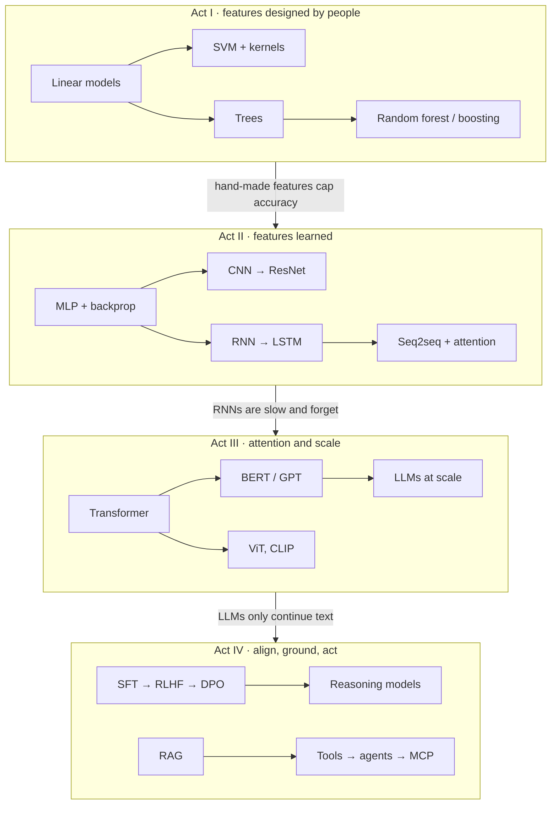
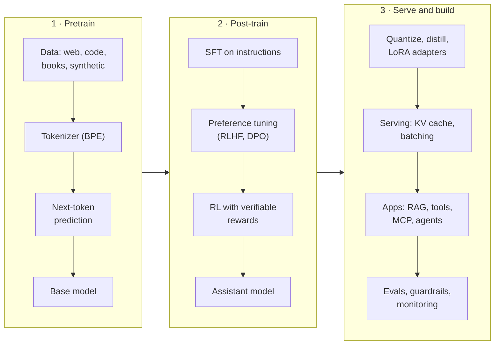

# The Big Picture

!!! abstract "TL;DR"
    AI/ML moved through four acts. **Act I:** people design features and algorithms learn weights on top of them. **Act II:** neural networks learn the features themselves. **Act III:** attention and scale turn next-token prediction into general-purpose models. **Act IV:** post-training, retrieval and tools make those models helpful, grounded and able to act. Each act began because the previous one hit a specific wall.

## The four acts

| | Years | Core idea | Representative techniques | The wall it hit |
|---|---|---|---|---|
| Foundations | always | Learn a function from data by minimizing a loss | MLE, gradient descent, cross-entropy, bias–variance, validation | — |
| Act I · Learn from features | 1950s–2000s | Humans design features; models learn weights | Linear and logistic regression, SVM, decision trees, random forests, gradient boosting, k-means, PCA | Hand-made features cap accuracy on raw images, audio and text |
| Act II · Learn the features | 2006–2016 | Deep networks learn features from raw data | Backprop at scale, ReLU, dropout, BatchNorm, CNNs, ResNet, word2vec, LSTM, seq2seq, attention | RNNs process one token at a time and forget long context; every task needs labels |
| Act III · Attention and scale | 2017–2022 | Self-attention plus self-supervised pretraining at internet scale | Transformer, BERT, GPT, scaling laws, ViT, CLIP, diffusion, LoRA, quantization | A pretrained model only continues text: it doesn't follow instructions, doesn't know your data, can't act |
| Act IV · Align, ground, act | 2022–now | Shape behavior, ground knowledge, give models tools | SFT, RLHF, DPO, reasoning via RL, RAG, function calling, agents, MCP, context and harness engineering | Reliability, cost, security and evaluation of autonomous systems: the current frontier |
| Production | throughout | Ship, monitor and design whole systems responsibly | MLOps, feature stores, drift monitoring, ML and GenAI system design, fairness | — |

## Timeline of the milestones interviewers mention

| Year | Milestone | Why it mattered |
|---|---|---|
| 1805 | Least squares (Legendre; Gauss 1809) | Linear regression; the first "fit a model to data" |
| 1948 | Shannon's information theory | Entropy and cross-entropy, the loss behind classifiers and LLMs |
| 1958 | Perceptron (Rosenblatt); logistic regression (Cox) | The first learning neuron; the probabilistic linear classifier |
| 1969 | *Perceptrons* (Minsky & Papert) | Showed single-layer nets can't learn XOR; funding dried up |
| 1977 | EM algorithm | Learning with hidden variables (GMMs, later VAEs) |
| 1984 | CART decision trees | Interpretable non-linear models |
| 1986 | Backpropagation popularized | Training multi-layer networks became practical |
| 1989 | CNNs for digits (LeCun); Q-learning (Watkins) | Weight sharing for images; value-based RL |
| 1992–95 | Kernel SVMs, soft margin | Dominated ML for about 15 years |
| 1995–2001 | AdaBoost, random forests, gradient boosting | Ensembles; still the tabular default |
| 1997 | LSTM | Memory over hundreds of steps |
| 2006 | Layer-wise pretraining (Hinton); Netflix Prize | Revival of deep learning; recommender systems go mainstream |
| 2009 | ImageNet | The dataset that made deep vision possible |
| 2012 | AlexNet | GPUs + ReLU + dropout beat hand-made features by a wide margin |
| 2013 | word2vec; VAE; DQN | Dense word meaning; deep generative models; deep RL |
| 2014 | GAN; seq2seq; attention; GRU; Adam; dropout paper | The modern deep-learning toolkit |
| 2015 | ResNet; BatchNorm; U-Net; distillation | Very deep networks train reliably |
| 2016 | LayerNorm; GELU; subword (BPE) tokenization | Pieces the Transformer would reuse |
| 2017 | **Transformer**; PPO; RLHF from preferences; sparse MoE; AdamW | Attention-only, parallel sequence modeling |
| 2018 | BERT; GPT-1; ELMo; ULMFiT | Pretrain once, fine-tune anywhere |
| 2019 | GPT-2; T5; RoBERTa; Sentence-BERT; MQA | Zero-shot ability; text-to-text; sentence embeddings |
| 2020 | GPT-3; scaling laws; ViT; DDPM; RAG paper | In-context learning; Transformers for images; diffusion |
| 2021 | CLIP; LoRA; RoPE; instruction tuning (FLAN) | Vision–language; cheap fine-tuning; modern positions |
| 2022 | Chinchilla; InstructGPT; chain-of-thought; FlashAttention; Stable Diffusion; ReAct; Constitutional AI; ChatGPT | Compute-optimal training; assistants; reasoning prompts; agents |
| 2023 | LLaMA; GPT-4; DPO; QLoRA; vLLM; GQA; function calling; Mixtral; LLaVA; Mamba | Open models; cheap alignment and fine-tuning; efficient serving |
| 2024 | GRPO; o1-style reasoning models; GraphRAG; MCP; MLA (DeepSeek-V2) | Test-time compute; a standard protocol for tools |
| 2025 | DeepSeek-R1; A2A protocol; agentic coding tools; "context engineering" | Open reasoning via RL; agents in daily engineering work |
| 2026 | Harness engineering as a discipline | Reliability comes from the loop, tools, permissions and evals around the model |

## Evolution lines

Each line is one idea evolving. Every station states the weakness that pushed the field to the next station. Station names link to the page that covers them.

### Act I lines

**Tree & ensemble line:** trees, then two ways to fix them: average them, or chain them.

- **[Decision tree](../classical-ml/trees-ensembles.md)** 1984 Readable and non-linear, but high variance: small data changes give a different tree.
- **[Bagging](../classical-ml/trees-ensembles.md)** 1996 Average trees trained on bootstrap samples to cut variance.
- **[Random forest](../classical-ml/trees-ensembles.md)** 2001 Random feature subsets de-correlate the trees. Bias stays where it was.
- **[AdaBoost](../classical-ml/trees-ensembles.md)** 1995 Chain learners instead: each one focuses on the previous one's mistakes. Sensitive to noisy labels.
- **[Gradient boosting](../classical-ml/trees-ensembles.md)** 2001 Each tree fits the gradient of any differentiable loss. Accurate, but sequential.
- **[XGBoost · LightGBM · CatBoost](../classical-ml/trees-ensembles.md)** 2014–2017 Second-order, regularized, fast, handles missing values and categories. Still the tabular default.

**Classifier line:** from one neuron to deep networks, with SVMs winning the years in between.

- **[Perceptron](../deep-learning/neural-networks.md)** 1958 Learns a line, but only for linearly separable data. Fails on XOR.
- **[Logistic regression](../classical-ml/linear-models.md)** 1958 Probabilities and a convex loss. Still a linear boundary.
- **[MLP + backprop](../deep-learning/neural-networks.md)** 1986 Hidden layers learn features, but deep versions were hard to train with 1990s data and compute.
- **[SVM + kernels](../classical-ml/knn-nb-svm.md)** 1992–1995 Maximum margin plus the kernel trick beat shallow nets. Training cost grows faster than n².
- **[Deep networks](../deep-learning/cnn-vision.md)** 2012 GPUs, ReLU, dropout and big datasets made depth work. Features are learned, not designed.

### Act II lines

**Vision line:** hand-made features to CNNs to Transformers to vision–language models.

- **[SIFT · HOG + SVM](../classical-ml/knn-nb-svm.md)** 1999–2005 Experts design the features, and accuracy plateaus.
- **[LeNet](../deep-learning/cnn-vision.md)** 1998 Learned convolution filters for digits. Too small for natural images with the compute of the time.
- **[AlexNet](../deep-learning/cnn-vision.md)** 2012 GPUs, ReLU and dropout: ImageNet top-5 error fell from about 26% to 15%.
- **[VGG · Inception](../deep-learning/cnn-vision.md)** 2014 Deeper and wider. Past about 20 layers, plain networks got worse, not better.
- **[ResNet](../deep-learning/cnn-vision.md)** 2015 Skip connections let 152-layer networks train. Reused in every Transformer block.
- **[Vision Transformer](../deep-learning/cnn-vision.md)** 2020 Image patches as tokens. Scales with data but needs a lot of it.
- **[CLIP](../deep-learning/cnn-vision.md)** 2021 Learns from 400M image–caption pairs and classifies zero-shot.
- **[Multimodal LLMs](../llms/generative-models.md)** 2023+ Vision encoders feed an LLM, so you can ask questions about images, charts and screens.

**Training line:** the tricks that made deep networks trainable.

- **[Sigmoid + SGD](../deep-learning/neural-networks.md)** 1980s Gradients vanish through saturating activations; one learning rate for everything.
- **[ReLU · Xavier/He init](../deep-learning/neural-networks.md)** 2010–2015 No saturation for positive inputs; weights start at the right scale.
- **[Momentum → Adam → AdamW](../deep-learning/training.md)** 1964–2017 Velocity damps zig-zags; per-parameter step sizes; decoupled weight decay.
- **[BatchNorm](../deep-learning/training.md)** 2015 Stable, fast training, but depends on batch size and is awkward for sequences.
- **[Residual connections](../deep-learning/cnn-vision.md)** 2015 An identity path carries gradients through hundreds of layers.
- **[LayerNorm → Pre-LN → RMSNorm](../deep-learning/training.md)** 2016–2019 Per-token normalization; the standard inside every LLM.

**Text representation line:** from counting words to embedding meaning.

- **[Bag of words · TF-IDF · BM25](../deep-learning/sequence-models.md)** 1950s–1994 Counts words, ignoring order and meaning. BM25 still powers keyword search.
- **[word2vec · GloVe · fastText](../deep-learning/sequence-models.md)** 2013–2016 Dense vectors from context. One vector per word, so "bank" is ambiguous.
- **[ELMo](../llms/pretraining.md)** 2018 Contextual vectors from a bi-LSTM: "bank" differs by sentence.
- **[BERT](../llms/pretraining.md)** 2018 Deep bidirectional context from a Transformer encoder.
- **[Sentence embeddings → LLM embedders](../ai-engineering/embeddings.md)** 2019–2025 One vector per passage, trained contrastively. The retrieval half of RAG.

### Act III lines

**Sequence line:** the main storyline, language modeling from counting to LLMs.

- **[n-gram language models](../deep-learning/sequence-models.md)** 1980s Count word sequences. No meaning, short window.
- **[RNN](../deep-learning/sequence-models.md)** 1990 Carries a hidden state, but gradients vanish and it runs one step at a time.
- **[LSTM · GRU](../deep-learning/sequence-models.md)** 1997 · 2014 Gates protect memory over hundreds of steps. Still sequential.
- **[Seq2seq](../deep-learning/sequence-models.md)** 2014 Encoder–decoder for translation. The whole input is squeezed into one vector.
- **[Attention](../deep-learning/sequence-models.md)** 2014 The decoder looks back at every input state. Still built on slow RNNs.
- **[Transformer](../llms/transformer.md)** 2017 Attention only, fully parallel. Cost grows with the square of the length.
- **[BERT · GPT](../llms/pretraining.md)** 2018 Pretrain once on raw text, then adapt to any task.
- **[LLMs at scale](../llms/pretraining.md)** 2020+ Few-shot learning appears with scale. Still needs alignment and grounding.

**Efficiency line:** fighting the quadratic cost and the memory wall.

- **[Full multi-head attention](../llms/transformer.md)** 2017 Quadratic in length; every head stores its own keys and values.
- **[KV cache](../llms/efficient-attention.md)** 2017+ Reuse past keys and values when generating. Memory grows with context length.
- **[MQA → GQA → MLA](../llms/efficient-attention.md)** 2019–2024 Share or compress keys and values across heads to shrink the cache.
- **[FlashAttention](../llms/efficient-attention.md)** 2022 Exact attention computed in on-chip tiles; never stores the full n×n matrix.
- **[PagedAttention · continuous batching](../llms/inference.md)** 2023 Serve many requests at once without wasting cache memory.
- **[Mixture of experts](../llms/efficient-attention.md)** 2017–2024 Many parameters, few active per token.

**Adaptation line:** ever cheaper ways to specialize a pretrained model.

- **[Train from scratch](../foundations/ml-fundamentals.md)** classic Needs lots of labeled data for every task.
- **[Full fine-tuning](../llms/fine-tuning.md)** 2018 Best quality, but a full copy of the weights per task.
- **[Adapters · prompt tuning](../llms/fine-tuning.md)** 2019–2021 Train a few new parameters; adapters add latency.
- **[LoRA](../llms/fine-tuning.md)** 2021 Low-rank weight updates that merge back in: no added latency.
- **[QLoRA](../llms/fine-tuning.md)** 2023 LoRA on a 4-bit base model: fine-tune 65B on one 48 GB GPU.

**Generative line:** each generator fixed the last one's blur, instability or speed.

- **[Autoencoder](../llms/generative-models.md)** 1980s Compress and reconstruct. The latent space has holes, so random samples look bad.
- **[VAE](../llms/generative-models.md)** 2013 A smooth Gaussian latent space; easy sampling, blurry outputs.
- **[GAN](../llms/generative-models.md)** 2014 Sharp images, but unstable training and mode collapse.
- **[Diffusion](../llms/generative-models.md)** 2020 Learn to remove noise step by step. Stable and diverse, but slow to sample.
- **[Latent diffusion · DiT · flow matching](../llms/generative-models.md)** 2022+ Diffuse in a compressed space with Transformer denoisers and straighter paths.

### Act IV lines

**Alignment line:** from text predictor to assistant to reasoner.

- **[Pretrained LM](../llms/pretraining.md)** 2020 Continues text. Doesn't reliably follow instructions.
- **[Instruction tuning (SFT)](../alignment/post-training.md)** 2021–2022 Imitates good demonstrations. Can't learn from "this answer is worse".
- **[RLHF with PPO](../alignment/post-training.md)** 2022 Learns from human preferences. Complex: four models in memory, unstable.
- **[Constitutional AI · RLAIF](../alignment/post-training.md)** 2022 AI feedback guided by written principles scales oversight.
- **[DPO](../alignment/post-training.md)** 2023 Learns from preference pairs directly: no reward model, no RL loop.
- **[RL with verifiable rewards](../alignment/reasoning.md)** 2024–2025 Rewards checkable answers, so models learn to reason longer (GRPO, R1).

**Grounding line:** how models got access to knowledge they were never trained on.

- **[Knowledge in weights](../llms/pretraining.md)** 2020 Frozen at the cutoff, can't cite sources, fills gaps with plausible text.
- **[Prompt stuffing](../ai-engineering/prompting.md)** 2022 Paste documents into the prompt. Limited by context size and cost.
- **[RAG](../ai-engineering/rag.md)** 2020–2023 Retrieve relevant chunks at query time and answer from them with citations.
- **[Hybrid search + reranking](../ai-engineering/rag.md)** 2023 Keywords plus vectors, then a cross-encoder picks the best passages.
- **[GraphRAG · agentic RAG](../ai-engineering/rag.md)** 2024+ Entity graphs for global questions; the model decides what to search and checks itself.

**Agent line:** from asking well to engineering the whole system around the model.

- **[Prompting](../ai-engineering/prompting.md)** 2020 Ask well and give examples. One shot, no actions.
- **[Chain-of-thought](../alignment/reasoning.md)** 2022 Think step by step before answering. Still no access to the world.
- **[ReAct](../ai-engineering/agents.md)** 2022 Interleave reasoning with actions and observations.
- **[Function calling](../ai-engineering/tool-calling.md)** 2023 Structured tool calls with JSON schemas, supported natively by models.
- **[Agents](../ai-engineering/agents.md)** 2023–2024 The model chooses its next step until the goal is met.
- **[MCP · A2A](../ai-engineering/mcp.md)** 2024–2025 Open protocols connect any AI app to any tool, and agents to each other.
- **[Context engineering](../ai-engineering/context-engineering.md)** 2025 Curate the smallest high-signal context at every step.
- **[Harness engineering](../ai-engineering/harness-engineering.md)** 2025–2026 Design the loop, tools, permissions, checks and evals around the model.

## Where the lines cross

The same few ideas reappear across decades. Making these connections out loud is what makes answers sound senior.

| Idea | Where it appears |
|---|---|
| **Dot-product similarity** | kNN → word2vec → attention scores ($QK^\top$) → vector search in RAG |
| **Softmax + cross-entropy** | Logistic regression → every neural classifier → the LLM's next-token head over a 100k-token vocabulary |
| **KL divergence** | Information theory → VAE loss → RLHF penalty → knowledge distillation |
| **Low-rank structure** | SVD and PCA → matrix-factorization recommenders → LoRA |
| **Residual connections** | ResNet (2015) → twice inside every Transformer layer |
| **Contrastive learning** | word2vec negative sampling → SimCLR and CLIP → embedding models behind RAG |
| **Nearest-neighbor search** | kNN → two-tower recommenders → vector databases |
| **Policy gradients** | REINFORCE → PPO → RLHF → GRPO for reasoning models |
| **Gating** | LSTM gates → GLU/SwiGLU feed-forward layers → mixture-of-experts routers |
| **Ensembling** | Bagging and boosting → dropout as an implicit ensemble → self-consistency voting in LLMs |

## The modern LLM lifecycle, end to end

AI engineer and agentic AI interviews often open with *"explain how an LLM application works end to end."* This is the picture to draw.

| Stage | What happens | Where to study it |
|---|---|---|
| Data and tokenization | Collect, filter, deduplicate; split text into subword tokens | [Pretraining & LLMs](../llms/pretraining.md), [The Transformer](../llms/transformer.md) |
| Pretraining | Predict the next token over trillions of tokens | [Pretraining & LLMs](../llms/pretraining.md) |
| Post-training | SFT, preference optimization, RL for reasoning | [Post-Training](../alignment/post-training.md), [Reasoning Models](../alignment/reasoning.md) |
| Compression and adaptation | Quantization, distillation, LoRA | [Fine-Tuning & Efficiency](../llms/fine-tuning.md) |
| Serving | Prefill and decode, KV cache, batching, cost per token | [Inference & Serving](../llms/inference.md) |
| Application | Prompting, RAG, tools, agents, MCP, context management | [AI Engineering](../ai-engineering/prompting.md) |
| Operations | Evals, guardrails, tracing, drift and cost monitoring | [Evaluating LLM Systems](../ai-engineering/evaluation.md), [MLOps & LLMOps](../production/mlops.md) |

## Three narratives to have ready

Interviewers often ask for a history in one or two minutes. These are the shapes of strong answers.

??? note "“Walk me through how NLP models evolved.”"
    We started by **counting**: bag-of-words and TF-IDF for documents, n-grams for language modeling. They had no notion of meaning. **word2vec** (2013) learned dense vectors where similar words sit close, but gave one vector per word. **RNNs and LSTMs** read sequences with memory, but one step at a time and with fading long-range memory. **Seq2seq with attention** (2014) let the decoder look back at every input word, fixing the single-vector bottleneck. The **Transformer** (2017) kept only attention, which made training parallel and long-range interactions direct. **Pretraining** (ELMo, BERT, GPT in 2018) learned from raw text and transferred to any task. **Scale** (GPT-3, 2020) produced in-context learning. **Alignment** (InstructGPT and ChatGPT, 2022) made models follow instructions. **Retrieval and tools** (2023 on) grounded them in fresh data and actions, and **RL with verifiable rewards** (2024–25) produced reasoning models.

??? note "“How did computer vision get from hand-made features to multimodal models?”"
    Before 2012, pipelines used hand-designed features such as SIFT and HOG fed into an SVM. **AlexNet** (2012) showed a CNN trained on GPUs with ReLU and dropout could cut ImageNet error from about 26% to 15%. **VGG and Inception** went deeper, but plain deep networks degraded until **ResNet** (2015) added skip connections. Detection (Faster R-CNN, YOLO) and segmentation (U-Net, Mask R-CNN) built on those backbones. The **Vision Transformer** (2020) treated image patches as tokens and scaled better with data. **CLIP** (2021) trained image and text encoders together on captions, enabling zero-shot classification, and those vision encoders now feed **multimodal LLMs** that answer questions about images, documents and screens.

??? note "“How did we get from GPT-3 to agents?”"
    GPT-3 predicted text well but didn't reliably follow instructions. **Instruction tuning and RLHF** (InstructGPT, 2022) turned it into an assistant, and ChatGPT made that conversational. Models still lacked fresh knowledge and actions, so **RAG** put retrieved documents in the prompt and **function calling** let models request tool calls with structured arguments. **ReAct-style agents** put those calls in a loop: reason, act, observe, repeat. **MCP** (2024) standardized how applications connect models to tools and data, so integrations are built once. As agents ran longer, the bottleneck moved to what's in the context window (**context engineering**) and to the system around the model: loop, tools, permissions, verification and evals (**harness engineering**).

## Interview questions

??? question "Why did Transformers replace RNNs?"
    Three reasons. **Parallelism:** an RNN must process token *t* before token *t+1*, while self-attention processes all tokens of a sequence at once, so training uses GPUs far better. **Path length:** in an RNN information between distant tokens passes through many steps and fades (vanishing gradients); in attention any two tokens interact directly in one step. **Scaling:** because training is parallel and stable, Transformers could be scaled to billions of parameters and trillions of tokens, and quality kept improving with scale. The cost is attention's $O(n^2)$ time and memory in sequence length, which motivated FlashAttention, sparse attention and state-space models.

??? question "Why does deep learning dominate images and text, while gradient boosting still wins on tabular data?"
    Images, audio and text are **raw, high-dimensional signals with local structure** (pixels near each other, words in order). Deep networks learn hierarchical features from them, which beats anything hand-designed. Tabular data is **already featurized**: columns are meaningful, heterogeneous (prices, categories, counts), often small, and have irregular, axis-aligned decision boundaries. Tree ensembles handle mixed types, missing values and monotonic thresholds natively, need little tuning, and are robust to uninformative features. Neural nets on tabular data tend to need much more tuning and data to match them. Many production systems therefore use GBDTs for tabular signals and neural networks for embeddings of text or images, sometimes feeding one into the other.

??? question "What changed between GPT-3 and ChatGPT?"
    Mostly **post-training**, not architecture. GPT-3 was a base model trained to continue internet text, so a question might be answered, ignored, or continued with more questions. InstructGPT and ChatGPT added **supervised fine-tuning** on human-written demonstrations, then **RLHF**: a reward model trained on human preference comparisons, and PPO to optimize the model against it with a KL penalty to stay close to the SFT model. The result follows instructions, holds a conversation, refuses some harmful requests, and was preferred by people even at much smaller sizes (a 1.3B InstructGPT model was preferred over 175B GPT-3 in the paper's evaluations).

??? question "Why did diffusion models overtake GANs for image generation?"
    GANs produce sharp images but train as an adversarial game, which is unstable and prone to **mode collapse** (covering only part of the data distribution). Diffusion models train with a simple, stable regression loss (predict the noise that was added), cover the distribution well, and are easy to **condition** on text through cross-attention and classifier-free guidance. Their weakness, slow sampling over many denoising steps, was reduced by better samplers, latent-space diffusion (Stable Diffusion), distillation and flow matching.

??? question "What is the difference between a language model, an assistant and an agent?"
    A **language model** predicts the next token; a base model just continues text. An **assistant** is a language model post-trained (SFT plus preference tuning) to follow instructions and converse safely. An **agent** is an assistant placed in a loop with **tools**: it decides which action to take, observes the result, and continues until a goal is met. What makes it an agent is that the model chooses the control flow, rather than a fixed sequence of calls written by a developer (which is a workflow).

??? question "What is self-supervised learning, and why was it the key to LLMs?"
    Self-supervised learning creates labels from the data itself, for example "predict the next word" or "fill in the masked word". It needs no human annotation, so the training set can be the whole internet. Next-token prediction at that scale forces a model to learn grammar, facts, reasoning patterns and code, which then transfer to downstream tasks with little or no labeled data. The same idea powers contrastive image models such as CLIP and masked autoencoders in vision.

??? question "Where does knowledge live in pretraining, fine-tuning and RAG?"
    **Pretraining** stores broad knowledge in the weights; it is expensive and frozen at a cutoff date. **Fine-tuning** adjusts the weights, which is good for behavior, format, style and domain language, but unreliable and costly for teaching many new facts. **RAG** keeps knowledge outside the model in a searchable store and inserts relevant passages at query time, so it is fresh, private, citable and access-controlled, but limited by retrieval quality. Production systems often combine them: a fine-tuned model for behavior plus RAG for facts.

??? question "Where does classical ML still beat LLMs in production?"
    On **structured prediction at scale with tight latency and cost budgets**: fraud scoring, credit risk, demand forecasting, ad click prediction, ranking. Gradient-boosted trees or logistic regression run in microseconds, are cheap, calibrated, explainable, and easy to monitor and retrain. LLMs are better for unstructured inputs (text, documents, conversation) and open-ended generation. A strong answer mentions combining them: for example LLM-generated features or embeddings feeding a GBDT, or a classical model routing requests before an LLM is called.
