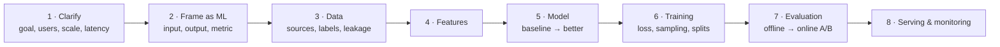

# Interview Playbook

!!! abstract "TL;DR"
    Most AI/ML loops combine five or six rounds: ML fundamentals, ML coding, ML or GenAI system design, a project deep dive, standard coding, and behavioral. Each rewards a repeatable structure. Use the **six-step frame** for concept questions, **clarify → baseline → improve** for coding, the **eight-step frame** for system design, and **STAR** for behavioral.

## What each round tests

| Round | What they test | What strong looks like | Prepare with |
|---|---|---|---|
| **ML fundamentals** | Concepts and judgment: bias–variance, metrics, regularization, trees vs nets, Transformers, LLM training | Explains the *why* and the trade-offs, not just definitions | Foundations to Alignment pages; [Flashcard Drill](../practice/flashcards.md) |
| **ML coding** | Implement a model, loss, metric or layer from scratch, cleanly | Vectorized code, correct shapes, edge cases, talks while coding | [ML Coding from Scratch](../practice/ml-coding.md) |
| **ML system design** | Open-ended: recommendations, search, fraud, ads, moderation | Clarifies, frames the ML problem, picks metrics, designs data and serving, covers monitoring | [ML System Design](../production/ml-system-design.md) |
| **GenAI system design** | RAG assistants, agents, LLM serving, evaluation, safety | Starts simple, measures, adds complexity only with evidence; discusses cost and latency | [GenAI System Design](../production/genai-system-design.md) |
| **Project deep dive** | Your own work, end to end | Clear problem, honest trade-offs, numbers, what you'd do differently | The project frame below |
| **Coding (DSA)** | Algorithms and data structures | Standard; usually separate from ML prep | Not covered on this site |
| **Behavioral** | Ownership, ambiguity, conflict, failure | Specific stories with your actions and measured results | STAR frame below |

## Answering a concept question: the six-step frame

Use this for "What is X?", "Explain X", "Why X instead of Y?".

1. **Define it in one sentence.**
2. **Name the problem it solved:** what came before, and why it failed.
3. **Explain how it works:** intuition first, then the key equation or a quick sketch.
4. **Give strengths and weaknesses.**
5. **Say when you'd use it, and what you'd choose instead.**
6. **Ground it in an example,** ideally from your own work.

Aim for 60–90 seconds, then stop and let the interviewer steer. Depth on demand beats a five-minute monologue.

??? example "Worked example: “What is LoRA?”"
    1. **Definition:** LoRA fine-tunes a large model by learning a small low-rank update to its weight matrices while the original weights stay frozen.
    2. **Problem:** full fine-tuning of a 7B model with Adam needs roughly 112 GB for weights, gradients and optimizer states, plus a full copy of the model for every task.
    3. **How:** weight updates during fine-tuning tend to be low-rank, so learn $\Delta W = BA$ with rank $r \ll d$. $B$ starts at zero, so training begins exactly at the base model. Usually well under 1% of parameters train.
    4. **Trade-offs:** cheap, and the update can be merged into $W$ so inference adds no latency. It can trail full fine-tuning on large domain shifts, and rank and alpha need tuning.
    5. **When:** per-task or per-customer adaptation on limited GPUs; QLoRA when memory is tight; full fine-tuning or continued pretraining for a big domain shift.
    6. **Example:** name the model, the rank, which layers you adapted, the data size, and the metric it moved.

??? example "Worked example: “Why do we divide by √d in attention?”"
    1. **Definition:** the scaling factor $1/\sqrt{d_k}$ in $\text{softmax}(QK^\top/\sqrt{d_k})V$.
    2. **Problem:** if query and key components are roughly independent with unit variance, their dot product has variance $d_k$. With $d_k = 128$, scores have a standard deviation around 11.
    3. **How:** large scores push softmax toward a one-hot output, where its gradient is nearly zero, so learning stalls. Dividing by $\sqrt{d_k}$ brings the variance back to about 1.
    4. **Trade-offs:** cheap and effective; some models add other stabilizers such as QK-normalization at very large scale.
    5. **Alternative framing:** it's the same reason we initialize weights with variance scaled by fan-in: keep signals at unit scale.
    6. **Example:** mention seeing attention entropy collapse or loss spikes when the scale is wrong.

## Handling follow-ups

Interviewers push on the weakest point of your answer. Expect these shapes and prepare them for every topic:

- **"What are its limitations?"** Every page's *Weaknesses* list.
- **"What would you use instead?"** The *What came next* line.
- **"How would you know it's working?"** The metric and the offline/online evaluation.
- **"What happens at 100× scale?"** Memory, latency, cost, data volume, failure modes.
- **"Have you seen this fail?"** A specific story with a number.

If you don't know: say what you do know, reason from first principles out loud, and state your assumption. "I haven't used X, but given it does Y, I'd expect Z" is a good answer. Guessing confidently is not.

## ML coding rounds

1. **Clarify** inputs, outputs, shapes, edge cases and constraints (time, memory, numerical stability).
2. **State the approach** in two or three sentences before typing.
3. **Write the simple correct version first.** Vectorize with NumPy; avoid Python loops over samples.
4. **Narrate shapes** as you go: "X is (n, d), w is (d,), so X @ w is (n,)."
5. **Test** on a tiny example you can check by hand.
6. **Discuss improvements:** numerical stability (log-sum-exp), regularization, complexity, batching.

The most common asks are on the [ML Coding](../practice/ml-coding.md) page: linear and logistic regression with gradient descent, k-means, kNN, a decision-tree split, softmax and cross-entropy, backprop for an MLP, scaled dot-product and multi-head attention, top-k/top-p sampling, and metrics such as AUC and NDCG.

## System design rounds: the eight-step frame

Time budget for a 45-minute round: about 5 minutes clarifying, 5 framing, 10 on data and features, 10 on modeling and training, 5 on evaluation, 10 on serving, monitoring and trade-offs. For GenAI designs, replace steps 4–6 with prompt, retrieval, tools and model choice, and spend more time on evaluation, guardrails, cost and latency. Full worked designs are on [ML System Design](../production/ml-system-design.md) and [GenAI System Design](../production/genai-system-design.md).

## Project deep dives

Prepare two or three projects with this structure, and rehearse each in 3 minutes and in 10:

| Part | What to say |
|---|---|
| **Problem** | The business goal and why it mattered, in one or two sentences |
| **Constraints** | Data size, latency, cost, labels, privacy, team |
| **Baseline** | What existed before and how good it was, with a number |
| **Approach** | Data, features, model, training, evaluation, and why you chose them over alternatives |
| **Results** | Offline metric and online impact, with numbers |
| **Trade-offs and failures** | What didn't work and what you learned |
| **Next steps** | What you'd do with more time or at 10× scale |

Expect questions like "Why that metric?", "How did you split the data?", "How did you know it wasn't leakage?", "What was the hardest bug?", "What would you change?".

## Behavioral rounds: STAR

- **Situation:** context in two sentences.
- **Task:** what you were responsible for.
- **Action:** what *you* did. Use "I", and include the decisions and trade-offs.
- **Result:** the measured outcome, plus what you learned.

Have six to eight stories ready, each mapped to several themes: a project you led, a disagreement, a failure, an ambiguous problem, a time you influenced without authority, a tight deadline, and a time you raised quality or safety concerns.

## Red flags interviewers notice

!!! pitfall "Answers that cost candidates points"
    - Reciting a definition without the problem it solves or its trade-offs.
    - Choosing accuracy as the metric for an imbalanced problem.
    - Jumping to a deep model before proposing a baseline.
    - Ignoring data leakage, especially time-based leakage.
    - Designing a system with no evaluation or monitoring plan.
    - Saying "fine-tune it" for a knowledge problem that RAG would solve, or the reverse.
    - Treating an LLM's output as trusted input to tools or code.
    - Claiming experience you can't explain in depth when asked a follow-up.

## Questions to ask the interviewer

- What does success look like for this role in the first six months?
- How do you evaluate models before and after launch?
- What's the split between research, building, and operating systems?
- What's the hardest ML problem the team is facing right now?
- How are LLM features evaluated and monitored here?

## Interview questions

??? question "Tell me about a model you shipped. How did you choose the metric?"
    Structure: business goal → what a mistake costs (false positive vs false negative) → offline metric that reflects that cost → online metric that measures the business goal → guardrail metrics. Example shape: "For fraud, a missed fraud cost about 40 times a false alarm, so we optimized recall at a fixed false-positive rate of 1% offline, measured PR-AUC across thresholds, and tracked prevented losses and manual-review volume online." Then mention how you checked the metric moved together with the business outcome.

??? question "How do you approach an ML problem you've never seen before?"
    Clarify the goal and how success is measured; check whether ML is needed at all (rules or heuristics can be the baseline); look at the data (size, labels, leakage risks, time structure); build the simplest baseline end to end; choose an offline metric aligned with the business cost; iterate on data and features before model complexity; validate properly (time-based splits where relevant); plan the online test and monitoring. Interviewers want to hear "baseline first" and "measure before adding complexity".

??? question "Your model performs well offline but poorly in production. What do you check?"
    In order: **training–serving skew** (features computed differently online, missing values filled differently, stale features); **data leakage** in offline evaluation (future information, duplicates across splits, target leakage); **distribution shift** (population, seasonality, a new product flow); **label definition or delay** (online labels differ from training labels); **feedback loops** (the model changes the data it later trains on); and **the metric mismatch** (the offline metric doesn't track the business outcome). Compare feature distributions offline vs online, replay production traffic through the offline pipeline, and check the experiment setup itself (sample ratio mismatch).

??? question "How would you explain a complex model's decision to a non-technical stakeholder?"
    Start from the decision and its business impact, not the algorithm. Use global explanations (which factors matter most overall, from SHAP or permutation importance) and local ones (why this specific case got this score) in plain language, with examples. Be explicit about uncertainty and limits: correlation is not causation, and importance is not the same as "changing this will change the outcome". Offer guardrails: human review for borderline cases, monitoring, and an appeal path.
